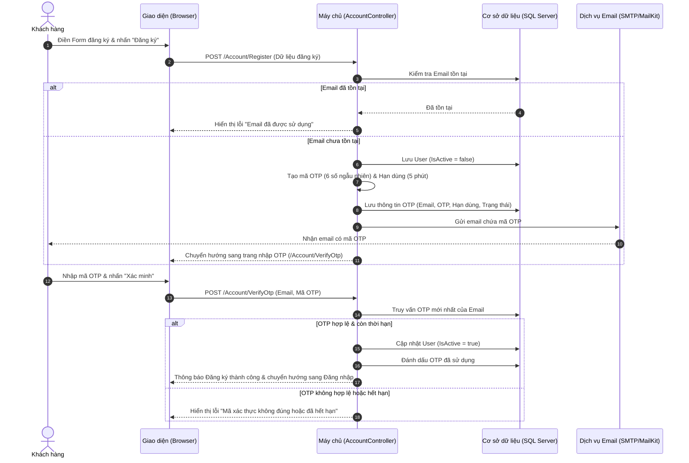

# Tài liệu Thiết kế Nghiệp vụ (BA): Tính năng Đăng ký Tài khoản qua Xác thực OTP Email

## 1. Giới thiệu & Mục tiêu
Tài liệu này mô tả chi tiết thiết kế nghiệp vụ (Business Analysis) và thiết kế hệ thống cho luồng đăng ký tài khoản của khách hàng (Customer) sử dụng mã xác thực OTP gửi qua Email tại hệ thống **PhucNguyen Resort**.
- **Mục tiêu**: Đảm bảo 100% tài khoản đăng ký mới là tài khoản chính chủ, có email hoạt động thực tế. Ngăn chặn việc spam tài khoản ảo làm tràn ngập cơ sở dữ liệu.
- **Yêu cầu cốt lõi**: Khách hàng chỉ đăng ký thành công sau khi nhập đúng mã OTP được gửi về Email đã nhập.

---

## 2. Quy trình Nghiệp vụ (Business Process Flow)

Hệ thống hỗ trợ 2 phương án thiết kế luồng xác thực OTP. 

### Phương án A: Xác thực Email TRƯỚC KHI tạo tài khoản (Pre-Verification)
1. Khách hàng điền thông tin đăng ký cơ bản.
2. Tại trường Email, nhấn nút **"Nhận mã OTP"**.
3. Hệ thống kiểm tra xem Email đã tồn tại chưa:
   - Nếu đã tồn tại: Báo lỗi trực tiếp.
   - Nếu chưa: Tạo mã OTP (6 chữ số), lưu tạm thời trong DB/Cache, gửi qua email khách hàng và bắt đầu đếm ngược 60 giây.
4. Khách hàng nhận OTP từ email, nhập vào ô **"Mã xác thực"** trên form.
5. Khách hàng điền các thông tin còn lại và nhấn **"Đăng ký"**.
6. Hệ thống kiểm tra mã OTP:
   - Nếu mã khớp và còn hạn: Tiến hành tạo tài khoản với trạng thái kích hoạt ngay (`IsActive = true`).
   - Nếu mã sai hoặc hết hạn: Hiển thị lỗi, yêu cầu thử lại.

*Ưu điểm*: Tránh lưu trữ tài khoản "rác" (chưa xác minh) trong bảng `Users`. Giúp dữ liệu luôn sạch.

### Phương án B: Xác thực Email SAU KHI gửi Form (Post-Verification) - *KHUYÊN DÙNG*
1. Khách hàng điền đầy đủ thông tin trên Form Đăng ký (như giao diện hiện tại) và nhấn **"Đăng ký"**.
2. Hệ thống kiểm tra dữ liệu hợp lệ và email chưa tồn tại:
   - Tạo tài khoản mới với trạng thái chưa kích hoạt (`IsActive = false`).
   - Tạo mã OTP (6 chữ số), lưu vào cơ sở dữ liệu kèm thời hạn hết hạn (ví dụ: 5 phút).
   - Gửi mã OTP về email của khách hàng.
3. Hệ thống chuyển hướng khách hàng sang trang **"Xác minh tài khoản"** (`/Account/VerifyOtp?email=...`) hoặc hiển thị Popup nhập OTP.
4. Khách hàng nhập mã OTP và nhấn **"Xác nhận"**:
   - Nếu mã khớp và còn hạn: Chuyển trạng thái tài khoản thành hoạt động (`IsActive = true`), thông báo thành công và chuyển hướng về trang Đăng nhập.
   - Nếu mã sai: Hiển thị thông báo lỗi và cho phép nhập lại.
   - Nếu hết hạn: Khách hàng nhấn **"Gửi lại mã"** để nhận mã mới.

*Ưu điểm*: Trải nghiệm người dùng mượt mà, không bị ngắt quãng khi đang điền form. Phù hợp tuyệt đối với cấu trúc MVC hiện tại của dự án.

---

## 3. Quy trình chi tiết (Sequence Diagram - Mermaid)

Dưới đây là sơ đồ tuần tự cho **Phương án B** (Xác thực sau khi gửi Form):



---

## 4. Các quy tắc nghiệp vụ (Business Rules)
1. **Định dạng OTP**: Gồm 6 chữ số ngẫu nhiên (từ `100000` đến `999999`).
2. **Thời gian hết hạn**: Mã OTP có hiệu lực trong vòng **5 phút** kể từ thời điểm gửi.
3. **Số lần nhập sai tối đa**: Khách hàng nhập sai quá **5 lần liên tiếp**, hệ thống sẽ vô hiệu hóa mã OTP hiện tại và yêu cầu gửi lại mã mới để bảo mật (tránh tấn công brute-force).
4. **Giới hạn gửi mã (Rate Limiting)**: Khoảng cách giữa 2 lần nhấn "Gửi lại mã" tối thiểu là **60 giây** để tránh spam email.
5. **Dọn dẹp tự động (Cleanup)**: Các tài khoản có trạng thái `IsActive = false` quá 24h mà không thực hiện xác thực sẽ bị hệ thống tự động xóa định kỳ (hoặc xóa mềm).

---

## 5. Thiết kế Cơ sở dữ liệu (Database Schema)

Để hỗ trợ lưu trữ và quản lý OTP, hệ thống sẽ tạo thêm một bảng mới `EmailOtp` thay vì chỉnh sửa trực tiếp bảng `User`, nhằm đảm bảo tính mở rộng cho các tính năng khác cần OTP sau này (ví dụ: Quên mật khẩu, Xác thực 2 lớp).

### Bảng mới: `EmailOtps`
| Tên cột | Kiểu dữ liệu | Ràng buộc | Mô tả |
| :--- | :--- | :--- | :--- |
| **OtpId** | `int` | Primary Key, Identity | Khóa chính tự tăng |
| **Email** | `nvarchar(100)` | Required, Foreign Key | Email nhận mã OTP |
| **OtpCode** | `varchar(6)` | Required | Mã xác thực gồm 6 chữ số |
| **ExpiryTime** | `datetime` | Required | Thời gian hết hạn của OTP |
| **IsUsed** | `bit` | Default: 0 | Trạng thái sử dụng (0: Chưa dùng, 1: Đã dùng) |
| **Attempts** | `int` | Default: 0 | Số lần đã nhập sai |
| **CreatedAt** | `datetime` | Default: `GETDATE()` | Thời điểm tạo mã |

---

## 6. Thiết kế API / Endpoints

### 1. Endpoint Đăng ký Tài khoản (Thay đổi logic hiện tại)
*   **Path**: `POST /Account/Register`
*   **Mô tả**: Lưu tài khoản khách hàng ở trạng thái `IsActive = false`, tạo OTP, gửi Email và chuyển hướng đến trang xác thực OTP.

### 2. Endpoint Hiển thị Trang nhập OTP
*   **Path**: `GET /Account/VerifyOtp?email={email}`
*   **Mô tả**: Hiển thị form nhập mã OTP cho khách hàng.

### 3. Endpoint Xác minh OTP
*   **Path**: `POST /Account/VerifyOtp`
*   **Tham số body**:
    ```json
    {
      "Email": "khachhang@example.com",
      "OtpCode": "123456"
    }
    ```
*   **Mô tả**: Xác thực OTP. Nếu khớp và còn hạn, cập nhật `IsActive = true` cho User, redirect sang `/Account/Login`.

### 4. Endpoint Gửi lại mã OTP (Resend OTP)
*   **Path**: `POST /Account/ResendOtp`
*   **Tham số body**:
    ```json
    {
      "Email": "khachhang@example.com"
    }
    ```
*   **Mô tả**: Vô hiệu hóa OTP cũ, sinh OTP mới và gửi qua email, trả về kết quả thành công/thất bại (gọi bằng AJAX để giữ nguyên trang).

---

## 7. Thiết kế Giao diện (UI/UX Mockups)

### Giao diện Trang nhập OTP (`VerifyOtp.cshtml`)
Giao diện được thiết kế hiện đại, bao gồm:
- Tiêu đề: "Xác minh tài khoản của bạn".
- Dòng thông báo: "Chúng tôi đã gửi mã xác thực gồm 6 chữ số tới email **[Email của khách]**. Vui lòng kiểm tra và nhập mã bên dưới để hoàn tất đăng ký."
- Ô nhập mã OTP gồm 6 ký tự hoặc 6 ô nhập số rời rạc tự động chuyển focus.
- Nút **"Xác minh"** nổi bật.
- Khu vực đếm ngược: "Gửi lại mã sau **59s**" hoặc hiển thị liên kết **"Gửi lại mã"** khi hết thời gian đếm ngược.
- Nút quay lại trang Đăng ký/Đăng nhập.
