<!-- Converted from SWP391_NHOM1.pdf to Markdown. Diagrams are rewritten as PlantUML code blocks. -->


<!-- Page 1 -->

Requirement & Design Specification 
PhucNguyen Resort & Tour Hub  
Version: 1.0 
 
 
 
 
 
 
 
 
 
– Hanoi, June 2026 –


<!-- Page 2 -->

Record of Changes 
Version 
Date 
A*​
M, D 
In charge 
Change Description 
V1.0 
15/07 
A 
 
 
V1.0 
16/7 
M 
 
 
V1.0 
16/7 
A 
 
 
V1.0 
17/7 
A 
 
 
V1.0 
18/7 
A 
 
 
 
 
 
 
 
 
 
 
 
 
 
 
 
 
 
 
 
 
 
 
 
 
 
 
 
 
 
 
 
 
 
 
 
 
 
*A - Added M - Modified D - Deleted


<!-- Page 3 -->

Contents 
Record of Changes..................................................................................................................... 2 
I. Overview.................................................................................................................................5 
1. System Context................................................................................................................ 5 
2. User Requirements........................................................................................................... 5 
2.1 Actors....................................................................................................................... 5 
2.2 Diagrams.................................................................................................................. 6 
2.3 Descriptions............................................................................................................13 
3. Activity Diagram................................................................................................................ 
4. System Functionalities................................................................................................... 14 
4.1 Screens Flow.......................................................................................................... 14 
4.3 Non-UI Functions...................................................................................................19 
II. Functional Requirements.....................................................................................................20 
III. System Design....................................................................................................................70 
1. Database Design.............................................................................................................70 
1.1 Database Schema....................................................................................................70 
Figure III.1: Entity Relationship Diagram....................................................................70 
1.2 Table Descriptions..................................................................................................70 
2. Code Packages................................................................................................................72 
2.1 Package Diagram....................................................................................................72 
2.2 Package Descriptions............................................................................................. 72


<!-- Page 4 -->

I. Overview 
1. System Context  
PhucNguyen Resort & Tour Hub is a web-based integrated resort management system that combines 
hotel booking, restaurant services, tour booking, billing, and operational management into a single 
platform. The system enables guests to conveniently access resort services while helping staff and 
managers efficiently manage daily operations, payments, customer information, and business 
performance through centralized dashboards and reports. 
 
 
 
 
 
Figure I.1: Context Diagram 
 
Context Diagram.png
Draw.io 
From context diagram to use case modeling 
2. User Requirements 
2.1 Actors 
 
# 
Actor 
Description 
1 
Guest 
An unauthenticated user who accesses the system without logging in. 
Guests can browse resort information, search available rooms, view 
restaurant menus, explore tour packages, read customer reviews, and 
register for an account.


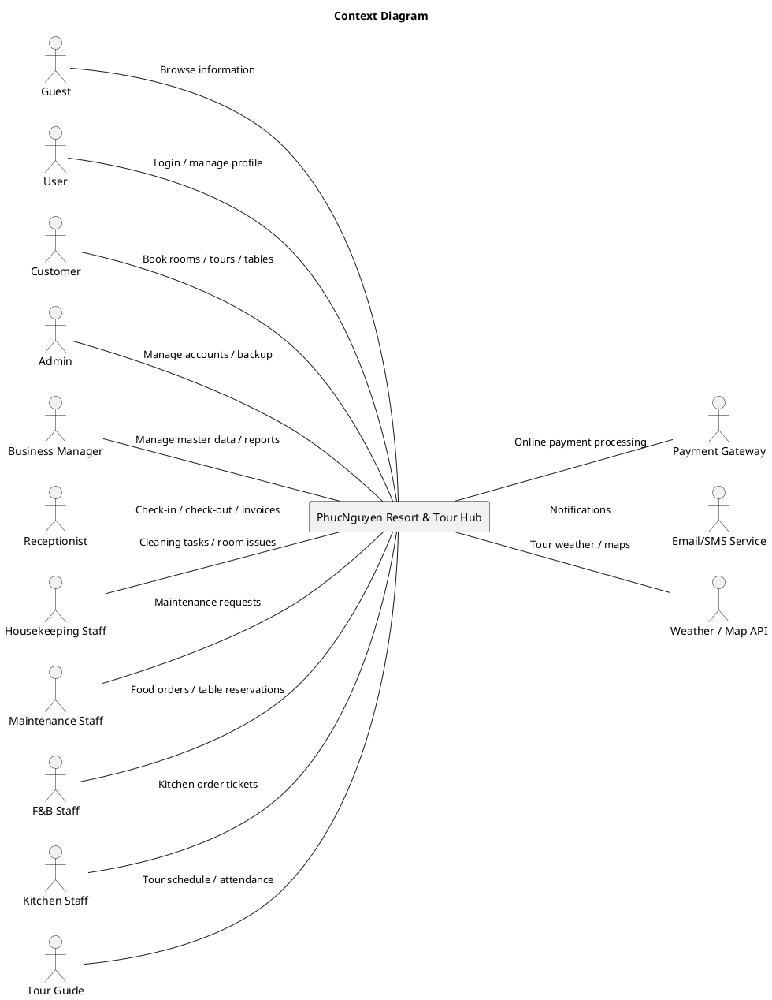


<!-- Page 5 -->

2 
User 
The user represents all external entities, specifically human beings. Users 
can log in, manage their personal profile, update personal information, and 
access authenticated system features. 
3 
Customer 
A registered and authenticated user who actively uses resort services. 
Customers can book rooms, make deposit payments, reserve restaurant 
tables, order food, book tours, view invoices, submit reviews, and request 
personal data deletion. 
4 
Admin 
The system administrator with the highest level of authority. Responsible 
for managing the entire system, user accounts, role assignments, account 
suspension/reactivation, data backup and recovery, and monitoring system 
activities. 
5 
Business 
Manager 
The resort operations manager responsible for managing business-related 
data such as room categories, restaurant menus, and tour packages. The 
manager can monitor revenue, occupancy rates, financial reports, customer 
reviews, and overall business performance. 
6 
Receptionist 
Front desk staff responsible for managing reservations, verifying guest 
information, performing check-in and check-out procedures, assigning 
rooms, updating room statuses, processing final payments, and generating 
consolidated invoices. 
7 
Housekeeping 
Staff 
Staff responsible for maintaining room cleanliness. They can view 
cleaning tasks, update room cleaning statuses, mark rooms as 
cleaned, and report maintenance issues when necessary. 
8 
Maintenance 
Staff 
Technical staff responsible for inspecting, repairing, and maintaining 
resort facilities and equipment. They manage maintenance requests, 
perform repairs, and update maintenance task statuses. 
9 
F&B Staff 
Restaurant and room service staff responsible for handling food orders, 
managing table reservations, updating order statuses, delivering food, and 
charging food expenses to guest room accounts. 
 
Kitchen Staff 
Kitchen personnel responsible for receiving Kitchen Order Tickets (KOTs), 
preparing food, updating food preparation statuses, and marking orders as 
ready for service.


<!-- Page 6 -->

2.2 Diagrams 
2.2.1 UCs for Guest 
 
Figure I.2: Use Case Diagram - Guest


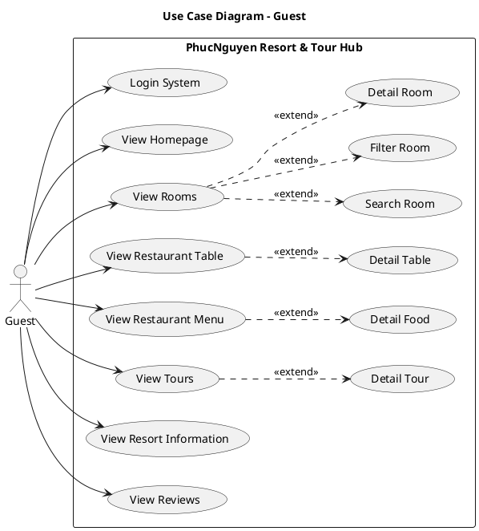


<!-- Page 7 -->

2.2.2 UCs for Registered User 
 
Figure I.3: Use Case Diagram -User


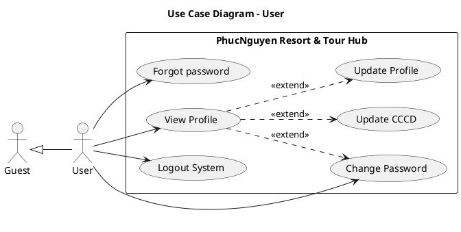


<!-- Page 8 -->

2.2.3 UCs for Customer 
 
Figure I.4: Use Case Diagram - Customer


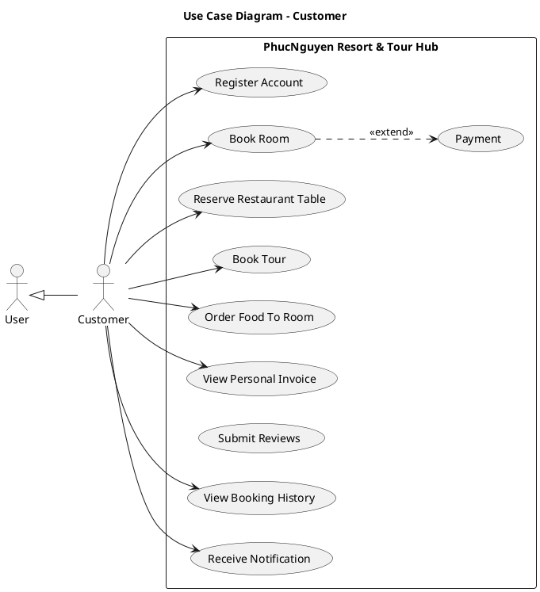


<!-- Page 9 -->

2.2.4 UCs for Business Manager: 
 
Figure I.6: Use Case Diagram -Business Manager


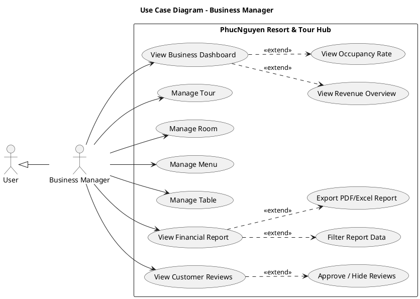


<!-- Page 10 -->

2.2.5 UCs for Receptionist: 
 
Figure I.7: Use Case Diagram - Receptionist


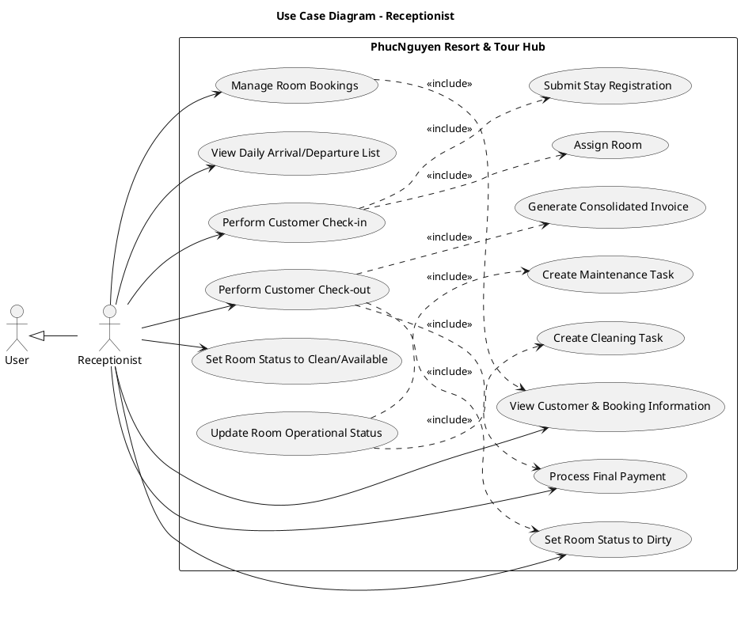


<!-- Page 11 -->

2.2.6 UCs for Housekeeping Staff: 
 
Figure I.8: Use Case Diagram - Housekeeping Staff


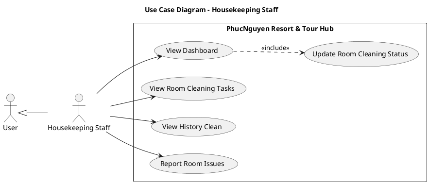


<!-- Page 12 -->

2.2.7 UCs for Maintenance Staff: 
 
Figure I.9: Maintenance Staff


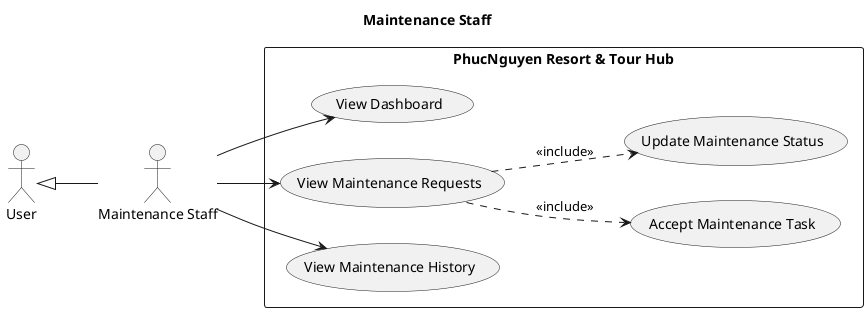


<!-- Page 13 -->

2.2.8 UCs for F&B Staff: 
 
Figure I.10: F&B Staff


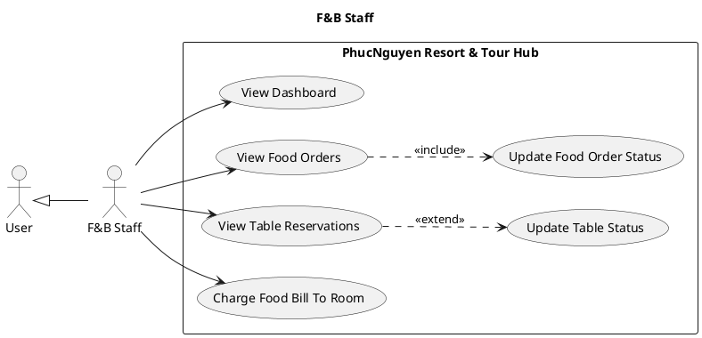


<!-- Page 14 -->

2.2.9 UCs for Kitchen Staff: 
 
Figure I.11: Kitchen Staff


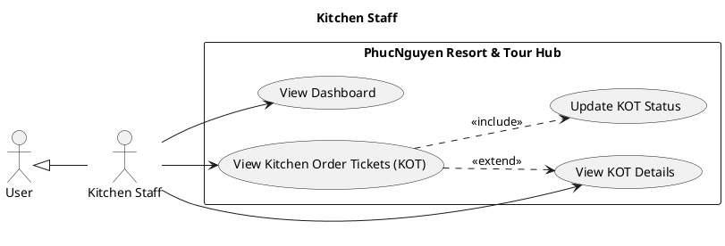


<!-- Page 15 -->

2.2.10 UCs for Admin: 
 
Figure I.5: Use Case Diagram - Admin 
 
2.3 Descriptions 
 
ID 
Use Case 
Actor(s) 
Use Case Description 
UC01 
Login 
Guest 
As a guest, I want to log into the system so that I can access 
features according to my role. 
UC02 
View 
Homepage 
Guest 
As a guest, I want to view the homepage so that I can 
access resort information and available services. 
UC03 
View Rooms 
Guest 
As a guest, I want to browse available rooms so that I can 
find suitable accommodation. 
UC04 
Search Room 
Guest 
As a guest, I want to search rooms based on my preferences 
so that I can find suitable rooms quickly. 
UC05 
Filter Room 
Guest 
As a guest, I want to filter rooms by category, price, and 
capacity so that I can narrow down my options. 
UC06 
View Room 
Details 
Guest 
As a guest, I want to view room details so that I can make 
an informed booking decision. 
UC07 
View 
Restaurant 
Table 
Guest 
As a guest, I want to view restaurant tables so that I can 
reserve a table if needed. 
UC08 
View Table 
Guest 
As a guest, I want to view table details so that I can select a


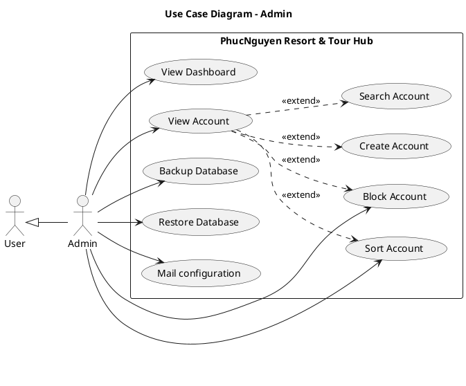


<!-- Page 16 -->

Details 
suitable table. 
UC09 
View 
Restaurant 
Menu 
Guest 
As a guest, I want to browse the restaurant menu so that I 
can explore available dishes. 
UC10 
View Food 
Details 
Guest 
As a guest, I want to view food details so that I can know 
ingredients, prices, and descriptions. 
UC11 
View Tours 
Guest 
As a guest, I want to browse available tours so that I can 
plan activities during my stay. 
UC12 
View Tour 
Details 
Guest 
As a guest, I want to view detailed tour information so that I 
can decide whether to book it. 
UC13 
View Resort 
Information 
Guest 
As a guest, I want to view resort information so that I can 
learn about facilities and services. 
UC14 
View Reviews Guest 
As a guest, I want to view customer reviews so that I can 
evaluate service quality. 
UC15 
View Profile 
Registered User 
As a registered user, I want to view my profile information so 
that I can verify my account details. 
UC16 
Update Profile Registered User 
As a registered user, I want to update my profile information 
so that my account information remains accurate. 
UC17 
Update 
CCCD/Passpor
t 
Registered User 
As a registered user, I want to upload or update my 
identification documents for verification purposes. 
UC18 
Change 
Password 
Registered User 
As a registered user, I want to change my password so that I 
can secure my account. 
UC19 
Forgot 
Password 
Registered User 
As a registered user, I want to reset my password when I 
forget it so that I can regain access to my account. 
UC20 
Logout 
Registered User 
As a registered user, I want to log out of the system so that 
my account remains secure. 
UC21 
Register 
Account 
Customer 
As a customer, I want to create an account so that I can use 
resort services. 
UC22 
Book Room 
Customer 
As a customer, I want to book a room so that I can stay at 
the resort. 
UC23 
Payment 
Customer 
As a customer, I want to pay deposits and service fees online 
so that my bookings can be confirmed. 
UC24 
Reserve 
Restaurant 
Table 
Customer 
As a customer, I want to reserve a restaurant table so that I 
can dine at my preferred time. 
UC25 
Order Food To 
Room 
Customer 
As a customer, I want to order food to my room so that I can 
enjoy room service. 
UC26 
Book Tour 
Customer 
As a customer, I want to book a tour so that I can participate 
in resort activities. 
UC27 
View Personal 
Invoice 
Customer 
As a customer, I want to view my invoices so that I can track 
my expenses.


<!-- Page 17 -->

UC28 
View Booking 
History 
Customer 
As a customer, I want to view my booking history so that I 
can review past reservations. 
UC29 
Submit 
Reviews 
Customer 
As a customer, I want to submit reviews so that I can share 
my experience. 
UC30 
Receive 
Notifications 
Customer 
As a customer, I want to receive notifications so that I can 
stay updated about bookings and services. 
UC31 
View 
Dashboard 
Admin 
As an administrator, I want to view the system dashboard so 
that I can monitor system activities. 
UC32 
View Account 
Admin 
As an administrator, I want to manage user accounts so that 
I can control system access. 
UC33 
Create 
Account 
Admin 
As an administrator, I want to create staff accounts so that 
employees can access the system. 
UC34 
Search 
Account 
Admin 
As an administrator, I want to search user accounts so that I 
can manage them efficiently. 
UC35 
Sort Account 
Admin 
As an administrator, I want to sort accounts so that I can find
information quickly. 
UC36 
Block Account Admin 
As an administrator, I want to block accounts that violate 
system policies. 
UC37 
Backup 
Database 
Admin 
As an administrator, I want to back up the database so that 
system data is protected. 
UC38 
Restore 
Database 
Admin 
As an administrator, I want to restore the database so that 
data can be recovered when needed. 
UC39 
View Business 
Dashboard 
Business Manager 
As a business manager, I want to view business dashboards 
so that I can monitor resort performance. 
UC40 
View Revenue 
Overview 
Business Manager 
As a business manager, I want to view revenue summaries 
so that I can evaluate business income. 
UC41 
View 
Occupancy 
Rate 
Business Manager 
As a business manager, I want to view occupancy rates so 
that I can monitor room utilization. 
UC42 
Monitor Resort 
Performance 
Business Manager 
As a business manager, I want to monitor operational 
performance so that I can improve efficiency. 
UC43 
Analyze 
Revenue by 
Service 
Business Manager 
As a business manager, I want to analyze revenue sources so 
that I can identify profitable services. 
UC44 
View Financial 
Report 
Business Manager 
As a business manager, I want to view financial reports so 
that I can evaluate business results. 
UC45 
Filter Report 
Data 
Business Manager 
As a business manager, I want to filter report data so that I 
can focus on specific information. 
UC46 
Export 
PDF/Excel 
Report 
Business Manager 
As a business manager, I want to export reports so that I can 
share and archive business information. 
UC47 
Moderate 
Business Manager 
As a business manager, I want to manage customer reviews


<!-- Page 18 -->

Customer 
Reviews 
so that inappropriate content can be controlled. 
UC48 
View 
Customer 
Reviews 
Business Manager 
As a business manager, I want to review customer feedback 
so that I can improve service quality. 
UC49 
Approve/Hide 
Review 
Business Manager 
As a business manager, I want to approve or hide reviews so 
that displayed feedback remains appropriate. 
UC50 
Manage Room 
Bookings 
Receptionist 
As a receptionist, I want to manage room bookings so that 
reservations are handled properly. 
UC51 
View 
Customer & 
Booking 
Information 
Receptionist 
As a receptionist, I want to view guest information so that I 
can verify reservations. 
UC52 
View Daily 
Arrival/Depart
ure List 
Receptionist 
As a receptionist, I want to view daily arrivals and departures
so that I can prepare operations. 
UC53 
Perform 
Customer 
Check-in 
Receptionist 
As a receptionist, I want to check guests in so that they can 
begin their stay. 
UC54 
Assign Room 
Receptionist 
As a receptionist, I want to assign rooms to guests during 
check-in. 
UC55 
Submit Stay 
Registration 
Receptionist 
As a receptionist, I want to submit guest stay registration 
information to comply with regulations. 
UC56 
Perform 
Customer 
Check-out 
Receptionist 
As a receptionist, I want to check guests out so that their 
stay can be completed. 
UC57 
Generate 
Consolidated 
Invoice 
Receptionist 
As a receptionist, I want to generate consolidated invoices 
including room, food, and tour charges. 
UC58 
Process Final 
Payment 
Receptionist 
As a receptionist, I want to process final payments so that 
invoices can be settled. 
UC59 
Update Room 
Operational 
Status 
Receptionist 
As a receptionist, I want to update room statuses so that 
room availability is accurate. 
UC60 
Create 
Cleaning Task Receptionist 
As a receptionist, I want to create cleaning tasks after guest 
check-out. 
UC61 
Create 
Maintenance 
Task 
Receptionist 
As a receptionist, I want to create maintenance requests 
when room issues are reported. 
UC62 
View 
Dashboard 
Housekeeping Staff 
As housekeeping staff, I want to view my dashboard so that I 
can monitor assigned tasks. 
UC63 
View Room 
Cleaning Tasks Housekeeping Staff 
As housekeeping staff, I want to view cleaning tasks so that I 
know which rooms require cleaning.


<!-- Page 19 -->

UC64 
Update Room 
Cleaning 
Status 
Housekeeping Staff 
As housekeeping staff, I want to update cleaning status so 
that room availability is accurate. 
UC65 
View Cleaning 
History 
Housekeeping Staff 
As housekeeping staff, I want to view cleaning history so that
I can track completed tasks. 
UC66 
Report Room 
Issues 
Housekeeping Staff 
As housekeeping staff, I want to report room issues so that 
maintenance staff can resolve them. 
UC67 
View 
Dashboard 
F&B Staff 
As an F&B Staff, I want to view the operational dashboard so 
that I can monitor food orders, table reservations, and 
restaurant activities in real time. 
UC68 
View Food 
Orders 
F&B Staff 
As an F&B Staff, I want to view all food orders so that I can 
track customer requests and manage the order workflow 
efficiently. 
UC69 
Update Food 
Order Status 
F&B Staff 
As an F&B Staff, I want to update the status of food orders 
(Pending → Cooking → Delivered) so that customers and 
other staff can track order progress. 
UC70 
View Table 
Reservations 
F&B Staff 
As an F&B Staff, I want to view table reservations so that I 
can prepare tables and manage restaurant seating 
arrangements. 
UC71 
Update Table 
Status 
F&B Staff 
As an F&B Staff, I want to update table status (Available, 
Reserved, Occupied) so that reservation information remains 
accurate. 
UC72 
Charge Food 
Bill To Room 
F&B Staff 
As an F&B Staff, I want to charge a customer's food bill 
directly to their room so that the amount can be included in 
the final consolidated invoice. 
UC73 
View 
Dashboard 
Kitchen Staff 
As a Kitchen Staff member, I want to view the kitchen 
dashboard so that I can monitor incoming orders and kitchen 
workload. 
UC74 
View Kitchen 
Order Tickets 
(KOT) 
Kitchen Staff 
As a Kitchen Staff member, I want to view all Kitchen Order 
Tickets (KOT) so that I can prepare food according to 
customer requests. 
UC75 
View KOT 
Details 
Kitchen Staff 
As a Kitchen Staff member, I want to view detailed 
information of a KOT so that I can prepare the correct dishes 
and quantities. 
UC76 
Update KOT 
Status 
Kitchen Staff 
As a Kitchen Staff member, I want to update the status of a 
KOT (Pending → Preparing → Ready to Serve) so that F&B 
Staff can know when orders are ready for delivery.


<!-- Page 20 -->

3. Activity Diagram 
3.1 Customer Room Booking Process 
 
 
booking.png
3.2 Receptionist Check-in Process  
 
 
checkin.png
3.3 Food Ordering & Room Service Process 
 
 
foodorder.png
3.4 Tour Booking Process


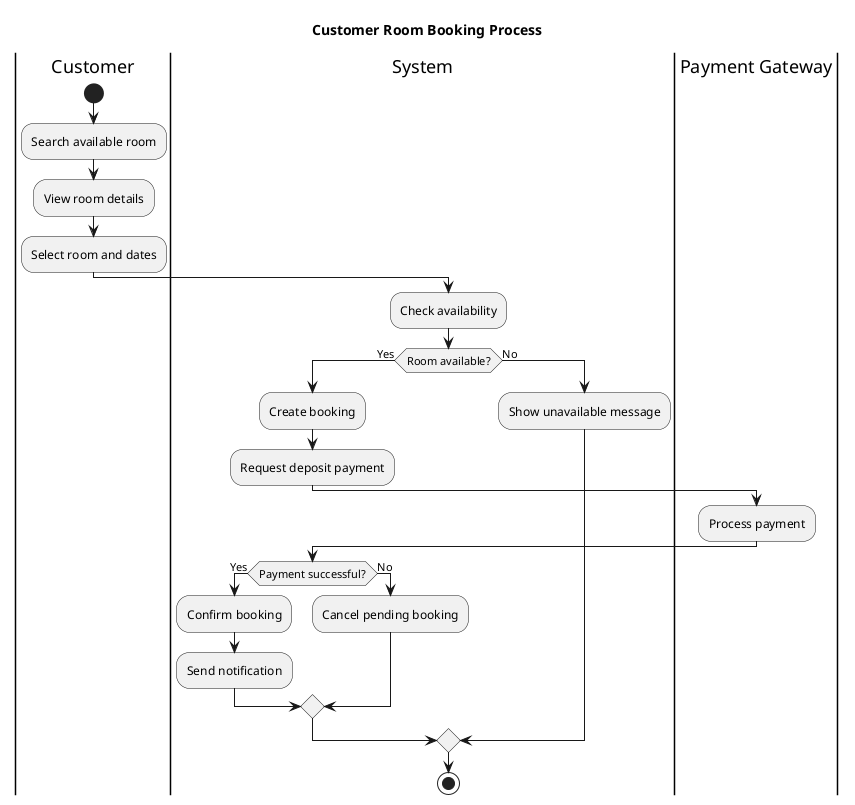


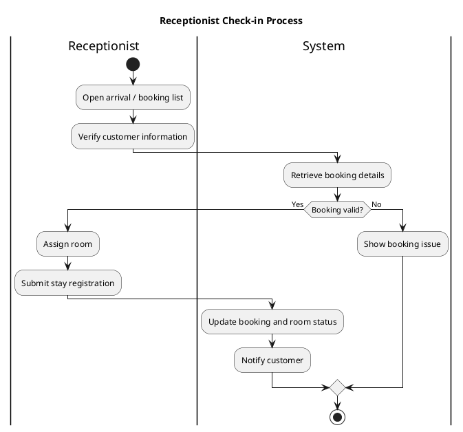


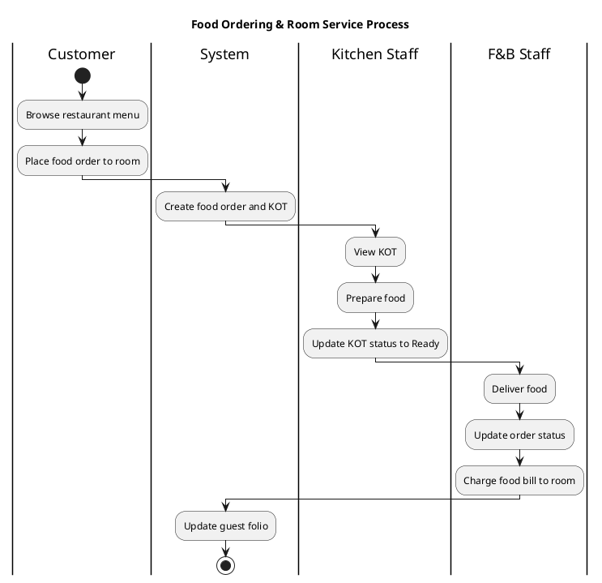


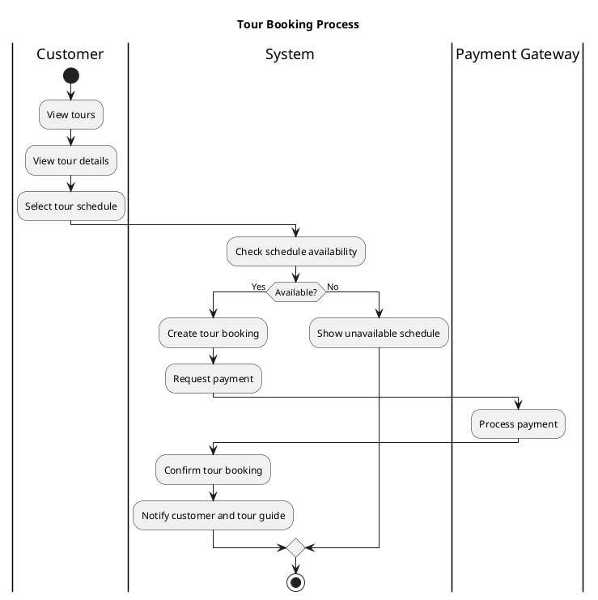


<!-- Page 21 -->

tourbooking.png
 
3.5 Customer Check-out & Consolidated Invoice Process 
 
 
checkout.png
3.6 Housekeeping & Mai​
ntenance Process 
 
 
cleanroom.png
 
4. System Functionalities 
4.1 Screens Flow 
4.1.1 Guest Screen Flow:


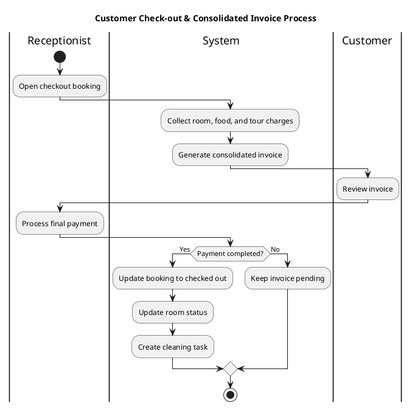


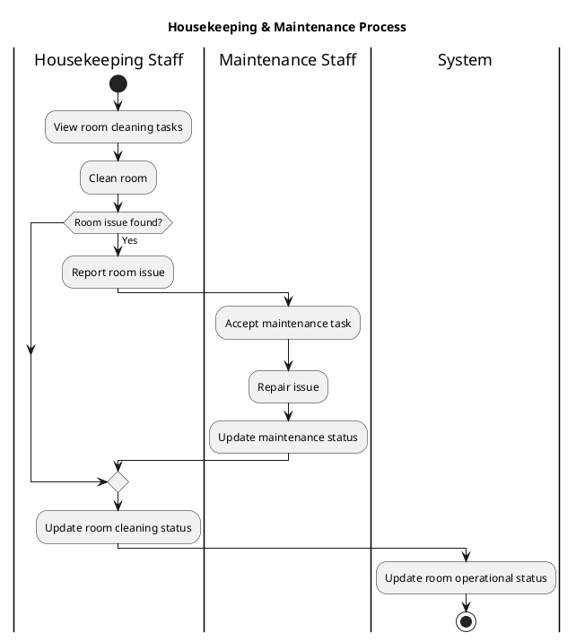


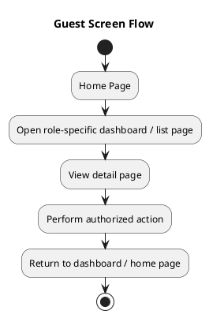


<!-- Page 22 -->


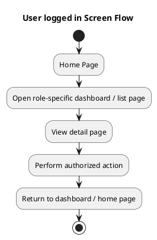


<!-- Page 23 -->


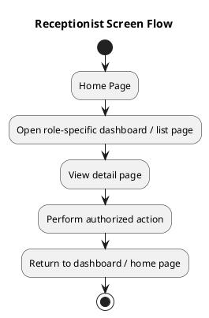


```plantuml
@startuml
title F&B Staff Screen Flow
start
:Home Page;
:Open role-specific dashboard / list page;
:View detail page;
:Perform authorized action;
:Return to dashboard / home page;
stop
@enduml
```


<!-- Page 24 -->


```plantuml
@startuml
title Tour Guide Screen Flow
start
:Home Page;
:Open role-specific dashboard / list page;
:View detail page;
:Perform authorized action;
:Return to dashboard / home page;
stop
@enduml
```


```plantuml
@startuml
title Kitchen Staff Screen Flow
start
:Home Page;
:Open role-specific dashboard / list page;
:View detail page;
:Perform authorized action;
:Return to dashboard / home page;
stop
@enduml
```


```plantuml
@startuml
title Maintenance Screen Flow
start
:Home Page;
:Open role-specific dashboard / list page;
:View detail page;
:Perform authorized action;
:Return to dashboard / home page;
stop
@enduml
```


```plantuml
@startuml
title Manager Screen Flow
start
:Home Page;
:Open role-specific dashboard / list page;
:View detail page;
:Perform authorized action;
:Return to dashboard / home page;
stop
@enduml
```


<!-- Page 25 -->

4.2 Screen Authorization 
 
Screen Name Guest User Tour 
Guide 
Manager 
Recept
ionist 
F&B 
Staff 
Kitchen 
Staff 
Maintenance 
Admin 
Home Page 
✓ 
✓ 
✓ 
✓ 
✓ 
✓ 
✓ 
✓ 
✓ 
User Login 
Page 
✓ 
✓ 
✓ 
✓ 
✓ 
✓ 
✓ 
✓ 
✓ 
User Register 
Page 
✓ 
✓ 
 
 
 
 
 
 
 
Verify Email 
Page 
✓ 
✓ 
 
 
 
 
 
 
 
Forgot 
Password 
Page 
✓ 
✓ 
 
 
 
 
 
 
 
About Resort 
Page 
✓ 
✓ 
✓ 
✓ 
✓ 
✓ 
✓ 
✓ 
✓


```plantuml
@startuml
title Admin Screen Flow
start
:Home Page;
:Open role-specific dashboard / list page;
:View detail page;
:Perform authorized action;
:Return to dashboard / home page;
stop
@enduml
```


<!-- Page 26 -->

Tour List Page 
✓ 
✓ 
  
  
  
  
  
  
  
Tour Detail 
Page 
✓ 
✓ 
  
  
  
  
  
  
  
Restaurant 
Menu Page 
✓ 
✓ 
  
  
  
  
  
  
  
Room Search 
Page 
✓ 
✓ 
  
  
  
  
  
  
  
Room Detail 
Page 
✓ 
✓ 
  
  
  
  
  
✓ 
  
Profile Page 
  
✓ 
✓ 
✓ 
✓ 
✓ 
✓ 
✓ 
✓ 
Change 
Password 
  
✓ 
  
  
  
  
  
  
  
Update 
ID/Passport 
Page 
  
✓ 
  
  
  
  
  
  
  
Data Deletion 
Request 
  
✓ 
  
  
  
  
  
  
  
Order Food 
  
✓ 
  
  
  
  
  
  
  
Table 
Reservation 
Page 
  
✓ 
  
  
  
  
  
  
  
Tour Booking 
Page 
  
✓ 
  
  
  
  
  
  
  
Room Booking 
Page 
  
✓ 
  
  
  
  
  
  
  
Deposit 
Payment Page 
  
✓ 
  
  
  
  
  
  
  
My Folio / 
Invoices Page 
  
✓ 
  
  
  
  
  
  
  
Online 
Payment Page 
  
✓ 
  
  
  
  
  
  
  
Review & 
Feedback 
Page 
  
✓ 
  
  
  
  
  
  
  
Tour Guide 
Dashboard 
  
  
✓


<!-- Page 27 -->

History Tour 
  
  
✓ 
  
  
  
  
  
  
Real-time 
Order List 
  
  
✓ 
  
  
✓ 
  
  
  
Tour Detail & 
Schedule 
  
  
✓ 
  
  
  
  
  
  
Attendance 
Check Page 
  
  
✓ 
  
  
  
  
  
  
Update Tour 
Status Page 
  
  
✓ 
  
  
  
  
  
  
Manager 
Dashboard 
  
  
  
✓ 
  
  
  
  
  
Master Data 
List 
(Rooms/Tours/
Menu) 
  
  
  
✓ 
  
  
  
  
  
Add/Edit 
Master Data 
Page 
  
  
  
✓ 
  
  
  
  
  
Revenue & 
Occupancy 
Dashboard 
  
  
  
✓ 
  
  
  
  
  
Financial 
Report Export 
Form 
  
  
  
✓ 
  
  
  
  
  
Staff Account 
Management 
  
  
  
 
  
  
  
  
✓ 
Receptionist 
Dashboard 
  
  
  
  
✓ 
  
  
  
  
Expected 
Arrivals/Depart
ures 
  
  
  
  
✓ 
  
  
  
  
Export 
Temporary 
Residence 
  
  
  
  
✓ 
  
  
  
  
Booking 
Management 
List 
  
  
  
  
✓


<!-- Page 28 -->

Booking Detail 
Page 
  
  
  
  
✓ 
  
  
  
  
Room Status 
Management 
  
  
  
  
✓ 
  
  
  
  
Check-In / 
Assign Room 
Page 
  
  
  
  
✓ 
  
  
  
  
Check-Out 
Page 
  
  
  
  
✓ 
  
  
  
  
Consolidated 
Invoice Page 
  
  
  
  
✓ 
  
  
  
  
Payment 
Processing 
Page 
  
  
  
  
✓ 
  
  
  
  
F&B Dashboard 
  
  
  
  
  
✓ 
  
  
  
Table 
Reservation 
List 
  
  
  
  
  
✓ 
  
  
  
Table Status 
Page 
  
  
  
  
  
✓ 
  
  
  
KOT 
Management 
Page 
  
  
  
  
  
✓ 
  
  
  
Order Detail 
Page 
  
  
  
  
  
✓ 
  
  
  
Charge to 
Room Form 
  
  
  
  
  
✓ 
  
  
  
Update Order 
Status 
  
  
  
  
  
✓ 
  
  
  
Kitchen 
Dashboard 
  
  
  
  
  
  
✓ 
  
  
Pending KOT 
List 
  
  
  
  
  
  
✓ 
  
  
KOT Detail 
Page 
  
  
  
  
  
  
✓ 
  
  
Update KOT 
Status 
  
  
  
  
  
  
✓


<!-- Page 29 -->

4.3 Non-UI Functions 
# 
Feature 
System Function 
Description 
 
 
 
 
 
 
 
 
(Preparing -> 
Ready) 
Maintenance 
Dashboard 
  
  
  
  
  
  
  
✓ 
  
Update 
Cleaning Status 
  
  
  
  
  
  
  
✓ 
  
Report 
Maintenance 
Issue 
  
  
  
  
  
  
  
✓ 
  
System Settings 
Configuration 
  
  
  
  
  
  
  
  
✓ 
Global Account 
Security 
(Lock/Unlock) 
  
  
  
  
  
  
  
  
✓ 
Account Detail 
& Activity 
  
  
  
  
  
  
  
  
✓ 
Database 
Backup & 
Restore Page 
  
  
  
  
  
  
  
  
✓ 
System Logs & 
Audit Trail Page 
  
  
  
  
  
  
  
  
✓


<!-- Page 30 -->

II. Functional Requirements 
III. System Design 
1. Database Design 
1.1 Database Schema 
 
​
Figure III.1: Entity Relationship Diagram 
draw 
1.2 Table Descriptions 
No 
Table 
Description 
1 Roles 
●​
Primary keys: RoleId 
●​
Foreign keys: None 
●​
Unique keys: RoleName 
2 Users 
●​
Primary keys: UserId 
●​
Foreign keys: RoleId → Roles(RoleId) 
●​
Unique keys: Email 
3 UserProfiles 
●​
Primary keys: ProfileId 
●​
Foreign keys: UserId → Users(UserId) 
●​
Unique keys: UserId 
4 RoomCategories 
●​
Primary keys: CategoryId 
●​
Foreign keys: None 
●​
Unique keys: None


```plantuml
@startuml
title Entity Relationship Diagram
hide circle
skinparam linetype ortho
entity Roles { *RoleId
--
RoleName <<unique>> }
entity Users { *UserId
--
RoleId
Email <<unique>> }
entity UserProfiles { *ProfileId
--
UserId <<unique>> }
entity RoomCategories { *CategoryId }
entity Rooms { *RoomId
--
CategoryId
RoomNumber <<unique>> }
entity Bookings { *BookingId
--
UserId }
entity BookingDetails { *BookingDetailId
--
BookingId
RoomCategoryId
RoomId (Nullable)
Price }
entity BookingGuests { *BookingGuestId
--
BookingId }
entity MenuCategories { *CategoryId }
entity MenuItems { *MenuItemId
--
CategoryId }
entity DiningTables { *TableId }
entity TableReservations { *ReservationId
--
UserId
TableId }
entity FoodOrders { *FoodOrderId
--
BookingId }
entity FoodOrderItems { *OrderItemId
--
FoodOrderId
MenuItemId }
entity KOT { *KotId
--
FoodOrderId <<unique>> }
entity Tours { *TourId }
entity TourSchedules { *ScheduleId
--
TourId
GuideId }
entity TourBookings { *TourBookingId
--
BookingId
ScheduleId }
entity Reviews { *ReviewId
--
UserId }
entity GuestFolios { *FolioId
--
BookingId <<unique>> }
entity FolioTransactions { *TransactionId
--
FolioId }
entity Invoices { *InvoiceId
--
FolioId <<unique>> }
entity Payments { *PaymentId
--
InvoiceId }
entity Refunds { *RefundId
--
BookingId }
entity Notifications { *NotificationId
--
UserId }
Roles ||--o{ Users
Users ||--|| UserProfiles
RoomCategories ||--o{ Rooms
Users ||--o{ Bookings
Bookings ||--o{ BookingDetails
RoomCategories ||--o{ BookingDetails
Rooms ||--o{ BookingDetails
Bookings ||--o{ BookingGuests
MenuCategories ||--o{ MenuItems
Users ||--o{ TableReservations
DiningTables ||--o{ TableReservations
Bookings ||--o{ FoodOrders
FoodOrders ||--o{ FoodOrderItems
MenuItems ||--o{ FoodOrderItems
FoodOrders ||--|| KOT
Tours ||--o{ TourSchedules
Users ||--o{ TourSchedules : GuideId
Bookings ||--o{ TourBookings
TourSchedules ||--o{ TourBookings
Users ||--o{ Reviews
Bookings ||--|| GuestFolios
GuestFolios ||--o{ FolioTransactions
GuestFolios ||--|| Invoices
Invoices ||--o{ Payments
Bookings ||--o{ Refunds
Users ||--o{ Notifications
@enduml
```


<!-- Page 31 -->

5 Rooms 
●​
Primary keys: RoomId 
●​
Foreign keys: CategoryId → RoomCategories(CategoryId) 
●​
Unique keys: RoomNumber 
6 Bookings 
●​
Primary keys: BookingId 
●​
Foreign keys: UserId → Users(UserId) 
●​
Unique keys: None 
7 BookingDetails 
●​
Primary keys: BookingDetailId 
●​
Foreign keys: BookingId → Bookings(BookingId), RoomCategoryId → RoomCategories(CategoryId), RoomId (Nullable) → Rooms(RoomId) 
●​
Unique keys: None 
8 BookingGuests 
●​
Primary keys: BookingGuestId 
●​
Foreign keys: BookingId → Bookings(BookingId) 
●​
Unique keys: None 
9 MenuCategories 
●​
Primary keys: CategoryId 
●​
Foreign keys: None 
●​
Unique keys: None 
10 MenuItems 
●​
Primary keys: MenuItemId 
●​
Foreign keys: CategoryId → MenuCategories(CategoryId) 
●​
Unique keys: None 
11 DiningTables 
●​
Primary keys: TableId 
●​
Foreign keys: None 
●​
Unique keys: None 
12 TableReservations 
●​
Primary keys: ReservationId 
●​
Foreign keys: UserId → Users(UserId), TableId → 
DiningTables(TableId) 
●​
Unique keys: None 
13 FoodOrders 
●​
Primary keys: FoodOrderId 
●​
Foreign keys: BookingId → Bookings(BookingId) 
●​
Unique keys: None 
14 FoodOrderItems 
●​
Primary keys: OrderItemId 
●​
Foreign keys: FoodOrderId → FoodOrders(FoodOrderId), MenuItemId 
→ MenuItems(MenuItemId) 
●​
Unique keys: None 
15 KOT 
●​
Primary keys: KotId 
●​
Foreign keys: FoodOrderId → FoodOrders(FoodOrderId) 
●​
Unique keys: FoodOrderId 
16 Tours 
●​
Primary keys: TourId 
●​
Foreign keys: None 
●​
Unique keys: None 
17 TourSchedules 
●​
Primary keys: ScheduleId 
●​
Foreign keys: TourId → Tours(TourId), GuideId → Users(UserId) 
●​
Unique keys: None 
18 TourBookings 
●​
Primary keys: TourBookingId 
●​
Foreign keys: BookingId → Bookings(BookingId), ScheduleId → 
TourSchedules(ScheduleId) 
●​
Unique keys: None 
19 Reviews 
●​
Primary keys: ReviewId 
●​
Foreign keys: UserId → Users(UserId)


<!-- Page 32 -->

●​
Unique keys: None 
20 GuestFolios 
●​
Primary keys: FolioId 
●​
Foreign keys: BookingId → Bookings(BookingId) 
●​
Unique keys: BookingId 
21 FolioTransactions 
●​
Primary keys: TransactionId 
●​
Foreign keys: FolioId → GuestFolios(FolioId) 
●​
Unique keys: None 
22 Invoices 
●​
Primary keys: InvoiceId 
●​
Foreign keys: FolioId → GuestFolios(FolioId) 
●​
Unique keys: FolioId 
22 Payments 
●​
Primary keys: PaymentId 
●​
Foreign keys: InvoiceId → Invoices(InvoiceId) 
●​
Unique keys: None 
23 Refunds 
●​
Primary keys: RefundId 
●​
Foreign keys: BookingId → Bookings(BookingId) 
●​
Unique keys: None 
24 Notifications 
●​
Primary keys: NotificationId 
●​
Foreign keys: UserId → Users(UserId) 
●​
Unique keys: None 
 
2. Code Packages 
2.1 Package Diagram 
 
Figure III.2: Packages Diagram 
2.2 Package Descriptions
