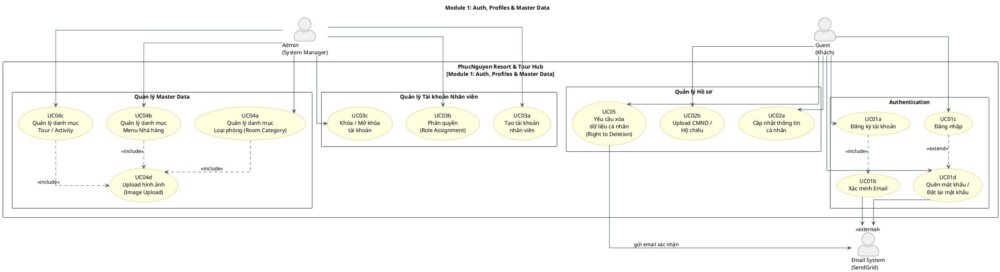

# Module 1: Auth, Profiles & Master Data

**Phụ trách:** Sinh viên 1  
**Phạm vi:** Xác thực người dùng, quản lý hồ sơ cá nhân, và quản lý dữ liệu gốc (Master Data) của toàn hệ thống.

---

## 1. Use Case Diagram (PlantUML)



---

## 2. Actors Specification

| Actor | Loại | Mô tả |
|-------|------|-------|
| **Guest (Khách)** | Primary | Người dùng cuối — đăng ký, đăng nhập, quản lý hồ sơ cá nhân, yêu cầu xóa dữ liệu |
| **Admin (System Manager)** | Primary | Quản trị viên hệ thống — quản lý nhân viên, phân quyền, quản lý toàn bộ master data |
| **Email System (SendGrid)** | Secondary / External | Hệ thống gửi email tự động (xác minh, reset mật khẩu, xác nhận xóa dữ liệu) |

---

## 3. Use Case Specifications

---

### UC01 — Đăng ký, Xác minh Email & Đăng nhập

| Thuộc tính         | Nội dung                                                                                      |
| --------------------| -----------------------------------------------------------------------------------------------|
| **Use Case ID**    | UC01                                                                                          |
| **Tên**            | Đăng ký, Xác minh Email & Đăng nhập                                                           |
| **Actor chính**    | Guest                                                                                         |
| **Actor phụ**      | Email System (SendGrid)                                                                       |
| **Mô tả**          | Cho phép khách hàng tạo tài khoản mới, xác minh danh tính qua email và đăng nhập vào hệ thống |
| **Tiền điều kiện** | Khách chưa có tài khoản (cho đăng ký) hoặc đã có tài khoản được xác minh (cho đăng nhập)      |
| **Hậu điều kiện**  | Khách được xác thực và truy cập vào hệ thống với session hợp lệ                               |

**Luồng chính (Main Flow) – Đăng ký:**

| Bước | Actor | Hành động |
|------|-------|-----------|
| 1 | Guest | Truy cập trang đăng ký, điền: Họ tên, Email, Mật khẩu, Số điện thoại |
| 2 | System | Kiểm tra email chưa tồn tại trong hệ thống |
| 3 | System | Tạo tài khoản với trạng thái `UNVERIFIED`, gửi email kèm link xác minh (hết hạn sau 24h) |
| 4 | Guest | Mở email, nhấn vào link xác minh |
| 5 | System | Chuyển trạng thái tài khoản sang `VERIFIED`, redirect về trang đăng nhập |

**Luồng chính (Main Flow) – Đăng nhập:**

| Bước | Actor | Hành động |
|------|-------|-----------|
| 1 | Guest | Nhập Email và Mật khẩu |
| 2 | System | Xác thực thông tin, kiểm tra trạng thái `VERIFIED` |
| 3 | System | Tạo JWT token, lưu session, redirect về trang chủ |

**Luồng thay thế (Alternative Flow):**

| Tình huống | Xử lý |
|------------|-------|
| Email đã tồn tại | Hiển thị lỗi "Email đã được sử dụng", đề xuất đăng nhập hoặc reset mật khẩu |
| Link xác minh hết hạn | Cung cấp tùy chọn "Gửi lại email xác minh" |
| Sai mật khẩu ≥ 5 lần | Khóa tài khoản tạm thời 15 phút, gửi cảnh báo qua email |

**Luồng ngoại lệ (Exception Flow):**

| Tình huống | Xử lý |
|------------|-------|
| Email System lỗi | Hiển thị thông báo "Không thể gửi email, vui lòng thử lại sau" |
| Tài khoản bị khóa | Hiển thị thông báo "Tài khoản bị tạm khóa, liên hệ Admin" |

**Business Rules áp dụng:**
- Mật khẩu tối thiểu 8 ký tự, gồm chữ hoa, chữ thường, số.
- Link xác minh có hiệu lực 24 giờ.
- Tuân thủ Nghị định 356/2025 về lưu trữ thông tin tài khoản.

---

### UC02 — Quản lý Hồ sơ & Upload CMND/Hộ chiếu

| Thuộc tính | Nội dung |
|-----------|----------|
| **Use Case ID** | UC02 |
| **Tên** | Quản lý hồ sơ cá nhân & Upload giấy tờ tùy thân |
| **Actor chính** | Guest |
| **Mô tả** | Khách cập nhật thông tin cá nhân và upload ảnh CMND/Hộ chiếu để đáp ứng yêu cầu đăng ký tạm trú theo Luật Cư trú 2020 |
| **Tiền điều kiện** | Guest đã đăng nhập, tài khoản ở trạng thái `VERIFIED` |
| **Hậu điều kiện** | Thông tin cá nhân được cập nhật; giấy tờ tùy thân được lưu trữ bảo mật |

**Luồng chính (Main Flow):**

| Bước | Actor | Hành động |
|------|-------|-----------|
| 1 | Guest | Vào trang "Hồ sơ cá nhân" |
| 2 | Guest | Cập nhật: Họ tên, Ngày sinh, Số điện thoại, Địa chỉ, Quốc tịch |
| 3 | Guest | Upload ảnh CMND/Passport (mặt trước + mặt sau) |
| 4 | System | Xác nhận **Explicit Consent** theo Nghị định 356/2025 trước khi lưu |
| 5 | System | Validate file (định dạng JPG/PNG, tối đa 5MB), lưu vào cloud storage bảo mật |
| 6 | System | Hiển thị thông báo "Cập nhật thành công" |

**Dữ liệu bắt buộc (theo Luật Cư trú 2020):**

| Trường | Bắt buộc | Ghi chú |
|--------|----------|---------|
| Họ và tên | ✅ | |
| Ngày tháng năm sinh | ✅ | |
| Số CMND / Hộ chiếu | ✅ | |
| Quốc tịch | ✅ | |
| Địa chỉ thường trú | ✅ | |

**Luồng thay thế / Ngoại lệ:**

| Tình huống | Xử lý |
|------------|-------|
| File quá lớn (> 5MB) | Báo lỗi "File quá lớn, tối đa 5MB" |
| Định dạng file không hợp lệ | Chỉ chấp nhận JPG, PNG, PDF |
| Khách không đồng ý consent | Không lưu thông tin nhạy cảm, cảnh báo không thể check-in nếu thiếu giấy tờ |

---

### UC03 — Admin Quản lý Tài khoản Nhân viên & Phân quyền

| Thuộc tính | Nội dung |
|-----------|----------|
| **Use Case ID** | UC03 |
| **Tên** | Quản lý tài khoản nhân viên & phân quyền Role |
| **Actor chính** | Admin (System Manager) |
| **Mô tả** | Admin tạo, chỉnh sửa, phân quyền và khóa/mở tài khoản nhân viên trong hệ thống |
| **Tiền điều kiện** | Admin đã đăng nhập với quyền `ADMIN` |
| **Hậu điều kiện** | Tài khoản nhân viên được tạo/cập nhật với đúng role và quyền truy cập tương ứng |

**Các Role trong hệ thống:**

| Role | Quyền hạn |
|------|-----------|
| `ADMIN` | Toàn quyền hệ thống |
| `RECEPTIONIST` | Quản lý check-in/out, phòng, hóa đơn |
| `FNB_STAFF` | Quản lý đơn ăn, bàn nhà hàng |
| `TOUR_GUIDE` | Xem danh sách khách tour |
| `GUEST` | Đặt phòng, gọi đồ, đặt tour |

**Luồng chính (Main Flow) – Tạo tài khoản nhân viên:**

| Bước | Actor | Hành động |
|------|-------|-----------|
| 1 | Admin | Vào trang "Quản lý nhân viên" → "Thêm nhân viên" |
| 2 | Admin | Điền: Họ tên, Email, Role, Số điện thoại, Phòng ban |
| 3 | System | Tự động tạo mật khẩu tạm thời, gửi email thông báo cho nhân viên |
| 4 | System | Lưu tài khoản với trạng thái `ACTIVE` |

**Luồng chính (Main Flow) – Phân quyền:**

| Bước | Actor | Hành động |
|------|-------|-----------|
| 1 | Admin | Chọn tài khoản nhân viên cần thay đổi role |
| 2 | Admin | Chọn Role mới từ danh sách |
| 3 | System | Cập nhật quyền, ghi log thay đổi (Audit Log) |

**Luồng thay thế / Ngoại lệ:**

| Tình huống | Xử lý |
|------------|-------|
| Email nhân viên đã tồn tại | Báo lỗi, không tạo trùng |
| Tự phân quyền cho bản thân | Hệ thống từ chối, yêu cầu Admin khác xác nhận |

---

### UC04 — Admin Quản lý Master Data (CRUD + Upload Ảnh)

| Thuộc tính | Nội dung |
|-----------|----------|
| **Use Case ID** | UC04 |
| **Tên** | Quản lý dữ liệu gốc: Phòng, Menu, Tour |
| **Actor chính** | Admin (System Manager) |
| **Mô tả** | Admin thực hiện CRUD đầy đủ cho 3 danh mục chính: Loại phòng, Menu nhà hàng, và Tour/Activity — bao gồm upload hình ảnh minh họa |
| **Tiền điều kiện** | Admin đã đăng nhập với quyền `ADMIN` |
| **Hậu điều kiện** | Dữ liệu được cập nhật và hiển thị ngay lập tức trên giao diện khách hàng |

**UC04a — Quản lý Loại Phòng (Room Category):**

| Trường dữ liệu | Mô tả |
|---------------|-------|
| Tên loại phòng | Ví dụ: Deluxe, Suite, Villa |
| Mô tả | Chi tiết tiện nghi |
| Giá mỗi đêm | VND |
| Sức chứa tối đa | Số người |
| Hình ảnh | Tối đa 10 ảnh, JPG/PNG |
| Trạng thái | Active / Inactive |

**UC04b — Quản lý Menu Nhà hàng:**

| Trường dữ liệu | Mô tả |
|---------------|-------|
| Tên món | |
| Danh mục | Khai vị / Món chính / Tráng miệng / Đồ uống |
| Giá | VND |
| Mô tả nguyên liệu | |
| Hình ảnh | Tối đa 5 ảnh |
| Trạng thái | Available / Unavailable |

**UC04c — Quản lý Tour/Activity:**

| Trường dữ liệu | Mô tả |
|---------------|-------|
| Tên tour | |
| Mô tả / Lịch trình | Itinerary chi tiết |
| Giá mỗi người | VND |
| Thời gian | Số giờ/ngày |
| Sức chứa tối đa | Số người/tour |
| Điều khoản (bảo hiểm, cảnh báo an toàn) | Theo Luật Du lịch 2017 |
| Hình ảnh | Tối đa 10 ảnh |

**Luồng chính (Main Flow) – Thêm mới:**

| Bước | Actor | Hành động |
|------|-------|-----------|
| 1 | Admin | Chọn danh mục cần quản lý (Phòng / Menu / Tour) |
| 2 | Admin | Nhấn "Thêm mới", điền thông tin vào form |
| 3 | Admin | Upload hình ảnh minh họa |
| 4 | System | Validate dữ liệu, lưu vào database và cloud storage |
| 5 | System | Cập nhật hiển thị ngay trên giao diện khách hàng |

**Luồng thay thế / Ngoại lệ:**

| Tình huống | Xử lý |
|------------|-------|
| Xóa danh mục đang có booking active | Không cho xóa, chỉ cho phép `Inactive` |
| File ảnh lỗi định dạng | Báo lỗi, giữ nguyên ảnh cũ |

---

### UC05 — Yêu cầu Xóa Dữ liệu Cá nhân (Right to Deletion)

| Thuộc tính | Nội dung |
|-----------|----------|
| **Use Case ID** | UC05 |
| **Tên** | Yêu cầu xóa dữ liệu cá nhân |
| **Actor chính** | Guest |
| **Actor phụ** | Admin, Email System |
| **Cơ sở pháp lý** | Điều 5, Nghị định 356/2025/NĐ-CP về Bảo vệ Dữ liệu Cá nhân |
| **Mô tả** | Khách hàng có quyền yêu cầu hệ thống xóa toàn bộ dữ liệu cá nhân của mình sau khi hoàn tất kỳ nghỉ |
| **Tiền điều kiện** | Guest đã đăng nhập; không có booking nào đang active hoặc chưa thanh toán |
| **Hậu điều kiện** | Dữ liệu cá nhân bị ẩn/xóa khỏi hệ thống; tài khoản bị vô hiệu hóa |

**Luồng chính (Main Flow):**

| Bước | Actor | Hành động |
|------|-------|-----------|
| 1 | Guest | Vào trang "Cài đặt tài khoản" → "Yêu cầu xóa dữ liệu" |
| 2 | System | Kiểm tra điều kiện: không có booking active, không có hóa đơn tồn đọng |
| 3 | System | Hiển thị cảnh báo rõ ràng: "Hành động này không thể hoàn tác. Toàn bộ dữ liệu sẽ bị xóa vĩnh viễn." |
| 4 | Guest | Xác nhận bằng cách nhập lại mật khẩu hoặc mã OTP |
| 5 | System | Gửi email xác nhận đến Guest với link xác nhận lần cuối |
| 6 | Guest | Nhấn xác nhận trong email |
| 7 | System | Thực hiện **Soft Delete**: ẩn dữ liệu cá nhân, thay thế bằng dữ liệu ẩn danh (pseudonymization) |
| 8 | System | Ghi Audit Log về yêu cầu xóa (lưu trữ tối thiểu 30 ngày theo quy định) |
| 9 | System | Gửi email xác nhận "Dữ liệu của bạn đã được xóa thành công" |

**Dữ liệu được xóa / ẩn danh hóa:**

| Loại dữ liệu | Xử lý |
|-------------|-------|
| Họ tên | Thay thế bằng `[Deleted User]` |
| Email | Hash hoặc xóa |
| Số điện thoại | Xóa |
| Ảnh CMND/Hộ chiếu | Xóa khỏi cloud storage |
| Lịch sử đặt phòng | Giữ lại dưới dạng ẩn danh (phục vụ báo cáo tài chính) |

**Luồng thay thế / Ngoại lệ:**

| Tình huống | Xử lý |
|------------|-------|
| Còn booking chưa hoàn tất | Từ chối yêu cầu, hiển thị danh sách booking cần xử lý trước |
| Còn hóa đơn chưa thanh toán | Từ chối, yêu cầu thanh toán trước |
| Yêu cầu từ Admin | Admin có thể thực hiện xóa thay cho Guest nếu có yêu cầu bằng văn bản |

---

## 4. Tóm tắt quan hệ giữa các Use Case

```
UC01 (Đăng ký)
  └── <<include>> UC01b (Xác minh Email)  → gửi qua Email System
  └── <<extend>>  UC01d (Quên mật khẩu)  → gửi qua Email System

UC04a, UC04b, UC04c (Quản lý Master Data)
  └── <<include>> UC04d (Upload ảnh)

UC05 (Right to Deletion)
  └── <<extend>> khi Guest có yêu cầu xóa tài khoản sau kỳ nghỉ
  └── gửi email xác nhận qua Email System
```

---

## 5. Ghi chú Kỹ thuật & Tuân thủ Pháp lý

| Yêu cầu | Mô tả |
|---------|-------|
| **Explicit Consent (UC02)** | Hiển thị popup đồng ý trước khi lưu CMND/Passport theo Nghị định 356/2025 |
| **Audit Log (UC03, UC05)** | Ghi lại tất cả thay đổi phân quyền và yêu cầu xóa dữ liệu |
| **Soft Delete (UC05)** | Không xóa cứng khỏi DB, chỉ ẩn danh hóa để bảo toàn tính toàn vẹn báo cáo |
| **JWT + Role-Based Access Control** | Mỗi API endpoint được bảo vệ theo Role tương ứng |
| **Cloud Storage** | Ảnh CMND/Passport được mã hóa và lưu trữ tách biệt khỏi database chính |

---

*Tài liệu này thuộc Module 1 — Dự án SWP391-HOS-02: PhucNguyen Resort & Tour Hub*
