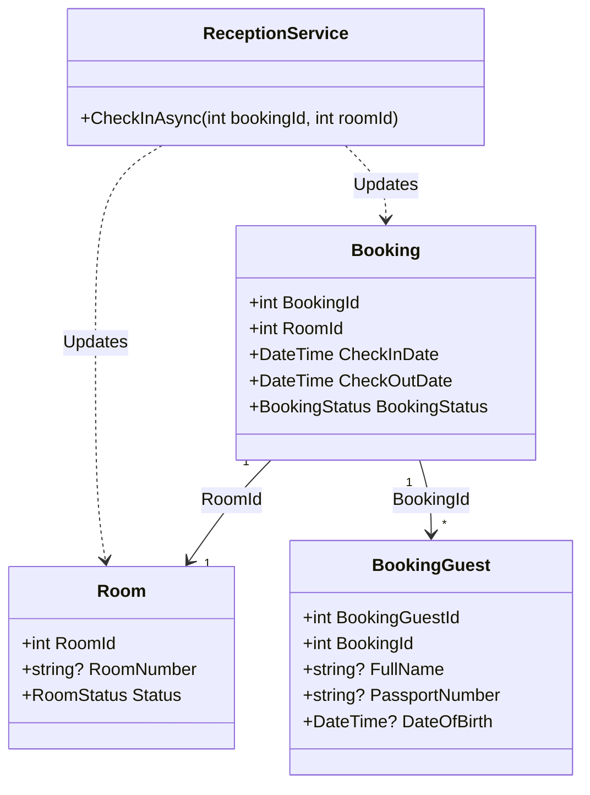
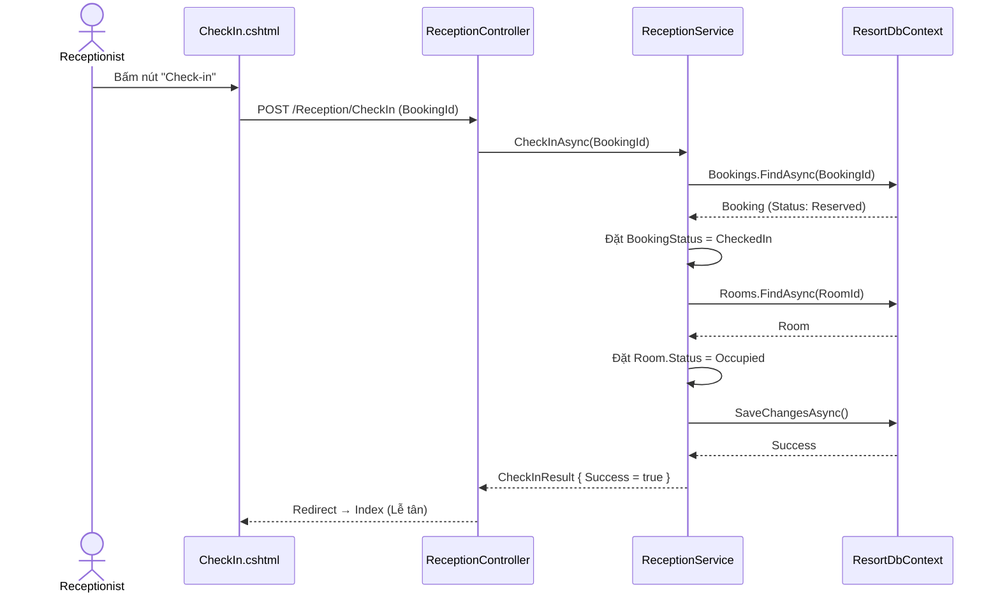
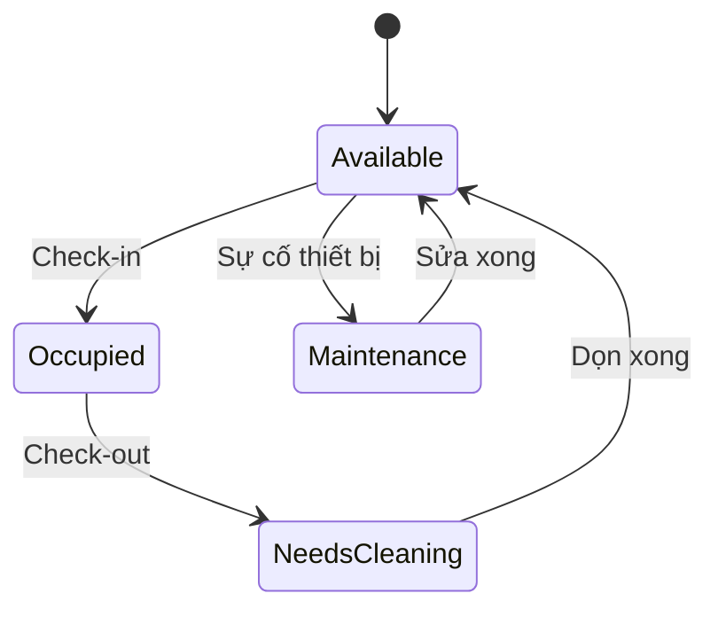

# ENGINEERING DOCUMENTATION STANDARD (EDS) v2.0

Quy chuẩn Tài liệu Kỹ thuật và Đặc tả Hiện thực hóa

| Field          | Value                   |
| -------------- | ----------------------- |
| Document ID    | `SWP391-MOD2-IMP-003` |
| Version        | 1.0                     |
| Date           | 2026-06-16              |
| Status         | Approve                 |
| Document Owner | Cuong                   |
| Author         | Cuong                   |
| Reviewed by    | Khanh                   |
| DPO Sign-off   | Cuong                   |
| Approved by    | Cuong                   |
| Last Review    | 2026-06-16              |
| Based on EDS   | v2.0                    |

## CHANGELOG

**Policy 4.4 — Immutable History**: Không bao giờ xóa thông tin cũ. Mọi thay đổi phải ghi vào bảng này.

| Ngày      | Người thực hiện | Nội dung thay đổi                                                                                               |
| ---------- | ------------------- | ------------------------------------------------------------------------------------------------------------------ |
| 2026-06-16 | Cuong               | Tạo tài liệu lần đầu - EDS cho Use Case Check-in (Reception), bổ sung chi tiết theo mẫu EDS Room Booking. |

## MỤC LỤC

1. Tổng quan Module
2. Ma trận Truy vết (Traceability Matrix)
3. Architecture Decision Records (ADR)
4. Non-Functional Requirements & SLA
5. Static Modeling (Mô hình Tĩnh)
6. Dynamic Modeling (Mô hình Động)
7. Domain Event Catalog
8. Interface Specification (Đặc tả Giao diện)
9. UI & Controller Specification (MVC)
10. Bảng thông báo lỗi (Validation & ModelState)
11. Quy trình Triển khai (Step-by-Step)
12. Rollback & Incident Runbook
13. Kịch bản Kiểm thử Chi tiết
14. Phương pháp Xác minh
15. Mẫu thử thực tế (UI Verification Samples)
16. Bảng tổng hợp phân quyền (Authorization Matrix)

---

## 1. Tổng quan Module

Module này xử lý toàn bộ luồng Check-in tại Lễ tân (Reception) của resort: xác nhận thông tin khách lưu trú, gán phòng vật lý (Assign Room), kiểm tra các quy tắc chống Double Booking, và cập nhật trạng thái phòng. Đây là một phần quan trọng của (CORE 1) theo đặc tả `SWP391-HOS-02` — Module 2: Room Reservation & Front Desk.

| Field                 | Value                                                                                  |
| --------------------- | -------------------------------------------------------------------------------------- |
| Module Name           | `Reception Check-In`                                                                 |
| Bounded Context       | `Front Office / Reception`                                                           |
| Data Classification   | PII / Sensitive-PII (CCCD, Passport, Date of Birth qua BookingGuest)                   |
| Compliance Scope      | NĐ 356/2025 (Bảo vệ dữ liệu cá nhân), Luật Cư trú 2020 (Khai báo tạm trú) |
| Upstream Dependencies | `Room Booking Module`, `Auth Module`                                               |
| Downstream Consumers  | `Housekeeping Module (Room Status)`, `F&B Module (Room Service)`                   |

## 2. Ma trận Truy vết (Traceability Matrix)

| Requirement ID             | Loại (BR/ADR/US) | Mô tả yêu cầu                                                                                | Thành phần Code                                                          | Compliance Target   | ADR liên quan |
| -------------------------- | ----------------- | ------------------------------------------------------------------------------------------------ | -------------------------------------------------------------------------- | ------------------- | -------------- |
| UC53 (SRS) / UC09 (HOS-02) | User Story        | Receptionist thực hiện check-in cho khách                                                     | `ReceptionService.CheckInAsync()`, `ReceptionController.CheckIn()`     | —                  | ADR-001        |
| UC54 (SRS)                 | User Story        | Receptionist gán phòng vật lý (Assign Room)                                                  | `ReceptionService.CheckInAsync()`                                        | —                  | —             |
| UC55 (SRS)                 | User Story        | Lưu trữ và nộp hồ sơ đăng ký lưu trú (Stay Registration)                              | `BookingGuestService`, `ReceptionController.CheckIn()`                 | Luật Cư trú 2020 | ADR-002        |
| BR01 (HOS-02)              | Business Rule     | Strict Concurrency — Phòng vật lý không được gán trùng lịch cho 2 check-in cùng lúc | `ReceptionService.CheckInAsync()` — double check trước khi cập nhật | —                  | —             |

## 3. Architecture Decision Records (ADR)

### ADR-001 — Sử dụng Service Layer cho Luồng Check-in

| Field      | Value             |
| ---------- | ----------------- |
| Status     | Accepted          |
| Deciders   | Architecture Team |
| Date       | 2026-06-16        |
| Supersedes | N/A               |

**Bối cảnh (Context)**
Logic ban đầu nằm trong `ReceptionController`, khiến controller xử lý toàn bộ logic gán phòng, đổi trạng thái phòng và booking, dẫn đến khó bảo trì và viết Unit Test.

**Các phương án đã xem xét (Options Considered)**

| Phương án                     | Mô tả                                  | Ưu điểm                                          | Nhược điểm                                 |
| -------------------------------- | ---------------------------------------- | --------------------------------------------------- | ---------------------------------------------- |
| A (Fat Controller)               | Xử lý trực tiếp trong `Controller` | Code nhanh, ít tạo file                           | Phá vỡ nguyên lý SRP, khó Test, code lặp |
| B (Thin Controller, Fat Service) | Tạo `IReceptionService`               | Code module hóa, tái sử dụng, dễ mock khi Test | Cần cấu hình Dependency Injection           |

**Quyết định (Decision)**
Chọn Phương án B. Tạo `IReceptionService` và `ReceptionService` để xử lý nghiệp vụ Check-in.

**Hệ quả (Consequences)**
Tích cực: Dễ dàng mở rộng luồng Check-in (ví dụ: gửi sự kiện cho dọn phòng, mở khóa phòng tự động).
Tiêu cực: Refactor lại controller cũ.

---

### ADR-002 — Bảo vệ dữ liệu cá nhân (PII) theo Nghị định 356/2025

| Field      | Value                  |
| ---------- | ---------------------- |
| Status     | Proposed               |
| Deciders   | Architecture Team, DPO |
| Date       | 2026-06-16             |
| Supersedes | N/A                    |

**Bối cảnh (Context)**
Bảng `BookingGuests` chứa các thông tin nhạy cảm: `FullName`, `DateOfBirth`, `PassportNumber`. Đây là yêu cầu bắt buộc của Luật Cư trú, nhưng nếu rò rỉ sẽ vi phạm Nghị định bảo vệ dữ liệu.

**Quyết định (Decision)**
Mọi thao tác truy xuất dữ liệu `BookingGuests` không hiển thị ID toàn bộ, và hệ thống cần cơ chế xóa tự động hoặc mã hóa AES các trường này sau khi lưu. Hiện tại, ta sẽ áp dụng cờ đồng ý sử dụng dữ liệu ở Frontend và tránh log các thông tin này ra Console.

## 4. Non-Functional Requirements & SLA

### 4.1. Performance & Availability

| Category     | Requirement           | Target SLA | Measurement Method | Compliance Basis |
| ------------ | --------------------- | ---------- | ------------------ | ---------------- |
| Latency      | Check-in action (p99) | < 500ms    | Load test          | —               |
| Availability | Uptime (monthly)      | 99.9%      | Uptime monitor     | —               |

### 4.2. Data Integrity & Retention

| Category   | Requirement                 | Target  | Verification Method | Compliance Basis |
| ---------- | --------------------------- | ------- | ------------------- | ---------------- |
| Durability | Ghi lại lịch sử Checkout | RPO = 0 | EF Core Transaction | Luật cư trú   |
| Retention  | Lưu trữ PII sau Checkout  | 7 ngày | DB backup policy    | NĐ 356/2025     |

### 4.3. Security

| Category        | Requirement                                   | Target                                | Verification Method       | Compliance Basis |
| --------------- | --------------------------------------------- | ------------------------------------- | ------------------------- | ---------------- |
| CSRF Protection | Tất cả POST form phải có AntiForgeryToken | `[ValidateAntiForgeryToken]`        | Code review + manual test | OWASP A05        |
| Authentication  | Chỉ Receptionist mới thao tác Check-in     | `[Authorize(Roles="Receptionist")]` | Integration test          | —               |

## 5. Static Modeling (Mô hình Tĩnh)

### 5.1. Class Diagram (Mermaid)



### 5.2. Data Structure (EF Core / C# Models)

**Booking Model** — file: `Models/Booking.cs`

```csharp
public class Booking
{
    public int BookingId { get; set; }
    public int RoomId { get; set; }
    public BookingStatus BookingStatus { get; set; } // Sẽ chuyển sang CheckedIn
    //...
}
```

**BookingGuest Model** — file: `Models/BookingGuest.cs`

```csharp
public class BookingGuest
{
    public int BookingGuestId { get; set; }
    public int BookingId { get; set; }
    public string FullName { get; set; }
    public string PassportNumber { get; set; }
    public DateTime DateOfBirth { get; set; }
}
```

## 6. Dynamic Modeling (Mô hình Động)

### 6.1. Sequence Diagram — Happy Path: Check-in Process



### 6.3. State Machine (Room Status)



## 7. Domain Event Catalog

### 7.1. Events Published (Phát ra)

| Event Name         | Trigger                                            | Publisher            | Subscriber(s)                         | Async? |
| ------------------ | -------------------------------------------------- | -------------------- | ------------------------------------- | ------ |
| `GuestCheckedIn` | Check-in thành công (BookingStatus -> CheckedIn) | `ReceptionService` | `HousekeepingModule`, `F&BModule` | No     |

## 8. Interface Specification (Đặc tả Giao diện)

### 8.1. Service Interface — `IReceptionService`

File: `Services/Reception/IReceptionService.cs`

```csharp
// @version 1.0
public interface IReceptionService
{
    /// <summary>
    /// Xử lý check-in: Cập nhật BookingStatus thành CheckedIn và RoomStatus thành Occupied.
    /// Kiểm tra hợp lệ (Booking tồn tại, đang ở Reserved).
    /// </summary>
    /// <param name="bookingId">Mã đặt phòng</param>
    /// <returns>CheckInResult báo lỗi hoặc thành công</returns>
    Task<CheckInResult> CheckInAsync(int bookingId);
}

public class CheckInResult
{
    public bool Success { get; set; }
    public string? ErrorMessage { get; set; }
    public string? ErrorCode { get; set; }
}
```

## 9. UI & Controller Specification (MVC)

### 9.1. Routes & Actions Table

| HTTP Method | Route                       | Controller.Action                        | Required Roles              | Chức năng                        | UC Reference |
| ----------- | --------------------------- | ---------------------------------------- | --------------------------- | ---------------------------------- | ------------ |
| GET         | `/Reception/Index`        | `ReceptionController.Index`            | `Receptionist`, `Admin` | Xem danh sách Booking trong ngày | UC52         |
| GET         | `/Reception/CheckIn/{id}` | `ReceptionController.CheckIn`          | `Receptionist`, `Admin` | Xem chi tiết để CheckIn         | UC51         |
| POST        | `/Reception/CheckIn/{id}` | `ReceptionController.CheckInConfirmed` | `Receptionist`, `Admin` | Xác nhận Check-in                | UC53         |

## 10. Bảng thông báo lỗi (Validation & ModelState)

| Mã lỗi Nội bộ         | Error Code  | Nơi hiển thị       | Câu thông báo (VI)                                 | Điều kiện kích hoạt                  |
| ------------------------- | ----------- | --------------------- | ----------------------------------------------------- | ----------------------------------------- |
| `ERR_BOOKING_NOT_FOUND` | `REC-001` | `TempData["Error"]` | Không tìm thấy booking này.                       | BookingId không tồn tại.               |
| `ERR_INVALID_STATUS`    | `REC-002` | `TempData["Error"]` | Chỉ có thể Check-in với trạng thái Reserved.    | BookingStatus != Reserved.                |
| `ERR_ROOM_NOT_READY`    | `REC-003` | `TempData["Error"]` | Phòng chưa được dọn dẹp hoặc đang bảo trì. | RoomStatus = NeedsCleaning / Maintenance. |

## 11. Quy trình Triển khai (Step-by-Step)

- [X] Tạo interface `IReceptionService` và implement.
- [X] Đăng ký `builder.Services.AddScoped<IReceptionService, ReceptionService>();`
- [X] Gọi service thay cho DbContext bên trong `ReceptionController`.

## 12. Rollback & Incident Runbook

### 12.1. Điều kiện kích hoạt Rollback

| Điều kiện                            | Ngưỡng   | Người quyết định |
| --------------------------------------- | ---------- | --------------------- |
| Check-in bị lỗi Internal Server (500) | ≥ 3 cases | Tech Lead             |

## 13. Kịch bản Kiểm thử Chi tiết

Xem chi tiết trong tài liệu `TDD_CHECKIN.md`.

## 14. Phương pháp Xác minh

### 14.1. Database Inspection

```sql
-- Kiểm tra booking đã chuyển trạng thái chưa
SELECT BookingId, BookingStatus FROM Bookings WHERE BookingId = 123;
-- Expected: 1 (CheckedIn)

-- Kiểm tra phòng đã được gán Occupied chưa
SELECT RoomId, Status FROM Rooms WHERE RoomId = 456;
-- Expected: 1 (Occupied)
```

## 16. Bảng tổng hợp phân quyền (Authorization Matrix)

| Endpoint                     | GUEST | CUSTOMER | RECEPTIONIST | ADMIN |
| ---------------------------- | ----- | -------- | ------------ | ----- |
| GET `/Reception/Index`     | ❌    | ❌       | ✅           | ✅    |
| POST `/Reception/CheckIn`  | ❌    | ❌       | ✅           | ✅    |
| POST `/Reception/CheckOut` | ❌    | ❌       | ✅           | ✅    |
