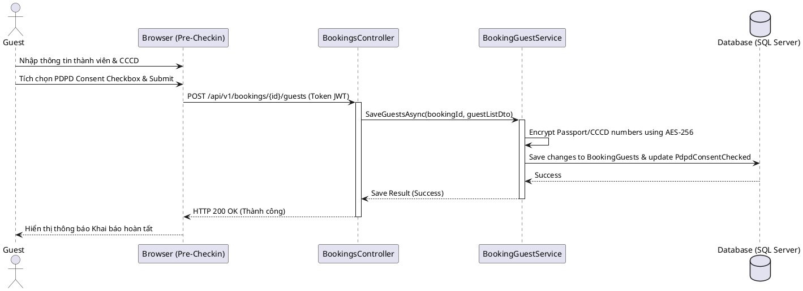

# ENGINEERING DOCUMENTATION STANDARD (EDS) v2.0

Quy chuẩn Tài liệu Kỹ thuật và Đặc tả Hiện thực hóa — Pre-Checkin & Stay Registration

| Field          | Value                       |
| -------------- | --------------------------- |
| Document ID    | `SWP391-MOD2-IMP-003`     |
| Version        | 1.0                         |
| Date           | 2026-06-14                  |
| Status         | Approve                     |
| Document Owner | Cuong                       |
| Author         | Cuong - Lead Developer / BA |
| Reviewed by    | Khanh                       |
| DPO Sign-off   | Khanh                       |
| Approved by    | Cuong                       |
| Last Review    | 2026-06-14                  |
| Based on EDS   | v2.0                        |

## CHANGELOG

**Policy 4.4 — Immutable History**: Không bao giờ xóa thông tin cũ. Mọi thay đổi phải ghi vào bảng này.

| Ngày      | Người thực hiện | Nội dung thay đổi                                                 |
| ---------- | ------------------- | -------------------------------------------------------------------- |
| 2026-06-14 | Cuong               | Tạo tài liệu lần đầu - EDS cho Pre-Checkin & Stay Registration |

---

## 1. Tổng quan Module

Mô tả mục đích: Module này chịu trách nhiệm thu thập, lưu trữ thông tin nhận dạng cá nhân (Họ tên, Ngày sinh, CCCD/Passport, Quốc tịch, Giới tính) của các thành viên tham gia chuyến đi nhằm phục vụ mục đích khai báo tạm trú trực tuyến và tối ưu hóa thời gian check-in trực tiếp tại quầy lễ tân, đồng thời tuân thủ các quy định về bảo vệ dữ liệu cá nhân của Nghị định 356/2025/NĐ-CP.

| Field                 | Value                                                            |
| --------------------- | ---------------------------------------------------------------- |
| Module Name           | `Pre-Checkin & Guest Registration`                             |
| Bounded Context       | `Room Reservation & Front Desk`                                |
| Data Classification   | Sensitive-PII (CCCD, Passport, Ngày sinh)                       |
| Compliance Scope      | Nghị định 356/2025/NĐ-CP (PDPD), Luật Cư trú 2020         |
| Upstream Dependencies | `Room Reservation (Module 2)`                                  |
| Downstream Consumers  | `Receptionist Check-in portal`, `Stay Registration Reporter` |

---

## 2. Ma trận Truy vết (Traceability Matrix)

| Requirement ID | Loại         | Mô tả yêu cầu                                         | Thành phần Code              | Compliance Target                           | ADR liên quan |
| -------------- | ------------- | --------------------------------------------------------- | ------------------------------ | ------------------------------------------- | -------------- |
| UC17 (NHOM1)   | User Story    | Khách hàng cập nhật CCCD/Passport                     | `BookingGuest` model         | Luật Cư trú 2020                         | ADR-003        |
| UC55 (NHOM1)   | User Story    | Lễ tân gửi thông tin tạm trú                        | `StayRegistrationService`    | Luật Cư trú 2020                         | —             |
| BR-PDPD-001    | Business Rule | Khách hàng phải đồng ý xử lý dữ liệu nhạy cảm | `Booking.PdpdConsentChecked` | NĐ 356/2025 Điều 9                       | ADR-003        |
| BR-PDPD-002    | Business Rule | Tự động xóa thông tin CCCD sau checkout 7 ngày      | `PdpdDataPurgeJob`           | NĐ 356/2025 Điều 5 (Quyền được xóa) | —             |

---

## 3. Architecture Decision Records (ADR)

### ADR-003 — Chiến lược thu thập thông tin CCCD (Pre-Checkin vs Checkout)

| Field    | Value               |
| -------- | ------------------- |
| Status   | Accepted            |
| Deciders | Cuong (Lead Dev/BA) |
| Date     | 2026-06-14          |

**Bối cảnh (Context)**
Việc khai báo tạm trú yêu cầu thông tin CCCD của mọi thành viên. Tuy nhiên, nếu bắt buộc nhập thông tin CCCD của tất cả khách đi cùng tại trang Checkout (lúc thanh toán cọc), sẽ tạo ra lực cản rất lớn (Friction), làm giảm tỷ lệ đặt phòng thành công (khách hàng thường không nhớ số CCCD của bạn bè/người thân khi đang thanh toán).

**Các phương án đã xem xét (Options Considered)**

- **Phương án A**: Bắt buộc nhập đầy đủ thông tin tất cả khách đi cùng tại trang Checkout mới cho thanh toán.
- **Phương án B**: Chỉ bắt buộc thông tin người đặt phòng chính tại Checkout. Cho phép khai báo thông tin các thành viên còn lại thông qua trang Pre-Checkin (truy cập bằng link gửi qua Email/SMS sau khi booking thành công).

**Quyết định (Decision)**
Chọn **Phương án B** để bảo toàn tỷ lệ chuyển đổi đơn hàng và tối ưu hóa luồng UX. Trang đặt phòng sẽ tinh giản tối đa, và trang Pre-Checkin sẽ là nơi khách hàng hoàn tất thông tin cá nhân của đoàn trước khi đến nhận phòng.

**Hệ quả (Consequences)**

- Tích cực: Đơn giản hóa trang Checkout; tăng tốc thanh toán; cải thiện UX.
- Tiêu cực: Lễ tân có thể phải nhập tay trực tiếp tại quầy đối với các booking khách hàng quên khai báo trước trực tuyến.
- Compliance Impact: Đảm bảo thu thập được Consent rõ ràng của người dùng trước khi họ cung cấp các thông tin nhạy cảm.

---

## 4. Non-Functional Requirements & SLA

### 4.1. Performance & Availability

- **Latency**: API cập nhật thông tin thành viên (`POST /api/v1/bookings/{id}/guests`) phải hoàn tất trong `< 200ms`.
- **Availability**: Trang Pre-Checkin phải có Uptime `99.9%` để khách khai báo bất kỳ lúc nào.

### 4.2. Data Integrity & Retention

- **Retention (Thời gian lưu giữ)**: Số CCCD/Passport và Ngày sinh của thành viên đi kèm phải được xóa bỏ vĩnh viễn (Purged) khỏi database sau **7 ngày** kể từ khi Booking chuyển sang trạng thái `CheckedOut`. Chỉ giữ lại Họ tên để phục vụ thống kê lịch sử lưu trú của phòng. (Tuân thủ Quyền được xóa - NĐ 356/2025).

### 4.3. Security

- **Mã hóa lưu trữ (Encryption at rest)**: Toàn bộ số CCCD/Passport của khách hàng khi lưu vào SQL Server phải được mã hóa bằng thuật toán `AES-256` sử dụng cơ chế Data Protection của ASP.NET Core. Không được lưu plaintext.
- **Bảo mật truy cập**: Link Pre-Checkin gửi qua email sử dụng mã Token dạng JWT có thời hạn hết hạn (Expiration) trùng với ngày Check-in để tránh rò rỉ dữ liệu qua email cũ.

---

## 5. Static Modeling (Mô hình Tĩnh)

### 5.1. Class Model (C#)

```csharp
namespace PhucNguyenResort.Models;

public class Booking
{
    public int BookingId { get; set; }
    public int RoomId { get; set; }
    public int UserId { get; set; }
    public DateTime CheckInDate { get; set; }
    public DateTime CheckOutDate { get; set; }
    public int NumberOfAdults { get; set; }
    public int NumberOfChildren { get; set; }
    public decimal TotalAmount { get; set; }
    public decimal DepositAmount { get; set; }
    public BookingStatus BookingStatus { get; set; }
  
    // Thuộc tính PDPD mới
    public bool PdpdConsentChecked { get; set; }
    public DateTime? ConsentTimestamp { get; set; }
  
    // Relationship
    public ICollection<BookingGuest> BookingGuests { get; set; } = new List<BookingGuest>();
}

public class BookingGuest
{
    public int BookingGuestId { get; set; }
    public int BookingId { get; set; }
  
    [Required]
    [StringLength(100)]
    public string FullName { get; set; }
  
    public DateTime? DateOfBirth { get; set; }
  
    public GenderType? Gender { get; set; } // Enum: Male = 0, Female = 1, Other = 2
  
    [StringLength(100)]
    public string PassportNumber { get; set; } // Sẽ được mã hóa AES-256 khi lưu trữ
  
    [StringLength(50)]
    public string Nationality { get; set; }
  
    public bool IsPrimaryBooker { get; set; }
  
    // Navigation Property
    public Booking Booking { get; set; }
}
```

---

## 6. Dynamic Modeling (Mô hình Động)

### 6.1. Sequence Diagram - Submit Pre-Checkin Guests (Happy Path)



---

## 7. Domain Event Catalog

### 7.1. Events Published

| Event Name                     | Trigger                           | Publisher               | Subscriber(s)                                     | Payload Schema                      | Async? |
| ------------------------------ | --------------------------------- | ----------------------- | ------------------------------------------------- | ----------------------------------- | ------ |
| `GuestRegistrationSubmitted` | Khách khai báo thành công     | `BookingGuestService` | `StayRegistrationService` (chuẩn bị tờ khai) | `GuestRegistrationSubmittedEvent` | Yes    |
| `PdpdDataPurged`             | Cron job xóa thông tin CCCD cũ | `PdpdDataPurgeJob`    | `SystemLogger` (ghi log hệ thống)             | `PdpdDataPurgedEvent`             | Yes    |

---

## 8. Interface Specification (Đặc tả Giao diện Service)

### 8.1. Service Interface (C#)

```csharp
namespace PhucNguyenResort.Services.Bookings;

public interface IBookingGuestService
{
    /// <summary>
    /// Lưu danh sách khách đi cùng cho một Booking sau khi xác thực sự đồng ý PDPD
    /// </summary>
    /// <throws>REG-001</throws>
    Task<bool> SaveBookingGuestsAsync(int bookingId, IEnumerable<BookingGuestDto> guests, bool consentChecked);

    /// <summary>
    /// Lấy danh sách khách đã được giải mã CCCD phục vụ Lễ tân check-in
    /// </summary>
    Task<IEnumerable<BookingGuestDto>> GetBookingGuestsForCheckInAsync(int bookingId);

    /// <summary>
    /// Xóa bỏ dữ liệu CCCD/Passport của các booking đã checkout quá 7 ngày
    /// </summary>
    Task<int> PurgeExpiredPiiDataAsync();
}
```

---

## 9. API Specification

### 9.1. Endpoints Table

| Method | Path                            | Auth Level       | Required Roles           | Rate Limit | Idempotent? |
| ------ | ------------------------------- | ---------------- | ------------------------ | ---------- | ----------- |
| POST   | `/api/v1/bookings/:id/guests` | JWT token (link) | Guest / Customer / Staff | 30/min     | Yes         |
| GET    | `/api/v1/bookings/:id/guests` | JWT              | Receptionist / Customer  | 100/min    | Yes         |

### 9.2. Request / Response Sample

**POST `/api/v1/bookings/15/guests`**
Request Body:

```json
{
  "pdpdConsentChecked": true,
  "guests": [
    {
      "fullName": "Nguyen Van A",
      "dateOfBirth": "1990-05-15",
      "gender": 0,
      "passportNumber": "012345678901",
      "nationality": "Vietnam",
      "isPrimaryBooker": true
    },
    {
      "fullName": "Nguyen Thi B",
      "dateOfBirth": "1995-10-20",
      "gender": 1,
      "passportNumber": "012345678902",
      "nationality": "Vietnam",
      "isPrimaryBooker": false
    }
  ]
}
```

Response - 200 OK:

```json
{
  "success": true,
  "message": "Cập nhật danh sách khách lưu trú thành công."
}
```

---

## 10. Bảng mã lỗi (Error Codes)

| Code        | HTTP Status | Message (EN)                      | Message (VI)                                               | Trigger Condition                                                |
| ----------- | ----------- | --------------------------------- | ---------------------------------------------------------- | ---------------------------------------------------------------- |
| `REG-001` | 400         | PDPD consent is required          | Bạn phải đồng ý điều khoản bảo mật dữ liệu     | Chưa tích chọn PDPD consent khi gửi CCCD                     |
| `REG-002` | 400         | Guest count exceeds booking limit | Số lượng khách khai báo vượt quá số lượng đặt | Số lượng bản ghi gửi lên lớn hơn số khách của booking |
| `REG-003` | 404         | Booking not found                 | Không tìm thấy mã đặt phòng                         | ID booking không tồn tại                                      |

---

## 11. Quy trình Triển khai (Step-by-Step)

1. **Database Migration**:
   - Thêm cột `PdpdConsentChecked` (bool) và `ConsentTimestamp` (DateTime) vào bảng `Bookings`.
   - Thêm cột `Gender` (int) và `IsPrimaryBooker` (bool) vào bảng `BookingGuests`.
2. **Cài đặt thư viện mã hóa**:
   - Sử dụng `Microsoft.AspNetCore.DataProtection` để mã hóa cột `PassportNumber` trước khi lưu vào database.
3. **Cập nhật views & controller**:
   - Sửa `BookingsController.cs` và views tương ứng.

---

## 12. Rollback Plan

```powershell
# Revert Database migration
dotnet ef database update [PreviousMigrationName]
dotnet ef migrations remove
```

---

## 13. Kịch bản Kiểm thử Chi tiết

(Xem kịch bản chi tiết trong file `TDD_PreCheckinRegistration.md`)

---

## 14. Phương pháp Xác minh

### 14.1. Database Encryption Inspection

```sql
-- Kiểm tra xem số CCCD đã được mã hóa chưa (phải hiển thị chuỗi Hex/Base64 mã hóa, không phải plaintext)
SELECT BookingGuestId, FullName, PassportNumber FROM BookingGuests WHERE BookingId = 15;
```

---

## 16. Bảng tổng hợp phân quyền (Authorization Matrix)

| Endpoint                             | GUEST (Link Token) | CUSTOMER (Booker) | RECEPTIONIST | ADMIN  |
| ------------------------------------ | ------------------ | ----------------- | ------------ | ------ |
| POST `/api/v1/bookings/:id/guests` | ✅                 | ✅ Own            | ✅ All       | ❌     |
| GET `/api/v1/bookings/:id/guests`  | ❌                 | ✅ Own            | ✅ All       | ✅ All |

---

*Bản quyền tài liệu kỹ thuật thuộc về Phúc Nguyên Resort & Tour Hub.*
