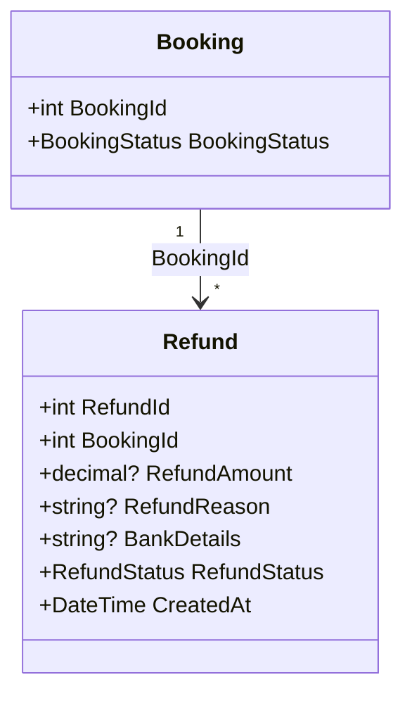
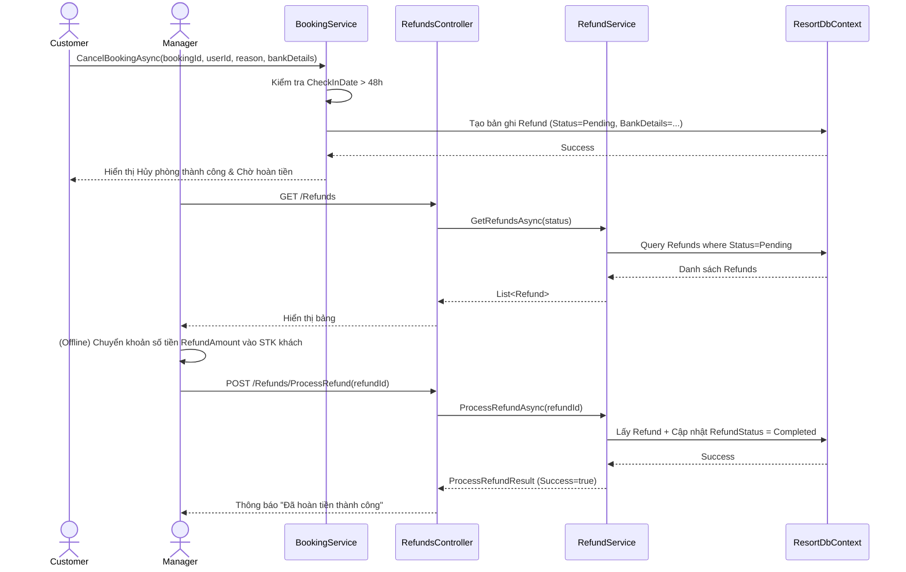

# ENGINEERING DOCUMENTATION STANDARD (EDS) v2.0

Quy chuẩn Tài liệu Kỹ thuật và Đặc tả Hiện thực hóa

| Field          | Value                   |
| -------------- | ----------------------- |
| Document ID    | `SWP391-MOD3-IMP-001` |
| Version        | 1.0                     |
| Date           | 2026-06-15              |
| Status         | Approve                 |
| Document Owner | Cuong                   |
| Author         | Cuong                   |
| Reviewed by    | Khanh                   |
| DPO Sign-off   | Khanh                   |
| Approved by    | Cuong                   |
| Last Review    | 2026-06-15              |
| Based on EDS   | v2.0                    |

## CHANGELOG

**Policy 4.4 — Immutable History**: Không bao giờ xóa thông tin cũ. Mọi thay đổi phải ghi vào bảng này.

| Ngày      | Người thực hiện | Nội dung thay đổi                                                                                                                                                                                                      |
| ---------- | ------------------- | ------------------------------------------------------------------------------------------------------------------------------------------------------------------------------------------------------------------------- |
| 2026-06-15 | Cuong               | Tạo tài liệu lần đầu - EDS cho Use Case Hoàn tiền (Refund Management)                                                                                                                                                 |

## MỤC LỤC

1. Tổng quan Module
2. Ma trận Truy vết (Traceability Matrix)
3. Architecture Decision Records (ADR)
4. Static Modeling (Mô hình Tĩnh)
5. Dynamic Modeling (Mô hình Động)
6. Domain Event Catalog
7. UI & Controller Specification (MVC)
8. Kịch bản Kiểm thử Chi tiết

---

## 1. Tổng quan Module

Module này xử lý luồng hoàn trả tiền phòng cho khách hàng (Customer) sau khi khách hủy phòng. Nó tách biệt với logic tạo booking và phục vụ cho đối tượng Manager/Admin để tiến hành xử lý hoàn tiền thủ công.
Đây là module mở rộng của Đặc tả `SWP391-HOS-02` (Room Reservation & Front Desk) nhằm đảm bảo BR03.

| Field                 | Value                                                                                                                                    |
| --------------------- | ---------------------------------------------------------------------------------------------------------------------------------------- |
| Module Name           | `Refund Management`                                                                                                        |
| Bounded Context       | `Room Booking / Reservation`                                                                                                           |
| Data Classification   | Sensitive-PII (Thông tin Tài khoản ngân hàng, Bank Details)                                                                                    |
| Compliance Scope      | Luật Du lịch 2017 (Chính sách hoàn tiền)                                              |
| Upstream Dependencies | `Booking Module` (Cancel Booking)              |
| Downstream Consumers  | None |

## 2. Ma trận Truy vết (Traceability Matrix)

| Requirement ID             | Loại (BR/ADR/US) | Mô tả yêu cầu                                                                                      | Thành phần Code                                                                                                            | Compliance Target   | ADR liên quan   |
| -------------------------- | ----------------- | ------------------------------------------------------------------------------------------------------ | ---------------------------------------------------------------------------------------------------------------------------- | ------------------- | ---------------- |
| BR03 (HOS-02)              | Business Rule     | Cancellation Policy: Hoàn 100% cọc nếu hủy trước check-in > 48h (Tạo Refund Pending) | `BookingService.CancelBookingAsync()`                                                 | Luật Du lịch 2017 | ADR-003               |
| UC-REF-01                  | User Story        | Manager xem danh sách các yêu cầu Hoàn tiền đang chờ xử lý                  | `RefundsController.Index()`, `RefundService.GetRefundsAsync()`                         | —                  | —          |
| UC-REF-02                  | User Story        | Manager đánh dấu yêu cầu Hoàn tiền là đã hoàn tất sau khi chuyển khoản thành công                 | `RefundsController.ProcessRefund()`, `RefundService.ProcessRefundAsync()`                         | —                  | ADR-003          |

## 3. Architecture Decision Records (ADR)

### ADR-003 — Luồng Hoàn tiền (Refund) thủ công thay vì tự động qua Payment Gateway

| Field      | Value             |
| ---------- | ----------------- |
| Status     | Accepted          |
| Deciders   | Architecture Team |
| Date       | 2026-06-15        |

**Bối cảnh (Context)**
Hệ thống cần cung cấp phương thức hoàn lại 100% cọc cho khách hàng nếu họ hủy phòng sớm hơn 48h. Việc hoàn tiền có thể làm hoàn toàn tự động qua cổng thanh toán (Payment Gateway) hoặc làm thủ công.

**Các phương án đã xem xét (Options Considered)**

| Phương án                                  | Mô tả                                | Ưu điểm                                              | Nhược điểm                                  |
| --------------------------------------------- | -------------------------------------- | ------------------------------------------------------- | ----------------------------------------------- |
| A (Hoàn tiền thủ công) | Hệ thống sinh ra 1 phiếu `Refund` trạng thái `Pending`. Quản lý xem thông tin và chuyển khoản ngoài đời thật, sau đó xác nhận trên hệ thống. | Triển khai nhanh, kiểm soát chặt chẽ luồng tiền, dễ test. | Tốn công sức quản lý thủ công. |
| B (Hoàn tiền tự động qua API)                      | Gọi API tới cổng thanh toán VNPay/Stripe để hoàn tiền tự động khi Customer bấm nút Hủy. | Khách hàng nhận tiền ngay, không tốn nhân lực. | Rủi ro bảo mật, tích hợp API phức tạp, khó verify qua môi trường sandbox. |

**Quyết định (Decision)**
Chọn Phương án A (Hoàn tiền thủ công) do tính chất dự án học thuật và an toàn tài chính. Khách hàng sẽ phải nhập `BankDetails` của họ khi yêu cầu hủy phòng để resort tiến hành chuyển khoản.

## 4. Static Modeling (Mô hình Tĩnh)

### 4.1. Class Diagram (Mermaid)



### 4.2. Data Structure (EF Core / C# Models)

**Refund Model** — file: `Models/Refund.cs`

```csharp
public class Refund
{
    public int RefundId { get; set; }
    public int BookingId { get; set; }
    
    [Column(TypeName = "decimal(18,2)")]
    public decimal? RefundAmount { get; set; }
    
    [StringLength(500)]
    public string? RefundReason { get; set; }
    
    [StringLength(200)]
    public string? BankDetails { get; set; }

    public RefundStatus RefundStatus { get; set; }
    public DateTime CreatedAt { get; set; } = DateTime.Now;

    public Booking? Booking { get; set; }
}
```

**RefundStatus Enum** — file: `Enums/RefundStatus.cs`

```csharp
public enum RefundStatus
{
    Pending,
    Completed,
    Failed
}
```

## 5. Dynamic Modeling (Mô hình Động)

### 5.1. Sequence Diagram — Refund Lifecycle



## 6. Domain Event Catalog

### 6.1. Events Consumed (Tiêu thụ)

| Event Name            | Source              | Handler               | Action thực hiện                                                                             |
| --------------------- | ------------------- | --------------------- | ---------------------------------------------------------------------------------------------- |
| `BookingCancelled`  | `BookingService`  | `BookingService`    | Nếu `RefundAmount > 0`, tạo ngay 1 bản ghi `Refund` (RefundStatus = Pending) vào DbContext và lưu trữ. |

## 7. UI & Controller Specification (MVC)

### 7.1. Routes & Actions Table

| HTTP Method | Route                           | Controller.Action                        | Required Roles                 | Chức năng                                     | UC Reference |
| ----------- | ------------------------------- | ---------------------------------------- | ------------------------------ | ----------------------------------------------- | ------------ |
| GET         | `/Refunds`                      | `RefundsController.Index`              | `Manager, Admin`           | Xem danh sách tất cả các yêu cầu Hoàn tiền | UC-REF-01    |
| POST        | `/Refunds/ProcessRefund/{id}`   | `RefundsController.ProcessRefund`      | `Manager, Admin`           | Cập nhật trạng thái phiếu Hoàn tiền thành Completed | UC-REF-02    |

## 8. Kịch bản Kiểm thử Chi tiết

**Policy (EDS v2.0 — Test Data)**: Mọi test scenario dùng `Test Data Classification = SYNTHETIC`.

### 8.1. Unit Tests

**TC-REF-001 — Khách hàng hủy phòng sinh ra Refund Pending**

```gherkin
Feature: Refund Management
  Background:
    Given Booking ID=10 có CheckInDate > 48h

  Scenario: Tạo phiếu yêu cầu hoàn tiền khi khách hủy phòng
    When Customer gọi CancelBookingAsync(10, userId, "Bận", "VCB-12345")
    Then 1 bản ghi Refund được sinh ra
    And RefundStatus = Pending
    And BankDetails = "VCB-12345"
```

**TC-REF-002 — Manager duyệt hoàn tiền thành công**

```gherkin
  Scenario: Manager đánh dấu đã chuyển khoản thành công
    Given Có 1 bản ghi Refund ID=5 với RefundStatus = Pending
    When Manager gọi POST /Refunds/ProcessRefund/5
    Then RefundStatus của ID=5 được chuyển thành Completed
```
