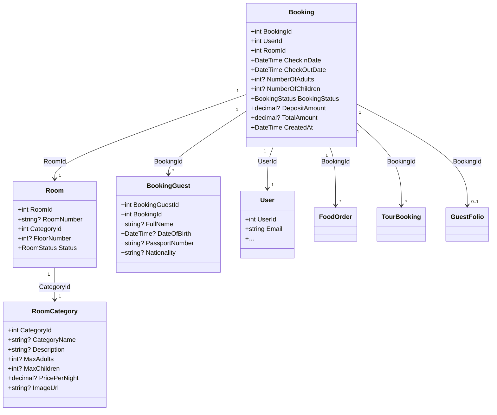
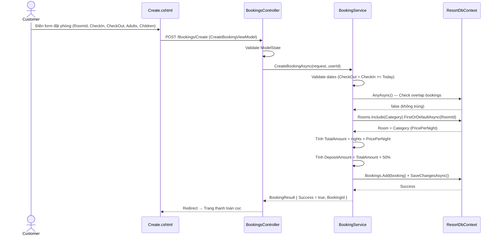
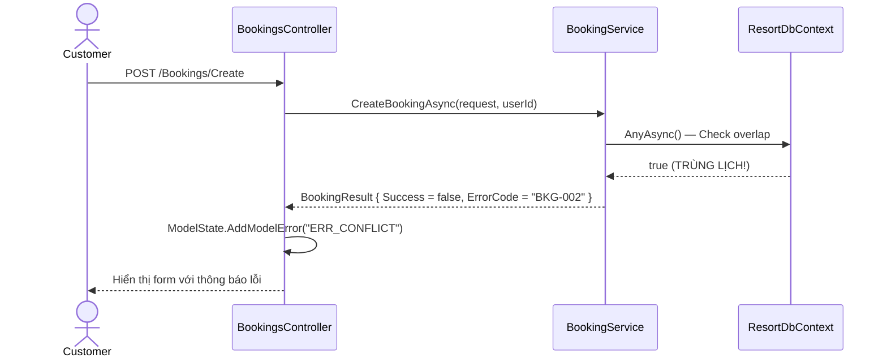
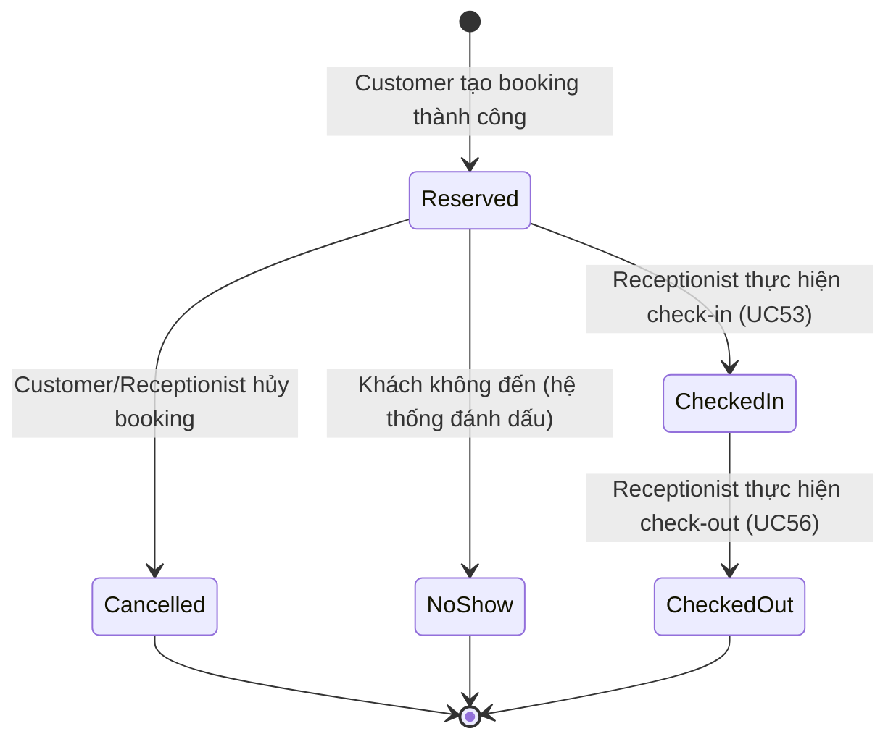

# ENGINEERING DOCUMENTATION STANDARD (EDS) v2.0

Quy chuẩn Tài liệu Kỹ thuật và Đặc tả Hiện thực hóa

| Field          | Value                   |
| -------------- | ----------------------- |
| Document ID    | `SWP391-MOD2-IMP-002` |
| Version        | 1.1                     |
| Date           | 2026-06-13              |
| Status         | Approve                 |
| Document Owner | Cuong                   |
| Author         | Cuong                   |
| Reviewed by    | Khanh                   |
| DPO Sign-off   | [ ] Pending             |
| Approved by    | Cuong                   |
| Last Review    | 2026-06-13              |
| Based on EDS   | v2.0                    |

## CHANGELOG

**Policy 4.4 — Immutable History**: Không bao giờ xóa thông tin cũ. Mọi thay đổi phải ghi vào bảng này.

| Ngày      | Người thực hiện | Nội dung thay đổi                                                                                                                                                                                                      |
| ---------- | ------------------- | ------------------------------------------------------------------------------------------------------------------------------------------------------------------------------------------------------------------------- |
| 2026-06-12 | AI Assistant        | Tạo tài liệu lần đầu - EDS cho Use Case Đặt Phòng (Room Booking)                                                                                                                                                 |
| 2026-06-13 | AI BA Review        | Chỉnh sửa toàn bộ để khớp với codebase thực tế (v1.1): cập nhật BookingStatus enum, Booking model, IBookingService interface, CreateBookingViewModel, bổ sung đầy đủ các section theo EDS Template v2.0 |

## MỤC LỤC

1. Tổng quan Module
2. Ma trận Truy vết (Traceability Matrix)
3. Architecture Decision Records (ADR)
4. Non-Functional Requirements & SLA
5. Static Modeling (Mô hình Tĩnh)
6. Dynamic Modeling (Mô hình Động)
7. Domain Event Catalog
8. Interface Specification (Đặc tả Giao diện)
9. UI & Controller Specification (MVC)
10. Bảng thông báo lỗi (Validation & ModelState)
11. Quy trình Triển khai (Step-by-Step)
12. Rollback & Incident Runbook
13. Kịch bản Kiểm thử Chi tiết
14. Phương pháp Xác minh
15. Mẫu thử thực tế (UI Verification Samples)
16. Bảng tổng hợp phân quyền (Authorization Matrix)

---

## 1. Tổng quan Module

Module này xử lý toàn bộ luồng đặt phòng resort của khách hàng (Customer): từ tìm kiếm phòng trống, đặt phòng, thanh toán cọc, đến hủy phòng. Module cũng hỗ trợ tính năng Add-on đặt Tour kèm khi booking phòng. Đây là module cốt lõi (CORE 1) theo đặc tả `SWP391-HOS-02` — Module 2: Room Reservation & Front Desk.

| Field                 | Value                                                                                                                                    |
| --------------------- | ---------------------------------------------------------------------------------------------------------------------------------------- |
| Module Name           | `Room Reservation & Front Desk`                                                                                                        |
| Bounded Context       | `Room Booking / Reservation`                                                                                                           |
| Data Classification   | PII / Sensitive-PII (CCCD, Passport qua BookingGuest)                                                                                    |
| Compliance Scope      | NĐ 356/2025 (Bảo vệ dữ liệu cá nhân), Luật Du lịch 2017 (Chính sách hoàn tiền)                                              |
| Upstream Dependencies | `Auth Module (Users, Roles)`, `Room Management Module (Rooms, RoomCategories)`, `Tours Module (TourSchedules, Tours)`              |
| Downstream Consumers  | `Consolidated Billing Module (GuestFolio, Invoice)`, `F&B Module (FoodOrders → Booking)`, `Tour Module (TourBookings → Booking)` |

## 2. Ma trận Truy vết (Traceability Matrix)

| Requirement ID             | Loại (BR/ADR/US) | Mô tả yêu cầu                                                                               | Thành phần Code                                                                                                            | Compliance Target   | ADR liên quan   |
| -------------------------- | ----------------- | ----------------------------------------------------------------------------------------------- | ---------------------------------------------------------------------------------------------------------------------------- | ------------------- | ---------------- |
| UC22 (SRS) / UC07 (HOS-02) | User Story        | Customer đặt phòng và thanh toán cọc an toàn                                             | `BookingService.CreateBookingAsync()`, `BookingsController.Create()`                                                     | NĐ 356/2025        | ADR-001, ADR-002 |
| UC04 (SRS) / UC06 (HOS-02) | User Story        | Guest tìm kiếm phòng theo ngày, số khách, loại phòng                                    | `HomeService.CheckAvailabilityAsync()`, `HomeService.SearchAvailableCategoriesAsync()`, `HomeController.SearchRooms()` | —                  | —               |
| UC06 (SRS)                 | User Story        | Guest xem chi tiết phòng                                                                      | `HomeService.GetRoomDetailsAsync()`, `HomeController.RoomDetails()`                                                      | —                  | —               |
| UC28 (SRS)                 | User Story        | Customer xem lịch sử đặt phòng                                                             | `BookingsController.MyBookings()`                                                                                          | —                  | —               |
| UC59 (SRS) / UC10 (HOS-02) | User Story        | Receptionist cập nhật trạng thái vận hành phòng                                          | `RoomsController.Edit()`, `RoomService.UpdateRoomAsync()`                                                                | —                  | —               |
| BR01 (HOS-02)              | Business Rule     | Strict Concurrency — Phòng không được đặt trùng cho cùng khoảng thời gian           | `BookingService.CreateBookingAsync()` — overlap check + `DbUpdateConcurrencyException` handling                         | —                  | ADR-002          |
| BR03 (HOS-02)              | Business Rule     | Cancellation Policy: Hoàn 100% cọc nếu hủy trước check-in > 48h, không hoàn nếu ≤ 48h | `BookingService.CancelBookingAsync()`                                                                                      | Luật Du lịch 2017 | —               |
| BR02 (HOS-02)              | Business Rule     | Guest không thể checkout nếu còn chi phí chưa thanh toán (food, tour)                    | `Downstream — Consolidated Billing Module`                                                                                | —                  | —               |

## 3. Architecture Decision Records (ADR)

### ADR-001 — Kiến trúc MVC .NET 8 với EF Core cho PhucNguyen Resort

| Field      | Value             |
| ---------- | ----------------- |
| Status     | Accepted          |
| Deciders   | Architecture Team |
| Date       | 2026-06-10        |
| Supersedes | N/A               |

**Bối cảnh (Context)**
Dự án cần xây dựng hệ thống web quản lý resort tích hợp (Hotel, F&B, Tour). Cần chọn technology stack phù hợp cho team sinh viên trong khuôn khổ SWP391.

**Các phương án đã xem xét (Options Considered)**

| Phương án                                  | Mô tả                                | Ưu điểm                                              | Nhược điểm                                  |
| --------------------------------------------- | -------------------------------------- | ------------------------------------------------------- | ----------------------------------------------- |
| A (ASP.NET MVC .NET 8 + EF Core + SQL Server) | Server-side rendering với Razor Views | Team quen thuộc, tài liệu nhiều, deploy đơn giản | Không có API riêng cho mobile                |
| B (React + .NET Web API)                      | SPA frontend + REST API backend        | Modern, tách biệt FE/BE                               | Phức tạp hơn cho team, deployment phức tạp |

**Quyết định (Decision)**
Chọn Phương án A vì phù hợp với trình độ team và thời hạn của dự án SWP391.

**Hệ quả (Consequences)**
Tích cực:

- Đơn giản hóa quá trình phát triển, 1 codebase duy nhất
- Sử dụng Data Annotations, ModelState validation native

Tiêu cực / Trade-offs:

- Không có API riêng cho ứng dụng mobile — chấp nhận được vì scope hiện tại chỉ cần web

---

### ADR-002 — Chiến lược xử lý Concurrency cho Đặt phòng

| Field      | Value             |
| ---------- | ----------------- |
| Status     | Accepted          |
| Deciders   | Architecture Team |
| Date       | 2026-06-12        |
| Supersedes | N/A               |

**Bối cảnh (Context)**
Hệ thống cần đảm bảo quy tắc BR01 (Double-Booking Prevention) để một phòng cụ thể không bị đặt trùng bởi 2 khách hàng cho cùng một khoảng thời gian. Đây là yêu cầu nghiệp vụ cốt lõi của bất kỳ hệ thống khách sạn nào.

**Các phương án đã xem xét (Options Considered)**

| Phương án                                        | Mô tả                                                                                           | Ưu điểm                                         | Nhược điểm                                                               |
| --------------------------------------------------- | ------------------------------------------------------------------------------------------------- | -------------------------------------------------- | ---------------------------------------------------------------------------- |
| A (Pessimistic Locking)                             | Lock table hoặc row bằng `UPDLOCK` SQL Server                                                 | Ngăn chặn triệt để conflict từ DB            | Gây nghẽn hệ thống, giảm performance khi tải cao                       |
| B (Application-level Check + DB Exception Handling) | Check overlap bằng LINQ query trước khi insert, bắt `DbUpdateConcurrencyException` khi save | Không bị lock, performance tốt, logic rõ ràng | Race condition vẫn có thể xảy ra giữa check và save (window rất nhỏ) |

**Quyết định (Decision)**
Chọn Phương án B: Application-level overlap check + catch `DbUpdateConcurrencyException`. Logic kiểm tra overlap: `b.CheckInDate < request.CheckOutDate && b.CheckOutDate > request.CheckInDate` và loại trừ các booking có status `Cancelled` hoặc `CheckedOut`.

**Hệ quả (Consequences)**
Tích cực:

- Performance tốt hơn trong đa số trường hợp (khi không có conflict)
- Code dễ hiểu, logic overlap tường minh

Tiêu cực / Trade-offs:

- Trong trường hợp cực kỳ hiếm (2 request chính xác cùng lúc vượt qua check), `DbUpdateConcurrencyException` sẽ được bắt và trả lỗi cho user — chấp nhận được

## 4. Non-Functional Requirements & SLA

### 4.1. Performance & Availability

| Category     | Requirement                   | Target SLA | Measurement Method        | Compliance Basis |
| ------------ | ----------------------------- | ---------- | ------------------------- | ---------------- |
| Latency      | Booking creation action (p99) | < 500ms    | Manual timing / Load test | —               |
| Latency      | Room search (p99)             | < 300ms    | Manual timing             | —               |
| Availability | Uptime (monthly)              | 99.9%      | Uptime monitor            | —               |
| Concurrency  | Simultaneous booking requests | 200 req/s  | Load test                 | —               |

### 4.2. Data Integrity & Retention

| Category   | Requirement                 | Target                           | Verification Method | Compliance Basis |
| ---------- | --------------------------- | -------------------------------- | ------------------- | ---------------- |
| Durability | Không mất record booking  | RPO = 0                          | EF Core Transaction | —               |
| Retention  | Lưu trữ lịch sử booking | Vĩnh viễn (archive sau 2 năm) | DB backup policy    | NĐ 356/2025     |

### 4.3. Security

| Category        | Requirement                                       | Target                          | Verification Method          | Compliance Basis  |
| --------------- | ------------------------------------------------- | ------------------------------- | ---------------------------- | ----------------- |
| Data Protection | Mã hóa CCCD/Passport (BookingGuest)             | AES-256 / SQL Column Encryption | SQL Inspection               | NĐ 356/2025      |
| CSRF Protection | Tất cả POST form phải có AntiForgeryToken     | `[ValidateAntiForgeryToken]`  | Code review + manual test    | OWASP A05         |
| Authentication  | Chỉ Customer đã đăng nhập mới đặt phòng | `[Authorize(Roles)]`          | Integration test             | —                |
| Payment         | Xử lý Deposit qua Payment Gateway               | VNPay/Stripe Sandbox            | Payment API Integration test | PCI-DSS awareness |

### 4.4. Scalability & Capacity Planning

Dự kiến tải: < 100 concurrent users, < 50 bookings/ngày (scope resort vừa/nhỏ). Scale strategy: Vertical scaling trên SQL Server.

## 5. Static Modeling (Mô hình Tĩnh)

### 5.1. Class Diagram (Mermaid)



### 5.2. Data Structure (EF Core / C# Models)

**Booking Model** — file: `Models/Booking.cs`

```csharp
public class Booking
{
    public int BookingId { get; set; }
    public int UserId { get; set; }
    public int RoomId { get; set; }

    [Required, DataType(DataType.Date)]
    public DateTime CheckInDate { get; set; }

    [Required, DataType(DataType.Date)]
    public DateTime CheckOutDate { get; set; }

    [Range(1, 20)]
    public int? NumberOfAdults { get; set; }

    [Range(0, 10)]
    public int? NumberOfChildren { get; set; }

    public BookingStatus BookingStatus { get; set; } = BookingStatus.Reserved;

    [Range(0, 999999999)]
    public decimal? DepositAmount { get; set; }

    [Range(0, 999999999)]
    public decimal? TotalAmount { get; set; }

    public DateTime CreatedAt { get; set; } = DateTime.Now;

    // Navigation properties
    public User? User { get; set; }
    public Room? Room { get; set; }
    public ICollection<BookingGuest> BookingGuests { get; set; } = new List<BookingGuest>();
    public ICollection<FoodOrder> FoodOrders { get; set; } = new List<FoodOrder>();
    public ICollection<TourBooking> TourBookings { get; set; } = new List<TourBooking>();
    public GuestFolio? GuestFolio { get; set; }
    public ICollection<Review> Reviews { get; set; } = new List<Review>();
    public ICollection<Refund> Refunds { get; set; } = new List<Refund>();
}
```

**BookingStatus Enum** — file: `Enums/BookingStatus.cs`

```csharp
public enum BookingStatus
{
    Reserved,    // Đã đặt (default khi tạo booking)
    CheckedIn,   // Khách đã nhận phòng
    CheckedOut,  // Khách đã trả phòng
    Cancelled,   // Đã hủy
    NoShow       // Khách không đến
}
```

**RoomStatus Enum** — file: `Enums/RoomStatus.cs`

```csharp
public enum RoomStatus
{
    Available,     // Phòng trống, sẵn sàng
    Occupied,      // Đang có khách
    Maintenance,   // Đang bảo trì
    NeedsCleaning  // Cần dọn dẹp
}
```

> ⚠️ **Lưu ý quan trọng**: Model `Booking` trong codebase **KHÔNG** có field `PaymentStatus` trực tiếp. Enum `PaymentStatus` (`Pending`, `Success`, `Failed`, `Refunded`) tồn tại nhưng được dùng cho model `Payment`, không phải `Booking`. Trạng thái thanh toán cọc được quản lý qua bảng `Payments` riêng.

## 6. Dynamic Modeling (Mô hình Động)

### 6.1. Sequence Diagram — Happy Path: Customer Đặt Phòng



### 6.2. Sequence Diagram — Error Path: Double Booking



### 6.3. State Machine (BookingStatus)



> ⚠️ **Logic quan trọng**: Khi kiểm tra overlap (phòng đã được đặt hay chưa), hệ thống **loại trừ** các booking có status `Cancelled` và `CheckedOut` — tức là các phòng đã hủy hoặc đã trả phòng được coi là "available" trở lại. Xem `BookingService.CreateBookingAsync()` line 30-31.

## 7. Domain Event Catalog

### 7.1. Events Published (Phát ra)

| Event Name             | Trigger                                                | Publisher                               | Subscriber(s)                                       | Async? |
| ---------------------- | ------------------------------------------------------ | --------------------------------------- | --------------------------------------------------- | ------ |
| `BookingCreated`     | Customer tạo booking thành công (status = Reserved) | `BookingService.CreateBookingAsync()` | `NotificationService` (gửi email xác nhận)     | Yes    |
| `BookingCancelled`   | Customer/Receptionist hủy booking                     | `BookingService.CancelBookingAsync()` | `PaymentService` (xử lý hoàn tiền nếu > 48h) | Yes    |
| `TourBookingCreated` | Customer chọn Add-on Tour khi đặt phòng            | `BookingService.CreateBookingAsync()` | `TourModule`                                      | Yes    |

### 7.2. Events Consumed (Tiêu thụ)

| Event Name            | Source              | Handler            | Action thực hiện                              |
| --------------------- | ------------------- | ------------------ | ----------------------------------------------- |
| `DepositPaid`       | `PaymentService`  | `BookingService` | Cập nhật DepositAmount thực tế vào Booking |
| `CheckInCompleted`  | `ReceptionModule` | `BookingService` | Chuyển status → CheckedIn                     |
| `CheckOutCompleted` | `ReceptionModule` | `BookingService` | Chuyển status → CheckedOut                    |

## 8. Interface Specification (Đặc tả Giao diện)

### 8.1. Service Interface — `IBookingService`

File: `Services/Bookings/IBookingService.cs`

```csharp
// @version 1.0
public interface IBookingService
{
    /// <summary>
    /// Tạo mới một booking (status mặc định = Reserved).
    /// Kiểm tra overlap, tính TotalAmount và DepositAmount.
    /// Hỗ trợ tạo TourBooking add-on nếu khách chọn.
    /// </summary>
    /// <param name="request">ViewModel chứa thông tin đặt phòng</param>
    /// <param name="userId">ID của customer đang đăng nhập</param>
    /// <returns>BookingResult với Success/ErrorCode/BookingId</returns>
    Task<BookingResult> CreateBookingAsync(CreateBookingViewModel request, int userId);

    /// <summary>
    /// Hủy booking. Tính toán hoàn tiền theo BR03:
    /// - > 48h trước check-in: Hoàn 100% DepositAmount
    /// - ≤ 48h: Không hoàn tiền (RefundAmount = 0)
    /// </summary>
    Task<CancelBookingResult> CancelBookingAsync(int bookingId, int userId);
}

public class BookingResult
{
    public bool Success { get; set; }
    public string? ErrorMessage { get; set; }
    public string? ErrorCode { get; set; }    // "BKG-001", "BKG-002"
    public int? BookingId { get; set; }
}

public class CancelBookingResult
{
    public bool Success { get; set; }
    public string? ErrorMessage { get; set; }
    public string? ErrorCode { get; set; }
    public decimal RefundAmount { get; set; }
}
```

### 8.2. Service Interface — `IHomeService` (Room Availability)

File: `Services/Home/IHomeService.cs`

```csharp
// @version 1.0
public interface IHomeService
{
    Task<IEnumerable<RoomCategory>> GetRoomCategoriesForHomeAsync();
    Task<RoomCategory?> GetRoomDetailsAsync(int id);

    /// <summary>
    /// Đếm số phòng trống cho một Category trong khoảng thời gian.
    /// Logic: TotalRooms (loại trừ Maintenance) - BookedRooms (loại trừ Cancelled, NoShow)
    /// </summary>
    Task<int> CheckAvailabilityAsync(int categoryId, DateTime checkInDate, DateTime checkOutDate);

    /// <summary>
    /// Tìm tất cả RoomCategory có phòng trống ≥ roomCount, phù hợp số khách.
    /// </summary>
    Task<IEnumerable<RoomCategory>> SearchAvailableCategoriesAsync(DateTime checkInDate, DateTime checkOutDate, int adultsCount, int childrenCount, int roomCount);
}
```

### 8.3. Service Interface — `IRoomService`

File: `Services/Rooms/IRoomService.cs`

```csharp
// @version 1.0
public interface IRoomService
{
    Task<IEnumerable<Room>> GetAllRoomsAsync();
    Task<Room?> GetRoomByIdAsync(int roomId);
    Task<IEnumerable<Room>> GetAvailableRoomsAsync();
    Task<Room> AddRoomAsync(Room room);
    Task UpdateRoomAsync(Room room);
    Task DeleteRoomAsync(int roomId);
    bool RoomExists(int roomId);
}
```

## 9. UI & Controller Specification (MVC)

### 9.1. Routes & Actions Table

| HTTP Method | Route                           | Controller.Action                        | Required Roles                 | Chức năng                                     | UC Reference |
| ----------- | ------------------------------- | ---------------------------------------- | ------------------------------ | ----------------------------------------------- | ------------ |
| GET         | `/Bookings/Create`            | `BookingsController.Create`            | `Customer`                   | Hiển thị form đặt phòng                    | UC22         |
| POST        | `/Bookings/Create`            | `BookingsController.Create`            | `Customer`                   | Xử lý logic tạo booking                      | UC22         |
| GET         | `/Bookings/MyBookings`        | `BookingsController.MyBookings`        | `Customer`                   | Xem danh sách booking đã đặt               | UC28         |
| POST        | `/Bookings/Cancel/{id}`       | `BookingsController.Cancel`            | `Customer`, `Receptionist` | Xử lý hủy booking                            | BR03         |
| GET         | `/Home/SearchRooms`           | `HomeController.SearchRooms`           | Tất cả (kể cả Guest)       | Tìm kiếm phòng trống theo ngày, số khách | UC04/UC06    |
| GET         | `/Home/CheckRoomAvailability` | `HomeController.CheckRoomAvailability` | Tất cả                       | API kiểm tra phòng trống (trả JSON)         | UC06         |
| GET         | `/Home/RoomDetails/{id}`      | `HomeController.RoomDetails`           | Tất cả                       | Xem chi tiết loại phòng                      | UC06         |
| GET         | `/Rooms/Edit/{id}`            | `RoomsController.Edit`                 | `Receptionist`, `Admin`    | Form cập nhật trạng thái phòng             | UC59         |
| POST        | `/Rooms/Edit/{id}`            | `RoomsController.Edit`                 | `Receptionist`, `Admin`    | Xử lý cập nhật trạng thái phòng          | UC59         |

### 9.2. ViewModels

**CreateBookingViewModel** — file: `ViewModels/Bookings/CreateBookingViewModel.cs`

```csharp
public class CreateBookingViewModel
{
    [Required]
    public int RoomId { get; set; }

    [Required]
    [DataType(DataType.Date)]
    [Display(Name = "Ngày nhận phòng")]
    public DateTime CheckInDate { get; set; }

    [Required]
    [DataType(DataType.Date)]
    [Display(Name = "Ngày trả phòng")]
    public DateTime CheckOutDate { get; set; }

    [Range(1, 10)]
    public int NumberOfAdults { get; set; }

    [Range(0, 10)]
    public int NumberOfChildren { get; set; }

    // Mảng lưu ID của các Tour Schedule mà khách chọn thêm (Add-on)
    public List<int>? SelectedTourScheduleIds { get; set; }
}
```

**RoomEditVM** — file: `ViewModels/Rooms/RoomEditVM.cs` (kế thừa RoomCreateVM)

```csharp
public class RoomEditVM : RoomCreateVM
{
    public int RoomId { get; set; }

    [Display(Name = "Room Status")]
    public RoomStatus Status { get; set; }
}
```

## 10. Bảng thông báo lỗi (Validation & ModelState)

Trong mô hình MVC, các lỗi nghiệp vụ không trả về mã HTTP 4xx dạng JSON, mà sẽ được thêm vào `ModelState` hoặc truyền qua `TempData` để hiển thị trên View.

| Mã lỗi Nội bộ      | Error Code (Service) | Nơi hiển thị       | Câu thông báo (VI)                                                               | Điều kiện kích hoạt                                                    |
| ---------------------- | -------------------- | --------------------- | ----------------------------------------------------------------------------------- | --------------------------------------------------------------------------- |
| `ERR_DATE`           | `BKG-001`          | `ModelState`        | Ngày Check-in phải trước Check-out và lớn hơn hoặc bằng hôm nay.          | `CheckOutDate <= CheckInDate` hoặc `CheckInDate < DateTime.Today`      |
| `ERR_CONFLICT`       | `BKG-002`          | `ModelState`        | Rất tiếc, phòng này đã có người đặt trong khoảng thời gian bạn chọn. | Overlap check trả về `true` HOẶC bắt `DbUpdateConcurrencyException` |
| `ERR_ROOM_NOT_FOUND` | —                   | `ModelState`        | Không tìm thấy thông tin phòng.                                                | `RoomId` không tồn tại trong DB                                        |
| `ERR_CANCEL`         | —                   | `TempData["Error"]` | Không thể hủy phòng ở trạng thái hiện tại.                                 | Booking đã ở trạng thái `Cancelled`                                  |
| `ERR_NOTFOUND`       | —                   | HTTP 404 View         | Không tìm thấy thông tin đặt phòng.                                          | Truy cập BookingId không tồn tại hoặc không thuộc userId             |

## 11. Quy trình Triển khai (Step-by-Step)

### 11.1. Prerequisites

- [X] ADR-001, ADR-002 đã được Accepted (xem §3)
- [ ] DPO sign-off nếu module xử lý PII (BookingGuest chứa CCCD/Passport)
- [X] Database schema đã được thiết kế và approval (xem SRS §III)

### 11.2. Implementation Steps

**Chặng 1 — Database Schema & Models**

1. Tạo các Model C#: `Booking`, `BookingGuest`, `Room`, `RoomCategory`
2. Tạo Enums: `BookingStatus`, `RoomStatus`
3. Cấu hình `ResortDbContext` với DbSets và relationships
4. Chạy EF Core Migration:

```bash
dotnet ef migrations add InitBookingSchema
dotnet ef database update
```

**Chặng 2 — ViewModels & Services**

1. Tạo `CreateBookingViewModel` với Data Annotations validation
2. Implement `BookingService` (xử lý overlap check, tính giá, tạo booking + tour add-on)
3. Implement `HomeService` (CheckAvailability, SearchAvailableCategories)
4. Implement `RoomService` (CRUD operations)

**Chặng 3 — Controllers & Views**

1. Xây dựng `BookingsController` (Create GET/POST, MyBookings, Cancel)
2. Cập nhật `HomeController` (SearchRooms, CheckRoomAvailability, RoomDetails)
3. Xây dựng `RoomsController` (CRUD + Edit status)
4. Thiết kế Razor Views kèm hiển thị `ModelState` errors và `[ValidateAntiForgeryToken]`

**Chặng 4 — Payment Integration**

1. Tích hợp màn hình thanh toán Deposit (VNPay/Stripe Sandbox) sau bước tạo Booking thành công
2. Tạo `PaymentService` để xử lý callback từ Payment Gateway

**Chặng 5 — Verification sau deploy**

```bash
# Chạy application
dotnet run --project PhucNguyenResort
# Truy cập: https://localhost:5001
# Test thủ công: Tạo booking, hủy booking, search rooms
```

### 11.3. Deployment Checklist

- [ ] Migration chạy thành công trên staging
- [ ] Tất cả các form POST có `[ValidateAntiForgeryToken]`
- [ ] `ModelState` errors hiển thị đúng trên View
- [ ] Overlap check hoạt động (test 2 tab browser)
- [ ] Cancellation refund logic hoạt động đúng theo BR03

## 12. Rollback & Incident Runbook

### 12.1. Điều kiện kích hoạt Rollback (Trigger Conditions)

| Điều kiện                               | Ngưỡng           | Người quyết định |
| ------------------------------------------ | ------------------ | --------------------- |
| Double Booking xảy ra (BR01 bị vi phạm) | ≥ 1 case          | Tech Lead             |
| Lỗi khi thanh toán Deposit               | > 10% giao dịch   | On-call Engineer      |
| Dữ liệu BookingGuest (PII) bị lộ       | Bất kỳ case nào | Tech Lead + DPO       |
| Cancellation refund tính sai              | ≥ 1 case          | Tech Lead             |

### 12.2. Rollback Procedure

```bash
# Bước 1: Revert migration (dev only)
dotnet ef migrations remove
dotnet ef database update [previous_migration_name]

# Bước 2: Revert code changes
git revert [commit_hash]

# Bước 3: Verify rollback
dotnet run --project PhucNguyenResort
# Test lại các luồng cơ bản
```

### 12.3. Post-Incident Review (PIR)

Bắt buộc hoàn thành PIR trong 48 giờ sau incident, bao gồm:

- **Timeline**: Diễn biến từng bước
- **Root Cause**: Nguyên nhân gốc (5 Whys)
- **Impact**: Số bookings bị ảnh hưởng, PII exposure?
- **Remediation**: Các bước khắc phục
- **Prevention**: Action items tránh tái diễn

## 13. Kịch bản Kiểm thử Chi tiết

**Policy (EDS v2.0 — Test Data)**: Mọi test scenario dùng `Test Data Classification = SYNTHETIC`.

### 13.1. Unit Tests

**TC-UNIT-001 — Tạo Booking thành công (Happy Path)**

```gherkin
Feature: Room Booking
  Background:
    Given test data classification: SYNTHETIC
    And Room ID=1 thuộc Category có PricePerNight = 500,000 VND

  Scenario: Customer đặt phòng thành công
    Given không có booking overlap cho Room ID=1 từ 01/01/2027 đến 05/01/2027
    When BookingService.CreateBookingAsync() được gọi với CheckIn=01/01, CheckOut=05/01, RoomId=1
    Then BookingResult.Success = true
    And Booking mới có TotalAmount = 2,000,000 (4 đêm × 500,000)
    And DepositAmount = 1,000,000 (50%)
    And BookingStatus = Reserved
```

**TC-UNIT-002 — Double Booking bị chặn**

```gherkin
  Scenario: Phòng đã có booking trùng lịch
    Given Room ID=1 đã có booking Reserved từ 02/01 đến 06/01
    When BookingService.CreateBookingAsync() được gọi với CheckIn=01/01, CheckOut=05/01, RoomId=1
    Then BookingResult.Success = false
    And ErrorCode = "BKG-002"
```

**TC-UNIT-003 — Hủy booking hoàn tiền 100% (> 48h)**

```gherkin
  Scenario: Customer hủy trước check-in hơn 48 giờ
    Given Booking ID=10 có CheckInDate = ngày mai + 3 ngày, DepositAmount = 1,000,000
    When BookingService.CancelBookingAsync(10, userId) được gọi
    Then CancelBookingResult.Success = true
    And RefundAmount = 1,000,000
    And BookingStatus = Cancelled
```

**TC-UNIT-004 — Hủy booking không hoàn tiền (≤ 48h)**

```gherkin
  Scenario: Customer hủy trong vòng 48 giờ trước check-in
    Given Booking ID=11 có CheckInDate = ngày mai, DepositAmount = 1,000,000
    When BookingService.CancelBookingAsync(11, userId) được gọi
    Then CancelBookingResult.Success = true
    And RefundAmount = 0
```

### 13.2. Integration Tests

**TC-INT-001 — Booking với Tour Add-on**

```gherkin
  Scenario: Customer đặt phòng kèm chọn Tour
    Given test data classification: SYNTHETIC
    And Room ID=1 available, TourSchedule ID=5 có Tour.Price = 200,000
    When CreateBookingAsync() được gọi với SelectedTourScheduleIds = [5], NumberOfAdults = 2, NumberOfChildren = 0
    Then Booking mới được tạo
    And TourBooking mới được tạo với TotalAmount = 400,000 (200,000 × 2 guests)
    And TourBooking.BookingStatus = Pending
```

### 13.3. E2E / Security Tests

**TC-E2E-001 — CSRF Protection**

```gherkin
  Scenario: POST /Bookings/Create không có AntiForgeryToken
    Given user Customer đã đăng nhập
    When POST /Bookings/Create được gọi KHÔNG CÓ RequestVerificationToken
    Then response status là 400 Bad Request
```

**TC-E2E-002 — Unauthorized Access**

```gherkin
  Scenario: Guest (chưa đăng nhập) cố truy cập trang đặt phòng
    Given user chưa đăng nhập
    When GET /Bookings/Create được gọi
    Then redirect đến trang Login
```

## 14. Phương pháp Xác minh

### 14.1. Database Inspection

```sql
-- Verify booking được tạo đúng
SELECT BookingId, UserId, RoomId, CheckInDate, CheckOutDate, 
       TotalAmount, DepositAmount, BookingStatus, CreatedAt
FROM Bookings
WHERE BookingId = @id;

-- Verify không có double booking
SELECT b1.BookingId, b2.BookingId
FROM Bookings b1
JOIN Bookings b2 ON b1.RoomId = b2.RoomId
WHERE b1.BookingId < b2.BookingId
  AND b1.BookingStatus NOT IN (3, 4)  -- Không phải Cancelled(3), NoShow(4)
  AND b2.BookingStatus NOT IN (3, 4)
  AND b1.CheckInDate < b2.CheckOutDate
  AND b1.CheckOutDate > b2.CheckInDate;
-- Expected: No rows returned

-- Verify TourBooking add-on
SELECT tb.TourBookingId, tb.BookingId, tb.ScheduleId, tb.Participants, tb.TotalAmount
FROM TourBookings tb
WHERE tb.BookingId = @bookingId;
```

### 14.2. Manual Browser Verification

```
1. Chạy application: dotnet run
2. Đăng nhập bằng tài khoản Customer
3. Truy cập /Home/SearchRooms → nhập ngày, số khách → xác nhận danh sách phòng hiển thị đúng
4. Click "Đặt phòng" → điền form → Submit → Verify redirect đến trang thanh toán
5. Kiểm tra /Bookings/MyBookings → Booking mới xuất hiện
6. Mở F12 Developer Tools → kiểm tra POST request có cookie xác thực và RequestVerificationToken
```

### 14.3. Concurrency Test (Double Booking Prevention)

```
1. Mở 2 tab browser, đăng nhập cùng 1 hoặc 2 tài khoản Customer khác nhau
2. Cả 2 tab cùng chọn cùng 1 phòng, cùng khoảng ngày
3. Tab 1 bấm "Đặt phòng" → thành công
4. Tab 2 bấm "Đặt phòng" → phải hiển thị lỗi ERR_CONFLICT, KHÔNG được sập trang
```

## 15. Mẫu thử thực tế (UI Verification Samples)

### 15.1. Form Validation

- **Truy cập `/Bookings/Create`**: Bỏ trống trường `CheckInDate` và submit → Form báo lỗi validation ngay lập tức nhờ Data Annotations `[Required]`.
- **Nhập CheckOutDate trước CheckInDate** → Service trả `BKG-001`, View hiển thị `ERR_DATE`.

### 15.2. Room Availability Check (JSON API)

```
GET /Home/CheckRoomAvailability?categoryId=1&checkIn=01/01/2027&checkOut=05/01/2027

Expected (có phòng):
{ "success": true, "availableRooms": 3, "message": "Tuyệt vời! Còn 3 phòng trống." }

Expected (hết phòng):
{ "success": true, "availableRooms": 0, "message": "Rất tiếc, loại phòng này đã hết trong khoảng thời gian bạn chọn." }

Expected (ngày không hợp lệ):
{ "success": false, "message": "Ngày không hợp lệ. Vui lòng chọn lại." }
```

### 15.3. Concurrency Conflict

- Mở 2 tab trình duyệt cho cùng 1 phòng và khoảng ngày. Tab 1 bấm Đặt phòng thành công. Tab 2 bấm Đặt phòng → phải hiển thị lỗi `ERR_CONFLICT` thay vì sập trang.

## 16. Bảng tổng hợp phân quyền (Authorization Matrix - MVC Controller)

Dùng Attribute `[Authorize(Roles = "...")]` trên các Action/Controller.

| Controller / Action                 | GUEST (Chưa đăng nhập) | CUSTOMER | RECEPTIONIST | ADMIN |
| ----------------------------------- | -------------------------- | -------- | ------------ | ----- |
| GET `/Home/SearchRooms`           | ✅                         | ✅       | ✅           | ✅    |
| GET `/Home/RoomDetails/{id}`      | ✅                         | ✅       | ✅           | ✅    |
| GET `/Home/CheckRoomAvailability` | ✅                         | ✅       | ✅           | ✅    |
| GET `/Bookings/Create`            | Redirect to Login          | ✅       | ❌           | ❌    |
| POST `/Bookings/Create`           | Redirect to Login          | ✅       | ❌           | ❌    |
| GET `/Bookings/MyBookings`        | Redirect to Login          | ✅ Own   | ❌           | ❌    |
| POST `/Bookings/Cancel/{id}`      | Redirect to Login          | ✅ Own   | ✅           | ✅    |
| GET `/Bookings/Index`             | Redirect to Login          | ❌       | ✅           | ✅    |
| GET, POST `/Rooms/Edit/{id}`      | Redirect to Login          | ❌       | ✅           | ✅    |

Chú thích:

- ✅ = Được phép
- ❌ = Bị từ chối (403 / Redirect)
- Own = Chỉ xem/thao tác booking của chính mình

---

## PHỤ LỤC

### A. Glossary (Thuật ngữ)

| Thuật ngữ    | Định nghĩa                                                                    |
| -------------- | -------------------------------------------------------------------------------- |
| Overlap        | Hai khoảng thời gian giao nhau:`A.start < B.end AND A.end > B.start`         |
| Double Booking | Cùng một phòng vật lý bị đặt cho 2 khách trong cùng khoảng thời gian |
| Deposit        | Tiền đặt cọc, mặc định 50% tổng giá phòng                              |
| BR01           | Business Rule: Strict Concurrency — Ngăn chặn Double Booking                  |
| BR03           | Business Rule: Cancellation Policy — Chính sách hoàn tiền khi hủy          |
| PII            | Personally Identifiable Information (CCCD, Passport trong BookingGuest)          |
| Add-on         | Dịch vụ bổ sung (Tour) được chọn kèm khi đặt phòng                    |

### B. Tài liệu tham chiếu

| Document                      | Link / Path                                   |
| ----------------------------- | --------------------------------------------- |
| SRS chính                    | `01_SRS/SWP391_NHOM1.md`                    |
| Project Specification         | `01_SRS/SWP391-HOS-02.md`                   |
| EDS Template                  | `template/EDS_TEMPLATE_V2.0.md`             |
| TDD cho CheckRoomAvailability | `03_implement/TDD_CheckRoomAvailability.md` |
