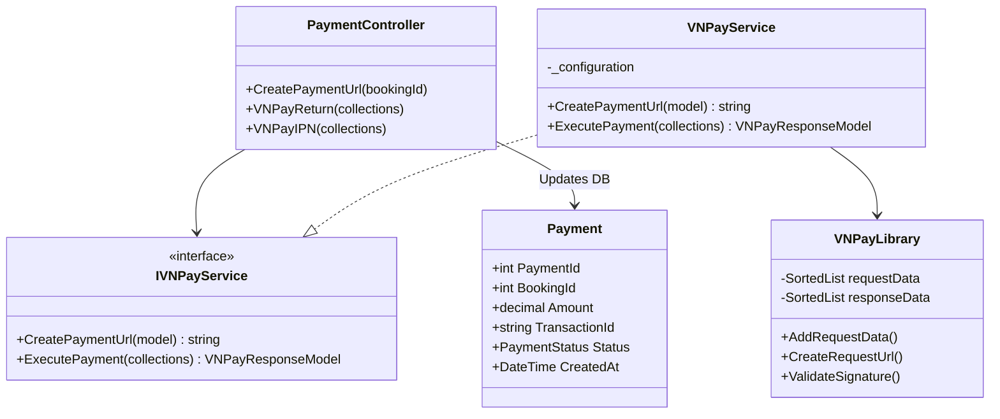
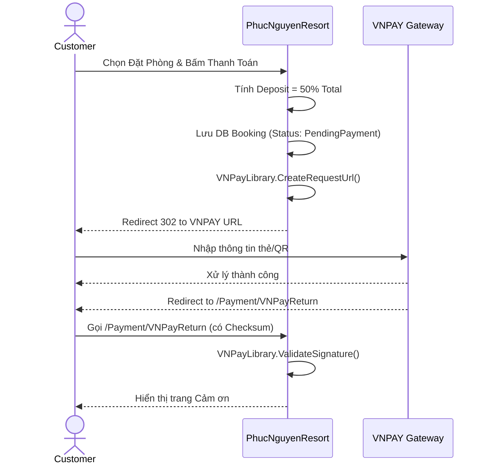
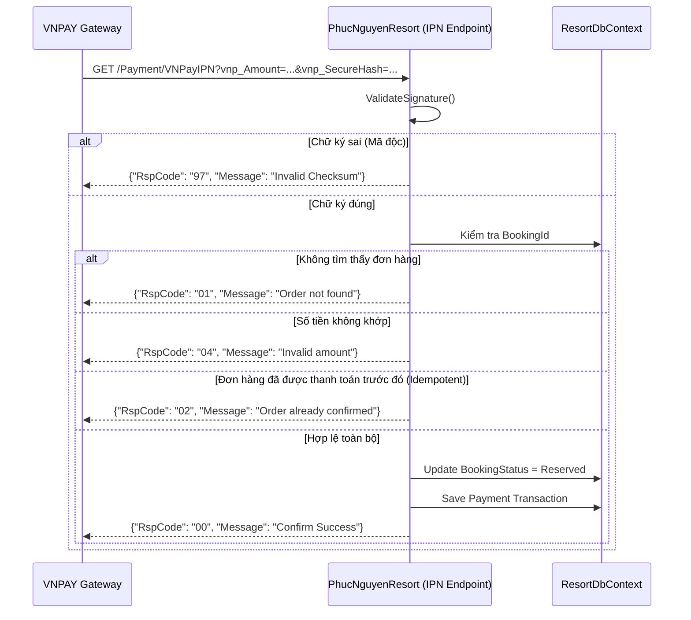

# ENGINEERING DOCUMENTATION STANDARD (EDS) v2.0

Quy chuẩn Tài liệu Kỹ thuật và Đặc tả Hiện thực hóa

| Field          | Value                  |
| -------------- | ---------------------- |
| Document ID    | `SWP391-PAY-IMP-001` |
| Version        | 1.0                    |
| Date           | 2026-06-13             |
| Status         | Approved               |
| Document Owner | cuong                  |
| Author         | cuong                  |
| Reviewed by    | khanh                  |
| DPO Sign-off   | [ ] Pending            |
| Approved by    | khanh                  |
| Last Review    | 2026-06-13             |
| Based on EDS   | v2.0                   |

## CHANGELOG

**Policy 4.4 — Immutable History**: Không bao giờ xóa thông tin cũ. Mọi thay đổi phải ghi vào bảng này.

| Ngày      | Người thực hiện | Nội dung thay đổi                                                                                 |
| ---------- | ------------------- | ---------------------------------------------------------------------------------------------------- |
| 2026-06-13 | AI BA               | Tạo tài liệu lần đầu - Tích hợp VNPAY                                                        |
| 2026-06-13 | AI BA               | Cập nhật chi tiết các phần (Mermaid, Error Codes, Deployment) cho giống chuẩn EDS_RoomBooking |

## MỤC LỤC

1. Tổng quan Module
2. Ma trận Truy vết (Traceability Matrix)
3. Architecture Decision Records (ADR)
4. Non-Functional Requirements & SLA
5. Static Modeling (Mô hình Tĩnh)
6. Dynamic Modeling (Mô hình Động)
7. Domain Event Catalog
8. Interface Specification (Đặc tả Giao diện)
9. UI & Controller Specification (MVC)
10. Bảng thông báo lỗi (Validation & Error Codes)
11. Quy trình Triển khai (Step-by-Step)
12. Rollback & Incident Runbook
13. Kịch bản Kiểm thử Chi tiết
14. Phương pháp Xác minh
15. Mẫu thử thực tế (API/UI Verification Samples)
16. Bảng tổng hợp phân quyền (Authorization Matrix)

---

## 1. Tổng quan Module

Module xử lý thanh toán trực tuyến sử dụng Cổng thanh toán VNPAY (môi trường Sandbox). Module chịu trách nhiệm khởi tạo URL thanh toán, xử lý khách hàng quay về trang web sau khi thanh toán (`vnp_ReturnUrl`), và quan trọng nhất là nhận Webhook (IPN - Instant Payment Notification) từ VNPAY để cập nhật trạng thái đơn hàng.

| Field                 | Value                                                                              |
| --------------------- | ---------------------------------------------------------------------------------- |
| Module Name           | `VNPay Integration`                                                              |
| Bounded Context       | `Payment & Billing`                                                              |
| Data Classification   | Confidential / Sensitive (Financial Transactions)                                  |
| Compliance Scope      | N/A (Dùng VNPAY Gateway, không lưu trữ thông tin thẻ tín dụng của khách) |
| Upstream Dependencies | `Room Booking Module`, `Consolidated Billing Module`                           |
| Downstream Consumers  | `VNPAY Sandbox API`                                                              |

## 2. Ma trận Truy vết (Traceability Matrix)

| Requirement ID | Loại (BR/ADR/US) | Mô tả yêu cầu                                                                                          | Thành phần Code                   | Compliance Target | ADR liên quan |
| -------------- | ----------------- | ---------------------------------------------------------------------------------------------------------- | ----------------------------------- | ----------------- | -------------- |
| UC23 (SRS)     | User Story        | Customer thanh toán cọc / phí dịch vụ online an toàn                                                 | `VNPayService.CreatePaymentUrl()` | Secure Payment    | ADR-005        |
| BR02 (HOS-02)  | Business Rule     | Đảm bảo tính toàn vẹn dữ liệu thanh toán, khách không thể checkout nếu chưa thanh toán hết | `PaymentController.VNPayIPN()`    | Data Integrity    | ADR-006        |

## 3. Architecture Decision Records (ADR)

### ADR-005 — Sử dụng mô hình Redirect cho VNPAY

| Field    | Value             |
| -------- | ----------------- |
| Status   | Accepted          |
| Deciders | Architecture Team |
| Date     | 2026-06-13        |

**Bối cảnh (Context)**
Hệ thống cần xử lý thanh toán trực tuyến nhưng để giảm bớt rủi ro bảo mật và trách nhiệm tuân thủ chuẩn PCI-DSS (Payment Card Industry Data Security Standard), hệ thống không nên trực tiếp nhập thông tin thẻ.

**Quyết định (Decision)**
Sử dụng mô hình Redirect (Chuyển hướng) của VNPAY. Hệ thống chỉ tạo URL mang thông tin thanh toán cơ bản (Mã đơn, Số tiền) cùng chữ ký bảo mật (Checksum Hash) và chuyển hướng khách sang website VNPAY.

**Hệ quả (Consequences)**

- Tích cực: Miễn trừ hoàn toàn trách nhiệm bảo mật thẻ tín dụng.
- Tiêu cực / Trade-offs: Bị phụ thuộc vào trình duyệt của khách hàng. Phải thiết kế hệ thống IPN (Server-to-Server Webhook) để bắt trạng thái giao dịch nếu khách hàng tắt trình duyệt sớm.

### ADR-006 — Chiến lược xử lý IPN Idempotency

| Field    | Value             |
| -------- | ----------------- |
| Status   | Accepted          |
| Deciders | Architecture Team |
| Date     | 2026-06-13        |

**Bối cảnh (Context)**
VNPAY IPN có thể được gọi nhiều lần cho cùng một giao dịch thanh toán (do retry policy của VNPAY nếu mạng lỗi).

**Quyết định (Decision)**
Hàm xử lý IPN (`VNPayIPN`) phải có tính Idempotent (kiểm tra trạng thái cũ). Nếu `PaymentStatus` đã là `Success`, bỏ qua việc cập nhật DB và vẫn trả về `{"RspCode": "00", "Message": "Confirm Success"}` cho VNPAY.

## 4. Non-Functional Requirements & SLA

### 4.1. Performance & Availability

| Category     | Requirement    | Target SLA | Measurement Method         |
| ------------ | -------------- | ---------- | -------------------------- |
| Latency      | URL Generation | < 200ms    | Manual timing              |
| Latency      | IPN Processing | < 500ms    | VNPAY logs / timeout limit |
| Availability | Webhook Uptime | 99.9%      | Uptime monitor             |

### 4.2. Data Integrity & Security

| Category    | Requirement                        | Target                   | Verification Method          |
| ----------- | ---------------------------------- | ------------------------ | ---------------------------- |
| Integrity   | SHA512 Checksum                    | 100% Match               | Unit test Checksum validator |
| Idempotency | Xử lý trùng lặp IPN            | Không duplicate records | Integration test             |
| Secure      | HashSecret không được hardcode | `appsettings.json`     | Code Review                  |

## 5. Static Modeling (Mô hình Tĩnh)

### 5.1. Class Diagram (Mermaid)



### 5.2. Data Structure (C# Models)

**VNPayRequestModel** — `Models/VNPayRequestModel.cs`

```csharp
public class VNPayRequestModel
{
    public int OrderId { get; set; } // BookingId
    public string FullName { get; set; }
    public string Description { get; set; }
    public double Amount { get; set; }
    public DateTime CreatedDate { get; set; }
}
```

**VNPayResponseModel** — `Models/VNPayResponseModel.cs`

```csharp
public class VNPayResponseModel
{
    public bool Success { get; set; }
    public string PaymentMethod { get; set; }
    public string OrderDescription { get; set; }
    public string OrderId { get; set; }
    public string TransactionId { get; set; }
    public string Token { get; set; }
    public string VnPayResponseCode { get; set; }
}
```

## 6. Dynamic Modeling (Mô hình Động)

### 6.1. Sequence Diagram — Happy Path: Tạo Thanh Toán



### 6.2. Sequence Diagram — Server-to-Server IPN Webhook



## 7. Domain Event Catalog

### 7.1. Events Published (Phát ra)

| Event Name         | Trigger                                    | Publisher                      | Subscriber(s)                   | Async? |
| ------------------ | ------------------------------------------ | ------------------------------ | ------------------------------- | ------ |
| `PaymentSuccess` | Cập nhật IPN thành công `RspCode=00` | `PaymentController.VNPayIPN` | `NotificationService`         | Yes    |
| `PaymentFailed`  | IPN nhận status thất bại từ VNPAY      | `PaymentController.VNPayIPN` | `BookingService` (Hủy đơn) | Yes    |

## 8. Interface Specification (Đặc tả Giao diện)

### 8.1. Service Interface

File: `Services/Payment/IVNPayService.cs`

```csharp
public interface IVNPayService
{
    string CreatePaymentUrl(HttpContext context, VNPayRequestModel model);
    VNPayResponseModel ExecutePayment(IQueryCollection collections);
}
```

## 9. UI & Controller Specification (MVC)

| HTTP Method | Route                    | Controller.Action | Required Roles                    | Chức năng                                                     |
| ----------- | ------------------------ | ----------------- | --------------------------------- | --------------------------------------------------------------- |
| GET         | `/Payment/VNPayReturn` | GUEST             | `PaymentController.VNPayReturn` | Khách hàng bị redirect về đây sau khi thanh toán VNPAY   |
| GET         | `/Payment/VNPayIPN`    | GUEST             | `PaymentController.VNPayIPN`    | Endpoint bí mật cho VNPAY Server gọi Webhook (Cập nhật DB) |

## 10. Bảng thông báo lỗi (Validation & Error Codes)

Bảng mã lỗi (RspCode) trả về cho VNPAY Webhook:

| RspCode | Ý nghĩa                    | Message (Tiếng Anh)    | Xử lý tại Backend                    |
| ------- | ---------------------------- | ----------------------- | --------------------------------------- |
| `00`  | Giao dịch thành công      | Confirm Success         | Update trạng thái `Paid`            |
| `97`  | Sai chữ ký checksum        | Invalid Checksum        | Ghi Log cảnh báo tấn công bảo mật |
| `01`  | Không tìm thấy mã đơn  | Order not found         | Bỏ qua                                 |
| `02`  | Đơn hàng đã thanh toán | Order already confirmed | Bỏ qua (Idempotency)                   |
| `04`  | Sai số tiền (Amount)       | Invalid amount          | Ghi Log cảnh báo can thiệp           |

## 11. Quy trình Triển khai (Step-by-Step)

### 11.1. Prerequisites

- [X] Có tài khoản Sandbox VNPAY (TmnCode, HashSecret)
- [X] `BookingsController` đã hoạt động tốt

### 11.2. Implementation Steps

**Chặng 1 — Cấu hình hệ thống**
Thêm thông tin vào `appsettings.json`:

```json
"VNPay": {
  "TmnCode": "XONYMEI0",
  "HashSecret": "2Y3GKP2EU216H98QKZ2R9YCQ8QW3CY9K",
  "BaseUrl": "https://sandbox.vnpayment.vn/paymentv2/vpcpay.html",
  "Version": "2.1.0"
}
```

**Chặng 2 — Implement Logic Library & Service**
Tạo file `Helpers/VNPayLibrary.cs` theo chuẩn document của VNPAY (xử lý SHA512 và QueryString).
Tạo `VNPayService` implement `IVNPayService`.

**Chặng 3 — Payment Controller & Webhook**
Tạo `PaymentController` xử lý `VNPayIPN` với chuỗi check (Null Check -> Hash Check -> Order Check -> Amount Check -> Status Check).

**Chặng 4 — Sửa đổi Booking Flow**
Cập nhật `BookingsController.Create()`: Thay vì redirect tới `MyBookings`, gọi `VNPayService.CreatePaymentUrl` và redirect tới VNPAY.

**Chặng 5 — Verification / Ngrok**
Sử dụng công cụ `ngrok http 5001` (hoặc cổng IIS Express tương ứng) để expose localhost ra internet. Cấu hình IPN URL của ngrok để VNPAY có thể bắn webhook về.

## 12. Rollback & Incident Runbook

### 12.1. Điều kiện kích hoạt Rollback (Trigger Conditions)

| Điều kiện                                             | Ngưỡng            | Người quyết định |
| -------------------------------------------------------- | ------------------- | --------------------- |
| Số lượng `RspCode=97` (Invalid Checksum) tăng vọt | > 10 requests/phút | On-call / Tech Lead   |
| Lỗi ngắt kết nối VNPAY (BaseUrl down)                | Liên tục          | Tech Lead             |

### 12.2. Rollback Procedure

Tắt tính năng VNPAY tạm thời, đưa Booking trở lại trạng thái thanh toán thủ công (Chuyển khoản / Tiền mặt).
Cập nhật file cấu hình tắt cờ `EnableVNPay = false`.

## 13. Kịch bản Kiểm thử Chi tiết (Xem TDD Spec)

Tham chiếu tài liệu: [TDD_VNPayIntegration.md](file:///e:/SWP391_PROJECT/su26-swp391-se2023-g1/03_implement/TDD_VNPayIntegration.md)

## 14. Phương pháp Xác minh

### 14.1. Server-to-Server IPN Log Check

```bash
# Trong console log của project
info: PhucNguyenResort.Controllers.PaymentController[0]
      VNPay IPN Received: OrderId=..., Amount=..., RspCode=00
```

### 14.2. Database Verification

```sql
SELECT BookingId, BookingStatus, DepositAmount
FROM Bookings 
WHERE BookingId = @id;
-- Expected: BookingStatus = Reserved (thay vì PendingPayment)
```

## 15. Mẫu thử thực tế (API/UI Verification Samples)

### 15.1. URL Gọi tới VNPAY (Mẫu)

```text
https://sandbox.vnpayment.vn/paymentv2/vpcpay.html?vnp_Amount=180600000&vnp_Command=pay&vnp_CreateDate=20210801153333&vnp_CurrCode=VND&vnp_IpAddr=127.0.0.1&vnp_Locale=vn&vnp_OrderInfo=Thanh+toan+don+hang+%3A5&vnp_OrderType=other&vnp_ReturnUrl=https%3A%2F%2Flocalhost%3A5001%2FPayment%2FVNPayReturn&vnp_TmnCode=XONYMEI0&vnp_TxnRef=5&vnp_Version=2.1.0&vnp_SecureHash=...
```

### 15.2. Mẫu IPN Callback (VNPAY gọi về Server)

```text
GET /Payment/VNPayIPN?vnp_Amount=180600000&vnp_BankCode=NCB&vnp_BankTranNo=VNP1370215&vnp_CardType=ATM&vnp_OrderInfo=Thanh+toan+don+hang+%3A5&vnp_PayDate=20260613153401&vnp_ResponseCode=00&vnp_TmnCode=XONYMEI0&vnp_TransactionNo=1370215&vnp_TransactionStatus=00&vnp_TxnRef=5&vnp_SecureHash=...
```

## 16. Bảng tổng hợp phân quyền (Authorization Matrix)

| Endpoint                 | GUEST | CUSTOMER | RECEPTIONIST | Ý nghĩa                                                                                                       |
| ------------------------ | ----- | -------- | ------------ | --------------------------------------------------------------------------------------------------------------- |
| `/Payment/VNPayReturn` | ✅    | ✅       | ❌           | Bất kỳ ai vừa thanh toán xong đều bị VNPAY chuyển hướng về đây                                     |
| `/Payment/VNPayIPN`    | ✅    | ✅       | ✅           | Mở công khai (GUEST) vì VNPAY Server gọi đến, bảo mật hoàn toàn bằng `vnp_SecureHash` (HMACSHA512) |
