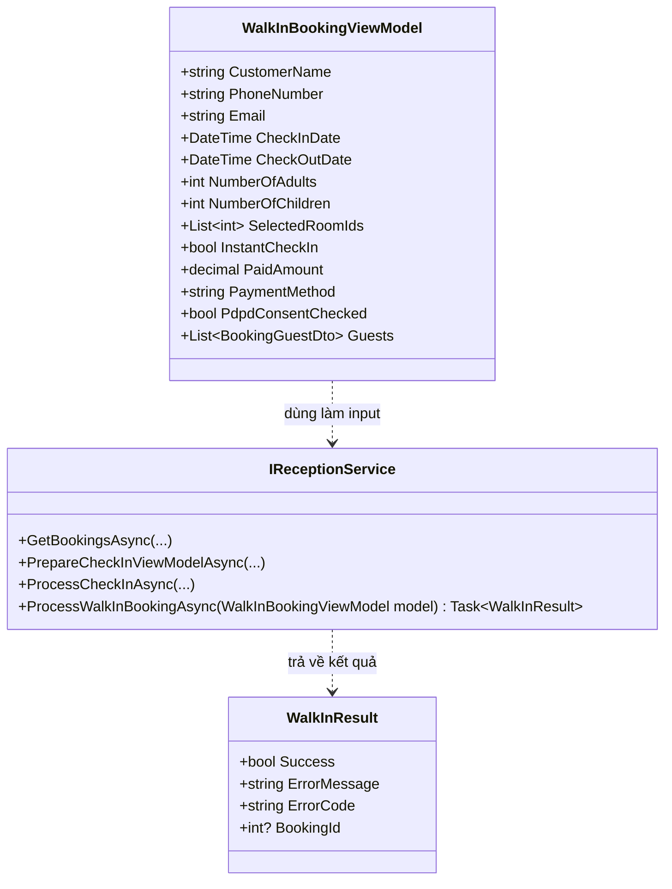
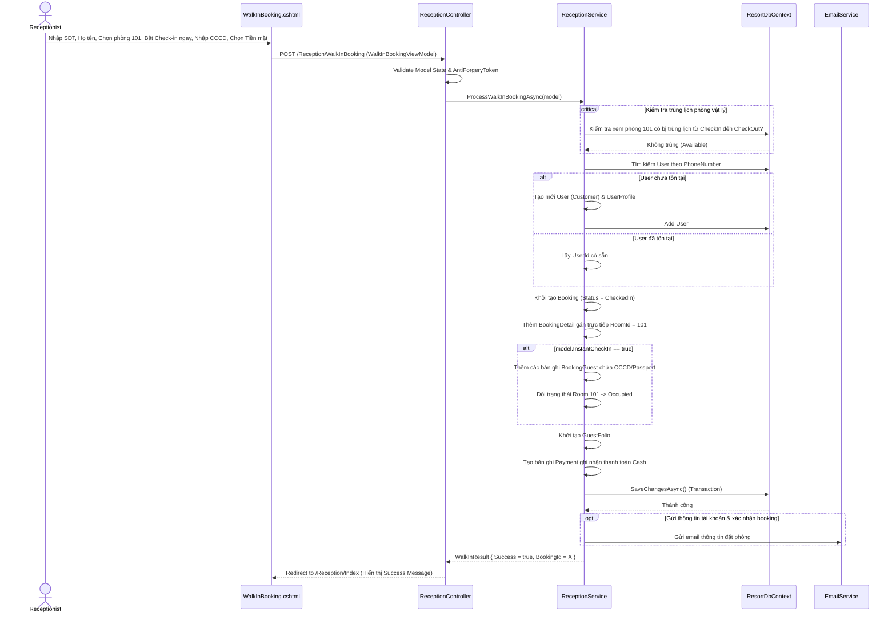

# ENGINEERING DOCUMENTATION STANDARD (EDS) v2.0

Quy chuẩn Tài liệu Kỹ thuật và Đặc tả Hiện thực hóa — Đặt Phòng Tại Quầy (Walk-in Booking)

| Field          | Value                   |
| -------------- | ----------------------- |
| Document ID    | `SWP391-MOD2-IMP-003` |
| Version        | 1.0                     |
| Date           | 2026-06-21              |
| Status         | Approve                 |
| Document Owner | Cuong                   |
| Author         | Cuong                   |
| Reviewed by    | Khanh                   |
| DPO Sign-off   | Khanh                   |
| Approved by    | Cuong                   |
| Last Review    | 2026-06-21              |
| Based on EDS   | v2.0                    |

## CHANGELOG

**Policy 4.4 — Immutable History**: Không bao giờ xóa thông tin cũ. Mọi thay đổi phải ghi vào bảng này.

| Ngày      | Người thực hiện | Nội dung thay đổi                                                                    |
| ---------- | ------------------- | --------------------------------------------------------------------------------------- |
| 2026-06-21 | Cuong               | Tạo tài liệu lần đầu - EDS cho Use Case Đặt Phòng Tại Quầy (Walk-in Booking) |

## MỤC LỤC

1. Tổng quan Module
2. Ma trận Truy vết (Traceability Matrix)
3. Architecture Decision Records (ADR)
4. Non-Functional Requirements & SLA
5. Static Modeling (Mô hình Tĩnh)
6. Dynamic Modeling (Mô hình Động)
7. Domain Event Catalog
8. Interface Specification (Đặc tả Giao diện)
9. UI & Controller Specification (MVC)
10. Bảng thông báo lỗi (Validation & ModelState)
11. Quy trình Triển khai (Step-by-Step)
12. Rollback & Incident Runbook
13. Kịch bản Kiểm thử Chi tiết
14. Phương pháp Xác minh
15. Mẫu thử thực tế (UI Verification Samples)
16. Bảng tổng hợp phân quyền (Authorization Matrix)

---

## 1. Tổng quan Module

Module này xử lý nghiệp vụ đặt phòng và nhận phòng trực tiếp tại quầy lễ tân (Walk-in Booking) do nhân viên Lễ tân (Receptionist) thực hiện. Khác với quy trình trực tuyến tự phục vụ (Self-service Booking) của Khách hàng, quy trình tại quầy cho phép gán trực tiếp số phòng vật lý, xử lý thanh toán ngoại tuyến (Tiền mặt, POS) và hỗ trợ nhận phòng ngay lập tức (Instant Check-in) bằng cách điền thông tin định danh và thực hiện Check-in chỉ trong một luồng biểu mẫu duy nhất.

| Field                 | Value                                                                                                          |
| --------------------- | -------------------------------------------------------------------------------------------------------------- |
| Module Name           | `Room Reservation & Front Desk`                                                                              |
| Bounded Context       | `Walk-in Booking / Front Desk Operations`                                                                    |
| Data Classification   | PII / Sensitive-PII (CCCD, Hộ chiếu khách lưu trú qua BookingGuest)                                       |
| Compliance Scope      | NĐ 356/2025/NĐ-CP (PDPD), Luật Cư trú 2020 (Khai báo tạm trú)                                          |
| Upstream Dependencies | `Auth Module (Users, Roles)`, `Room Management Module (Rooms, RoomCategories)`                             |
| Downstream Consumers  | `Consolidated Billing Module (GuestFolio, Invoice, Payments)`, `Housekeeping Module (Room Status updates)` |

---

## 2. Ma trận Truy vết (Traceability Matrix)

| Requirement ID | Loại (BR/ADR/US) | Mô tả yêu cầu                                                                                                     | Thành phần Code                                                                            | Compliance Target   | ADR liên quan |
| -------------- | ----------------- | --------------------------------------------------------------------------------------------------------------------- | -------------------------------------------------------------------------------------------- | ------------------- | -------------- |
| UC49 (SRS)     | User Story        | Lễ tân quản lý và tạo đơn đặt phòng trực tiếp tại quầy                                                 | `ReceptionController.WalkInBooking()`, `IReceptionService.ProcessWalkInBookingAsync()`   | —                  | ADR-003        |
| UC51 (SRS)     | User Story        | Lễ tân thực hiện nhận phòng (Check-in) cho khách                                                               | `ReceptionController.CheckIn()`, `IReceptionService.ProcessCheckInAsync()`               | Luật Cư trú 2020 | —             |
| UC55 (SRS)     | User Story        | Lễ tân xử lý thanh toán trực tiếp tại quầy (Tiền mặt, quẹt thẻ POS)                                      | `IReceptionService.ProcessWalkInBookingAsync()` (thanh toán cọc/toàn bộ ngoại tuyến) | —                  | —             |
| BR-WK-01       | Business Rule     | Tất cả Booking phải liên kết với 1 `UserId` (Customer). Hệ thống tự sinh tài khoản nếu là khách mới. | `IReceptionService.ProcessWalkInBookingAsync()` (tự tạo `User` record)                 | NĐ 356/2025        | ADR-003        |
| BR-WK-02       | Business Rule     | Thanh toán tại quầy được tự xác nhận bằng Tiền mặt (Cash), POS, hoặc chuyển khoản (Bank Transfer).     | `Payment` table insertion with offline method                                              | —                  | —             |
| BR-WK-03       | Business Rule     | Kiểm soát trùng phòng vật lý gán trực tiếp tại thời điểm đặt phòng.                                   | `IReceptionService.ProcessWalkInBookingAsync()` (Overlap Room Check)                       | —                  | ADR-002        |
| BR-WK-04       | Business Rule     | Gán trực tiếp phòng vật lý (`RoomId`) thay vì chỉ chọn hạng phòng như đặt online.                     | `BookingDetail` table insertion with `RoomId` filled                                     | —                  | —             |

---

## 3. Architecture Decision Records (ADR)

*(Thừa hưởng ADR-001 về ASP.NET MVC .NET 8 và ADR-002 về overlap check)*

### ADR-003 — Chiến lược quản lý thực thể tài khoản Khách hàng khi đặt phòng tại quầy

| Field      | Value             |
| ---------- | ----------------- |
| Status     | Accepted          |
| Deciders   | Architecture Team |
| Date       | 2026-06-21        |
| Supersedes | N/A               |

**Bối cảnh (Context)**
Trong cơ sở dữ liệu của PhucNguyen Resort, bảng `Booking` có quan hệ bắt buộc với bảng `User` thông qua `UserId`. Khi khách đặt phòng online, họ đã có tài khoản và đăng nhập. Tuy nhiên, khi khách bước vào quầy đặt trực tiếp (Walk-in), họ thường chưa có tài khoản hoặc không muốn làm thủ tục đăng ký tài khoản dài dòng. Chúng ta cần thiết kế giải pháp vừa bảo đảm tính toàn vẹn dữ liệu (mỗi booking gắn với một User cụ thể), vừa thuận tiện cho Lễ tân xử lý nhanh.

**Các phương án đã xem xét (Options Considered)**

| Phương án | Mô tả                                                                                                                                                                                         | Ưu điểm                                                                                                                                                            | Nhược điểm                                                                                                                                                                                                                      |
| ------------ | ----------------------------------------------------------------------------------------------------------------------------------------------------------------------------------------------- | --------------------------------------------------------------------------------------------------------------------------------------------------------------------- | ----------------------------------------------------------------------------------------------------------------------------------------------------------------------------------------------------------------------------------- |
| A            | Dùng một tài khoản chung duy nhất (ví dụ:`WalkInGuestAccount` với `UserId = 9999`) cho tất cả khách vãng lai.                                                                   | Lễ tân không cần nhập thông tin khách hàng, tốc độ tạo booking cực nhanh.                                                                                | Vi phạm nghiêm trọng tính toàn vẹn dữ liệu; không thể gửi hóa đơn điện tử riêng cho khách; không thể lưu lịch sử quay lại của khách; vi phạm Nghị định 356/2025 về định danh chủ thể dữ liệu. |
| B            | Bắt khách tạo tài khoản trước bằng email trên điện thoại rồi lễ tân mới tìm kiếm để đặt phòng.                                                                           | Giữ cấu trúc dữ liệu nguyên bản, không cần code xử lý tự sinh tài khoản.                                                                                | Gây trải nghiệm rất tệ cho khách hàng tại quầy. Lễ tân tốn thời gian giải thích.                                                                                                                                     |
| C (Chọn)    | Lễ tân nhập nhanh thông tin tối thiểu (Họ tên, SĐT, Email). Hệ thống tự tìm kiếm, nếu chưa có sẽ tự sinh nhanh một User có Role `Customer` với mật khẩu ngẫu nhiên. | Bảo đảm tính toàn vẹn dữ liệu, lưu giữ được thông tin khách hàng cũ cho lần sau, hỗ trợ gửi hóa đơn/email xác nhận, tuân thủ pháp luật. | Cần thêm code logic tự động tạo tài khoản trong Service.                                                                                                                                                                    |

**Quyết định (Decision)**
Chọn Phương án C. Hệ thống cho phép Lễ tân nhập Số điện thoại. Nếu SĐT đã tồn tại, tự động điền thông tin cũ. Nếu chưa tồn tại, yêu cầu nhập Họ tên và Email (nếu khách không có email, hệ thống tự động sinh email tạm thời dạng `[SĐT]@phucnguyenresort.temp`) và tiến hành tạo tài khoản ngầm.

---

## 4. Non-Functional Requirements & SLA

### 4.1. Performance & Availability

* **Latency**: Xử lý tạo đơn đặt tại quầy và check-in đồng thời (p99) < 800ms.
* **Real-time Availability**: Sơ đồ phòng trống phải cập nhật ngay sau khi bấm "Hoàn tất đặt phòng".

### 4.2. Security & Compliance

* **Validate Anti-Forgery**: Tất cả POST form phải áp dụng `[ValidateAntiForgeryToken]`.
* **PDPD Compliance**: Lễ tân phải xác nhận đã xin ý kiến đồng ý của khách hàng trước khi nhập CCCD/Passport bằng checkbox `PdpdConsentChecked`.

---

## 5. Static Modeling (Mô hình Tĩnh)

### 5.1. Class Diagram (Mermaid)



---

## 6. Dynamic Modeling (Mô hình Động)

### 6.1. Sequence Diagram — Đặt phòng tại quầy và Check-in ngay (Instant Check-in)



---

## 7. Domain Event Catalog

### 7.1. Events Published (Phát ra)

* `WalkInBookingCreated`: Phát ra sau khi lưu đơn thành công tại quầy. Kèm thông tin tài khoản nếu là khách mới để hệ thống gửi thư kích hoạt.
* `PaymentRecorded`: Ghi nhận thanh toán Tiền mặt/POS trực tiếp tại quầy để phân hệ kế toán đối chiếu cuối ngày.

---

## 8. Interface Specification (Đặc tả Giao diện)

### 8.1. Cập nhật `IReceptionService`

File: `Services/Reception/IReceptionService.cs`

```csharp
namespace PhucNguyenResort.Services.Reception
{
    public interface IReceptionService
    {
        Task<IEnumerable<Booking>> GetBookingsAsync(string? searchString, BookingStatus? statusFilter, DateTime? dateFilter);
        Task<PreCheckinViewModel?> PrepareCheckInViewModelAsync(int bookingId);
        Task<Booking?> GetBookingByIdAsync(int bookingId);
        Task<CheckInResult> ProcessCheckInAsync(PreCheckinViewModel model);
      
        /// <summary>
        /// Xử lý đặt phòng trực tiếp tại quầy. Tự động sinh User nếu cần, gán phòng vật lý trực tiếp,
        /// ghi nhận thanh toán ngoại tuyến và thực hiện Check-in ngay nếu InstantCheckIn = true.
        /// </summary>
        Task<WalkInResult> ProcessWalkInBookingAsync(WalkInBookingViewModel model);
    }

    public class WalkInResult
    {
        public bool Success { get; set; }
        public string? ErrorMessage { get; set; }
        public string? ErrorCode { get; set; } // "WKB-001", "WKB-002", "WKB-003"
        public int? BookingId { get; set; }
    }
}
```

---

## 9. UI & Controller Specification (MVC)

### 9.1. Routes & Actions Table

| HTTP Method | Route                        | Controller.Action                     | Required Roles              | Chức năng                                                   |
| ----------- | ---------------------------- | ------------------------------------- | --------------------------- | ------------------------------------------------------------- |
| GET         | `/Reception/WalkInBooking` | `ReceptionController.WalkInBooking` | `Receptionist`, `Admin` | Hiển thị giao diện Đặt phòng tại quầy                 |
| POST        | `/Reception/WalkInBooking` | `ReceptionController.WalkInBooking` | `Receptionist`, `Admin` | Xử lý nghiệp vụ đặt phòng và nhận phòng trực tiếp |

### 9.2. ViewModels

**WalkInBookingViewModel** — file: `ViewModels/Bookings/WalkInBookingViewModel.cs`

```csharp
using System.ComponentModel.DataAnnotations;
using PhucNguyenResort.ViewModels.Bookings;

namespace PhucNguyenResort.ViewModels.Bookings
{
    public class WalkInBookingViewModel
    {
        [Required(ErrorMessage = "Họ tên khách hàng không được để trống.")]
        [Display(Name = "Họ tên khách đặt")]
        public string CustomerName { get; set; } = string.Empty;

        [Required(ErrorMessage = "Số điện thoại không được để trống.")]
        [Phone(ErrorMessage = "Số điện thoại không hợp lệ.")]
        [Display(Name = "Số điện thoại")]
        public string PhoneNumber { get; set; } = string.Empty;

        [EmailAddress(ErrorMessage = "Email không hợp lệ.")]
        [Display(Name = "Email")]
        public string? Email { get; set; }

        [Required(ErrorMessage = "Vui lòng chọn ngày nhận phòng.")]
        [DataType(DataType.Date)]
        [Display(Name = "Ngày nhận phòng")]
        public DateTime CheckInDate { get; set; } = DateTime.Today;

        [Required(ErrorMessage = "Vui lòng chọn ngày trả phòng.")]
        [DataType(DataType.Date)]
        [Display(Name = "Ngày trả phòng")]
        public DateTime CheckOutDate { get; set; } = DateTime.Today.AddDays(1);

        [Range(1, 20)]
        [Display(Name = "Số người lớn")]
        public int NumberOfAdults { get; set; } = 2;

        [Range(0, 10)]
        [Display(Name = "Số trẻ em")]
        public int NumberOfChildren { get; set; } = 0;

        [Required(ErrorMessage = "Vui lòng chọn ít nhất một phòng vật lý.")]
        [Display(Name = "Gán số phòng vật lý")]
        public List<int> SelectedRoomIds { get; set; } = new List<int>();

        [Display(Name = "Nhận phòng ngay (Instant Check-in)")]
        public bool InstantCheckIn { get; set; } = true;

        [Range(0, 999999999, ErrorMessage = "Số tiền thanh toán không hợp lệ.")]
        [Display(Name = "Số tiền thực nhận")]
        public decimal PaidAmount { get; set; }

        [Required]
        [Display(Name = "Phương thức thanh toán")]
        public string PaymentMethod { get; set; } = "Cash"; // Cash, POS, BankTransfer

        [Display(Name = "Đồng ý điều khoản bảo vệ dữ liệu cá nhân (PDPD)")]
        public bool PdpdConsentChecked { get; set; }

        // Danh sách thông tin định danh dùng cho việc Check-in ngay
        public List<BookingGuestDto> Guests { get; set; } = new List<BookingGuestDto>();
    }
}
```

---

## 10. Bảng thông báo lỗi (Validation & ModelState)

| Mã lỗi Nội bộ   | Error Code  | Nơi hiển thị | Câu thông báo (VI)                                                                                 | Điều kiện kích hoạt                                                                                        |
| ------------------- | ----------- | --------------- | ----------------------------------------------------------------------------------------------------- | --------------------------------------------------------------------------------------------------------------- |
| `ERR_PHONE`       | `WKB-001` | `ModelState`  | Số điện thoại không đúng định dạng.                                                         | `PhoneNumber` chứa ký tự chữ cái hoặc độ dài < 9 số.                                                |
| `ERR_DOUBLE`      | `WKB-002` | `ModelState`  | Phòng vật lý [Số phòng] đã được gán hoặc bận trong khoảng thời gian này.              | Phát hiện phòng vật lý được chọn bị bận (Trạng thái phòng bận hoặc có đơn khác đè ngày). |
| `ERR_PII_MISSING` | `WKB-003` | `ModelState`  | Khách chính bắt buộc phải điền đầy đủ CCCD/Passport và Quốc tịch khi nhận phòng ngay. | `InstantCheckIn = true` nhưng thông tin định danh của primary guest bị để trống.                     |
| `ERR_PDPD`        | —          | `ModelState`  | Lễ tân phải tích xác nhận khách đồng ý cung cấp thông tin cá nhân (PDPD).               | `PdpdConsentChecked = false` khi `InstantCheckIn = true`.                                                   |

---

## 11. Quy trình Triển khai (Step-by-Step)

### 11.1. Prerequisites

* Sơ đồ các phòng vật lý trong `Rooms` đã liên kết đúng `RoomCategories`.
* Có các phương thức hỗ trợ tạo/truy vấn User theo số điện thoại trong hệ thống.

### 11.2. Implementation Steps

1. **Tạo ViewModel và DTO**: Tạo file `WalkInBookingViewModel.cs` trong thư mục ViewModels.
2. **Cập nhật Service**: Cập nhật Interface `IReceptionService` và lớp hiện thực `ReceptionService.cs` để thêm method `ProcessWalkInBookingAsync`.
3. **Cập nhật Controller**:
   * Tạo Action `GET: /Reception/WalkInBooking` lấy danh sách các phòng khả dụng (trạng thái `Available` & `Clean`) truyền vào View.
   * Tạo Action `POST: /Reception/WalkInBooking` đón dữ liệu, gọi Service xử lý và trả thông báo thông qua `TempData["SuccessMessage"]`.
4. **Thiết kế Giao diện**: Tạo view `WalkInBooking.cshtml` chứa form nhập thông tin Lễ tân, tích hợp AJAX tải nhanh phòng trống khi thay đổi ngày.

---

## 12. Rollback & Incident Runbook

### 12.1. Điều kiện kích hoạt Rollback

* Xảy ra lỗi trùng phòng vật lý thực tế sau khi tạo booking (Double booking tại quầy).
* Giao dịch thanh toán tại quầy ghi nhận sai lệch trên hệ thống hóa đơn cuối ngày.

### 12.2. Rollback Procedure

```bash
# Revert code
git revert [commit_hash]
```

---

## 13. Kịch bản Kiểm thử Chi tiết

Tất cả kịch bản kiểm thử sử dụng dữ liệu giả định (`SYNTHETIC`). Chi tiết cách thiết lập và asserts được mô tả đầy đủ trong file đặc tả kiểm thử TDD: **[TDD_WalkInBooking.md](file:///e:/SWP391_PROJECT/su26-swp391-se2023-g1/03_implement/TDD_WalkInBooking.md)**.

---

## 14. Phương pháp Xác minh

### 14.1. Database Inspection

Truy vấn SQL để kiểm tra Booking và Payments được tạo đồng thời trong 1 Transaction:

```sql
SELECT b.BookingId, b.BookingStatus, p.PaymentMethod, p.Amount, f.FolioId
FROM Bookings b
INNER JOIN Payments p ON p.InvoiceId = (SELECT InvoiceId FROM Invoices WHERE FolioId = (SELECT FolioId FROM GuestFolios WHERE BookingId = b.BookingId))
INNER JOIN GuestFolios f ON f.BookingId = b.BookingId
WHERE b.BookingId = [Mã_Booking_Mới];
```

---

## 15. Bảng tổng hợp phân quyền (Authorization Matrix)

| Endpoint                          | GUEST | CUSTOMER | RECEPTIONIST | ADMIN |
| --------------------------------- | ----- | -------- | ------------ | ----- |
| GET `/Reception/WalkInBooking`  | ❌    | ❌       | ✅           | ✅    |
| POST `/Reception/WalkInBooking` | ❌    | ❌       | ✅           | ✅    |

*Chú thích:*

* `✅`: Được phép truy cập.
* `❌`: Bị từ chối (403 Forbidden hoặc redirect sang trang Login).
* Khách hàng (Customer) không được phép tự tạo booking trực tiếp bằng API này để tránh gán sai phòng vật lý.
