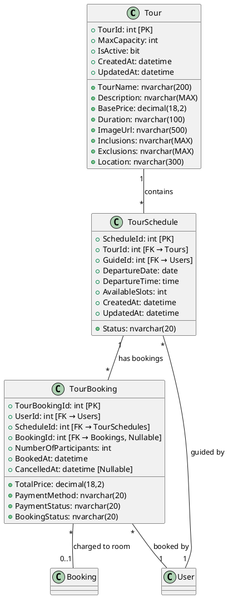
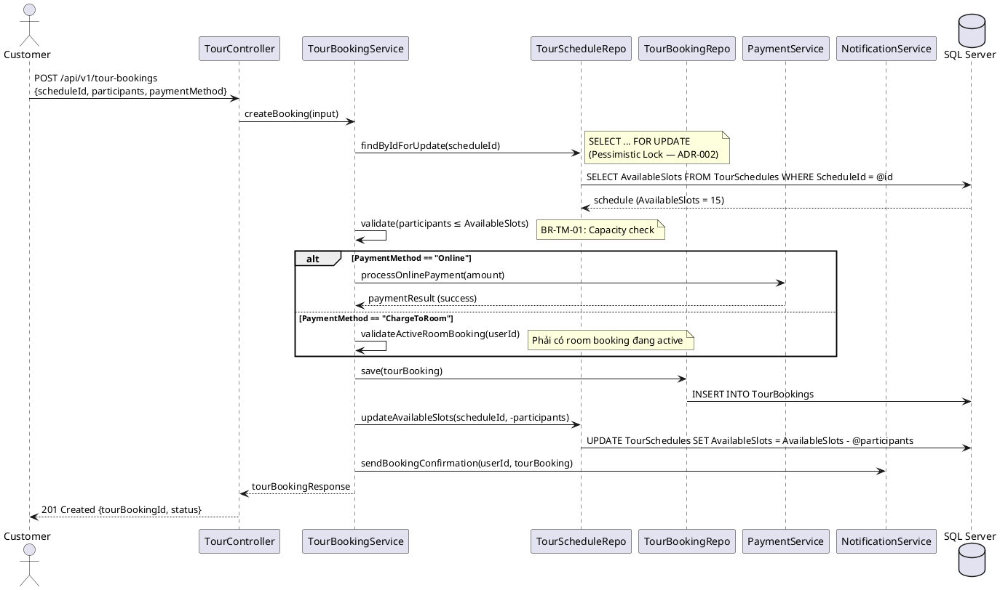
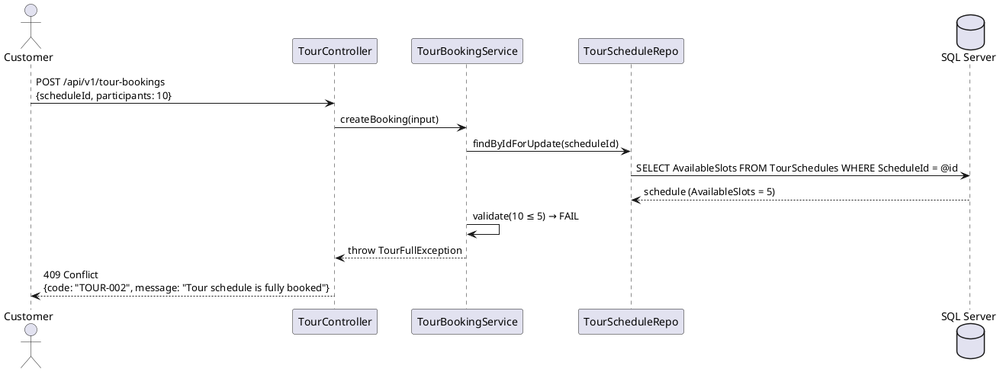
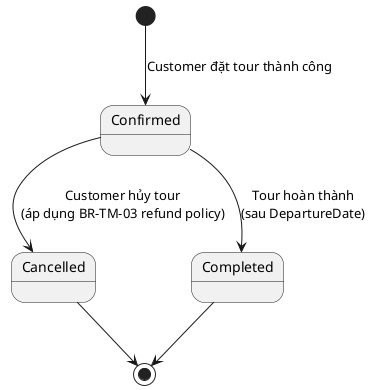
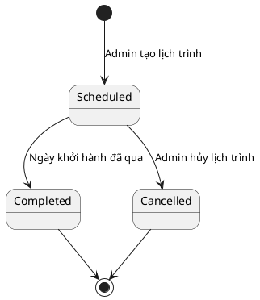
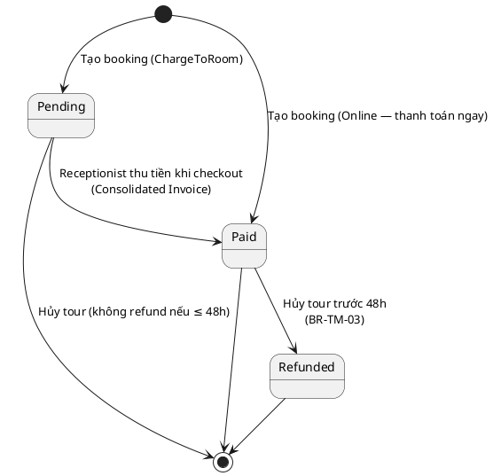

# ENGINEERING DOCUMENTATION STANDARD (EDS) v2.0

## Module: Tour Management (Quản lý Tour)

| Field          | Value                                                               |
| -------------- | ------------------------------------------------------------------- |
| Document ID    | `SWP391-TOUR-IMP-001`                                             |
| Version        | 1.0                                                                 |
| Date           | 2026-06-18                                                          |
| Status         | Approved                                                            |
| Document Owner | Nguyễn Khắc Hiếu                                                 |
| Author         | Nguyễn Khắc Hiếu                                                 |
| Reviewed by    | truong cuong                                                        |
| DPO Sign-off   | [ ] Pending*(Module này không trực tiếp xử lý Sensitive-PII)* |
| Approved by    | Nguyễn Khắc Hiếu                                                 |
| Last Review    | 2026-06-18                                                          |
| Based on EDS   | v2.0                                                                |

## CHANGELOG

**Policy 4.4 — Immutable History**: Không bao giờ xóa thông tin cũ. Mọi thay đổi phải ghi vào bảng này.

| Ngày      | Người thực hiện | Nội dung thay đổi                                         |
| ---------- | ------------------- | ------------------------------------------------------------ |
| 2026-06-18 | Nguyễn Khắc Hiếu | Tạo tài liệu lần đầu — EDS cho Tour Management Module |

## MỤC LỤC

1. Tổng quan Module
2. Ma trận Truy vết (Traceability Matrix)
3. Architecture Decision Records (ADR)
4. Non-Functional Requirements & SLA
5. Static Modeling (Mô hình Tĩnh)
6. Dynamic Modeling (Mô hình Động)
7. Domain Event Catalog
8. Interface Specification (Đặc tả Giao diện)
9. API Specification
10. Bảng mã lỗi (Error Codes)
11. Quy trình Triển khai (Step-by-Step)
12. Rollback & Incident Runbook
13. Kịch bản Kiểm thử Chi tiết
14. Phương pháp Xác minh
15. Mẫu thử thực tế (API Verification Samples)
16. Bảng tổng hợp phân quyền (Authorization Matrix)

---

## 1. Tổng quan Module

Module Tour Management cung cấp chức năng quản lý toàn bộ vòng đời của dịch vụ tour du lịch tại PhucNguyen Resort & Tour Hub. Module cho phép khách hàng duyệt, tìm kiếm và đặt các tour hoạt động địa phương; cho phép Admin quản lý danh mục tour, lịch trình, và phân công hướng dẫn viên; cho phép Tour Guide xem danh sách khách hàng trong ngày. Đặc biệt, module tích hợp chặt chẽ với hệ thống thanh toán tổng hợp (Consolidated Billing) — khách có thể chọn thanh toán trực tiếp hoặc charge to room khi check-out.

| Field                 | Value                                                                                                 |
| --------------------- | ----------------------------------------------------------------------------------------------------- |
| Module Name           | `Tour Management`                                                                                   |
| Bounded Context       | `Tourism & Activities`                                                                              |
| Data Classification   | Internal (không chứa Sensitive-PII trực tiếp — PII khách hàng thuộc module Auth/Profile)      |
| Compliance Scope      | Luật Du lịch Việt Nam 2017 (An toàn, Bảo hiểm, Hoàn tiền)                                     |
| Upstream Dependencies | `Auth Module (Users, Roles)`, `Room Reservation Module (Bookings)`, `Payment Module (Payments)` |
| Downstream Consumers  | `Consolidated Billing Module (GuestFolios, Invoices)`, `Notification Module`, `Review Module`   |

---

## 2. Ma trận Truy vết (Traceability Matrix)

Ánh xạ trực tiếp: [Mã yêu cầu] -> [Thành phần Code] -> [Mục tiêu Tuân thủ].

| Requirement ID | Loại (BR/ADR/US) | Mô tả yêu cầu                                                      | Thành phần Code                                            | Compliance Target   | ADR liên quan |
| -------------- | ----------------- | ---------------------------------------------------------------------- | ------------------------------------------------------------ | ------------------- | -------------- |
| UC-TM-01       | User Story        | Guest duyệt danh sách tour có sẵn                                  | `TourController.GET /api/v1/tours`                         | —                  | —             |
| UC-TM-02       | User Story        | Guest xem chi tiết tour (itinerary, weather, map)                     | `TourController.GET /api/v1/tours/:id`                     | —                  | ADR-001        |
| UC-TM-03       | User Story        | Customer đặt tour cho ngày cụ thể, chỉ định số người        | `TourBookingService.createBooking()`                       | —                  | ADR-002        |
| UC-TM-04       | User Story        | Customer chọn thanh toán trực tiếp hoặc charge to room            | `PaymentIntegrationService.processPayment()`               | —                  | ADR-002        |
| UC-TM-05       | User Story        | Admin CRUD tour catalog (tên, mô tả, giá, ảnh)                    | `TourCatalogService.create/update/delete()`                | —                  | —             |
| UC-TM-06       | User Story        | Admin tạo/sửa lịch trình tour, phân công Tour Guide              | `TourScheduleService.createSchedule()`                     | —                  | —             |
| UC-TM-07       | User Story        | Tour Guide xem manifest (danh sách khách) trong ngày                | `TourManifestController.GET /api/v1/tour-guides/manifests` | —                  | —             |
| UC-TM-08       | User Story        | Receptionist xem tour charges chưa thanh toán khi checkout           | `ConsolidatedBillingService.getTourCharges()`              | —                  | —             |
| BR-TM-01       | Business Rule     | TourSchedule không được overbook — tổng participants ≤ capacity | `TourBookingService.validateCapacity()`                    | —                  | ADR-002        |
| BR-TM-02       | Business Rule     | Guest không được checkout nếu còn tour charge chưa thanh toán  | `CheckoutGuard.validatePendingTourCharges()`               | BR02 (SRS gốc)     | —             |
| BR-TM-03       | Business Rule     | Hủy tour: hoàn 100% nếu hủy trước 48h; 0% nếu trong 48h         | `TourCancellationService.processRefund()`                  | Luật Du lịch 2017 | ADR-003        |

---

## 3. Architecture Decision Records (ADR)

### ADR-001 — Tích hợp API thời tiết và bản đồ cho Tour Details

| Field      | Value           |
| ---------- | --------------- |
| Status     | Accepted        |
| Deciders   | `[Tech Lead]` |
| Date       | 2026-06-18      |
| Supersedes | N/A             |

**Bối cảnh (Context)**
Trang Tour Details cần hiển thị dự báo thời tiết và bản đồ tương tác cho các tour ngoài trời. Cần quyết định cách tích hợp API bên ngoài (OpenWeather, Google Maps) mà không ảnh hưởng performance.

**Các phương án đã xem xét (Options Considered)**

| Phương án | Mô tả                                               | Ưu điểm                                  | Nhược điểm                                |
| ------------ | ----------------------------------------------------- | ------------------------------------------- | --------------------------------------------- |
| A            | Gọi API thời tiết từ Server-side, cache kết quả | + Kiểm soát rate limit, bảo mật API key | - Tăng latency server                        |
| B            | Gọi API thời tiết từ Client-side (JavaScript)     | + Giảm tải server                         | - Expose API key, khó kiểm soát rate limit |

**Quyết định (Decision)**
Chọn Phương án A — Server-side với cache 30 phút. API key được lưu trong environment variables, không expose ra client.

**Hệ quả (Consequences)**
Tích cực:

- API key được bảo vệ an toàn
- Kiểm soát được rate limit và chi phí API

Tiêu cực / Trade-offs:

- Tăng nhẹ latency do proxy qua server — giảm thiểu bằng caching 30 phút

---

### ADR-002 — Chiến lược ngăn chặn Overbooking Tour

| Field      | Value           |
| ---------- | --------------- |
| Status     | Accepted        |
| Deciders   | `[Tech Lead]` |
| Date       | 2026-06-18      |
| Supersedes | N/A             |

**Bối cảnh (Context)**
BR-TM-01 yêu cầu hệ thống không được overbooking tour. Khi nhiều khách đặt tour cùng lúc, cần giải pháp concurrency control.

**Các phương án đã xem xét (Options Considered)**

| Phương án | Mô tả                             | Ưu điểm                            | Nhược điểm                  |
| ------------ | ----------------------------------- | ------------------------------------- | ------------------------------- |
| A            | Pessimistic Locking (DB row lock)   | + Đảm bảo consistency tuyệt đối | - Giảm throughput khi load cao |
| B            | Optimistic Locking (version column) | + Throughput cao hơn                 | - Retry logic phức tạp        |

**Quyết định (Decision)**
Chọn Phương án A — Pessimistic Locking trên bảng `TourSchedules` khi tạo booking. Sử dụng `SELECT ... FOR UPDATE` trong transaction để đảm bảo tổng `Participants` không vượt `MaxCapacity`.

**Hệ quả (Consequences)**
Tích cực:

- Loại bỏ hoàn toàn race condition overbooking

Tiêu cực / Trade-offs:

- Giảm throughput nhẹ — chấp nhận được vì tour booking không có lưu lượng cao như room booking

---

### ADR-003 — Chính sách hoàn tiền tour

| Field      | Value                                   |
| ---------- | --------------------------------------- |
| Status     | Accepted                                |
| Deciders   | `[Tech Lead]`, `[Business Manager]` |
| Date       | 2026-06-18                              |
| Supersedes | N/A                                     |

**Bối cảnh (Context)**
Luật Du lịch Việt Nam 2017 yêu cầu quy định rõ chính sách hoàn tiền. Dự án áp dụng cùng chính sách hủy phòng (BR03 trong SRS gốc) cho tour: 100% nếu hủy trước 48h, 0% nếu trong 48h.

**Quyết định (Decision)**
Áp dụng chính sách hủy đồng nhất: hoàn 100% nếu hủy > 48h trước ngày tour; 0% nếu hủy ≤ 48h. Logic tính thời gian dựa trên `TourSchedules.DepartureDate`.

---

## 4. Non-Functional Requirements & SLA

### 4.1. Performance & Availability

| Category     | Requirement                            | Target SLA | Measurement Method | Compliance Basis |
| ------------ | -------------------------------------- | ---------- | ------------------ | ---------------- |
| Latency      | API response GET /tours (p99)          | < 500ms    | Load test          | —               |
| Latency      | API response POST /tour-bookings (p99) | < 800ms    | Load test          | —               |
| Availability | Tour module uptime (monthly)           | 99.5%      | Uptime monitor     | —               |
| Throughput   | Concurrent booking requests            | 50 req/s   | Load test          | —               |

### 4.2. Data Integrity & Retention

| Category    | Requirement                 | Target              | Verification Method         | Compliance Basis    |
| ----------- | --------------------------- | ------------------- | --------------------------- | ------------------- |
| Concurrency | Không overbooking tour     | 0 overbooking cases | Stress test + DB constraint | BR-TM-01            |
| Consistency | TourBooking ↔ Payment sync | 100%                | Reconciliation query        | BR-TM-02            |
| Retention   | Tour booking records        | 3 năm              | DB backup policy            | Luật Du lịch 2017 |

### 4.3. Security

| Category         | Requirement                              | Target                | Verification Method  | Compliance Basis |
| ---------------- | ---------------------------------------- | --------------------- | -------------------- | ---------------- |
| Authentication   | Tất cả booking endpoints yêu cầu JWT | JWT Bearer            | Auth middleware test | —               |
| Authorization    | Role-based access                        | Least privilege       | Auth Matrix (§16)   | —               |
| Input Validation | Chống SQL Injection, XSS                | Parameterized queries | Security test        | OWASP A03:2021   |

### 4.4. Scalability & Capacity Planning

Dự kiến tải trong 12 tháng: ~500 tour bookings/tháng, ~20 active tours. Chiến lược scale: vertical scaling cho DB, horizontal scaling cho API server nếu cần.

---

## 5. Static Modeling (Mô hình Tĩnh)

### 5.1. Class Diagram (PlantUML)



### 5.2. Data Structure (SQL Server Schema)

```sql
-- === TOUR MANAGEMENT SCHEMA ===

-- Bảng Tours: Lưu thông tin danh mục tour
CREATE TABLE Tours (
    TourId          INT IDENTITY(1,1) PRIMARY KEY,
    TourName        NVARCHAR(200)   NOT NULL,           -- Tên tour hiển thị
    Description     NVARCHAR(MAX)   NULL,               -- Mô tả chi tiết, itinerary
    BasePrice       DECIMAL(18,2)   NOT NULL,           -- Giá cơ bản / người
    Duration        NVARCHAR(100)   NULL,               -- VD: "Nửa ngày", "1 ngày"
    MaxCapacity     INT             NOT NULL DEFAULT 20,-- Số khách tối đa / lịch trình
    ImageUrl        NVARCHAR(500)   NULL,               -- Ảnh đại diện tour
    Inclusions      NVARCHAR(MAX)   NULL,               -- Bao gồm (ăn, xe, vé...)
    Exclusions      NVARCHAR(MAX)   NULL,               -- Không bao gồm
    Location        NVARCHAR(300)   NULL,               -- Địa điểm / tọa độ
    IsActive        BIT             NOT NULL DEFAULT 1, -- Trạng thái hoạt động
    CreatedAt       DATETIME2       NOT NULL DEFAULT GETDATE(),
    UpdatedAt       DATETIME2       NULL
);

-- Bảng TourSchedules: Lịch trình cụ thể của tour
CREATE TABLE TourSchedules (
    ScheduleId      INT IDENTITY(1,1) PRIMARY KEY,
    TourId          INT             NOT NULL,           -- FK → Tours
    GuideId         INT             NULL,               -- FK → Users (Tour Guide)
    DepartureDate   DATE            NOT NULL,           -- Ngày khởi hành
    DepartureTime   TIME            NULL,               -- Giờ khởi hành
    AvailableSlots  INT             NOT NULL,           -- Số chỗ còn lại (giảm dần khi booking)
    Status          NVARCHAR(20)    NOT NULL DEFAULT 'Scheduled',  -- Scheduled / Completed / Cancelled
    CreatedAt       DATETIME2       NOT NULL DEFAULT GETDATE(),
    UpdatedAt       DATETIME2       NULL,
    CONSTRAINT FK_TourSchedules_Tours FOREIGN KEY (TourId) REFERENCES Tours(TourId),
    CONSTRAINT FK_TourSchedules_Guide FOREIGN KEY (GuideId) REFERENCES Users(UserId)
);

-- Bảng TourBookings: Đặt tour của khách hàng
CREATE TABLE TourBookings (
    TourBookingId       INT IDENTITY(1,1) PRIMARY KEY,
    UserId              INT             NOT NULL,           -- FK → Users (Customer)
    ScheduleId          INT             NOT NULL,           -- FK → TourSchedules
    BookingId           INT             NULL,               -- FK → Bookings (Nullable — nếu charge to room)
    NumberOfParticipants INT            NOT NULL DEFAULT 1, -- Số người tham gia
    TotalPrice          DECIMAL(18,2)   NOT NULL,           -- Tổng giá = BasePrice × Participants
    PaymentMethod       NVARCHAR(20)    NOT NULL DEFAULT 'Online',  -- Online / ChargeToRoom
    PaymentStatus       NVARCHAR(20)    NOT NULL DEFAULT 'Pending', -- Pending / Paid / Refunded
    BookingStatus       NVARCHAR(20)    NOT NULL DEFAULT 'Confirmed', -- Confirmed / Cancelled / Completed
    BookedAt            DATETIME2       NOT NULL DEFAULT GETDATE(),
    CancelledAt         DATETIME2       NULL,
    CONSTRAINT FK_TourBookings_User FOREIGN KEY (UserId) REFERENCES Users(UserId),
    CONSTRAINT FK_TourBookings_Schedule FOREIGN KEY (ScheduleId) REFERENCES TourSchedules(ScheduleId),
    CONSTRAINT FK_TourBookings_Booking FOREIGN KEY (BookingId) REFERENCES Bookings(BookingId)
);
```

---

## 6. Dynamic Modeling (Mô hình Động)

### 6.1. Sequence Diagram — Happy Path: Customer đặt Tour



### 6.2. Sequence Diagram — Error Path: Overbooking bị chặn



### 6.3. State Machine — TourBooking Status



### 6.4. State Machine — TourSchedule Status



### 6.5. State Machine — PaymentStatus (TourBooking)



---

## 7. Domain Event Catalog

### 7.1. Events Published (Phát ra)

| Event Name               | Trigger                                | Publisher                   | Subscriber(s)                               | Payload Schema           | Async? |
| ------------------------ | -------------------------------------- | --------------------------- | ------------------------------------------- | ------------------------ | ------ |
| `TourBookingCreated`   | Customer đặt tour thành công       | `TourBookingService`      | `NotificationService`, `BillingService` | `TourBookingCreated`   | Yes    |
| `TourBookingCancelled` | Customer hoặc Admin hủy tour booking | `TourCancellationService` | `NotificationService`, `PaymentService` | `TourBookingCancelled` | Yes    |
| `TourScheduleCreated`  | Admin tạo lịch trình tour mới      | `TourScheduleService`     | `NotificationService`                     | `TourScheduleCreated`  | Yes    |
| `TourCatalogUpdated`   | Admin cập nhật thông tin tour       | `TourCatalogService`      | `CacheService`                            | `TourCatalogUpdated`   | Yes    |

### 7.2. Events Consumed (Tiêu thụ)

| Event Name           | Source                | Handler                | Action thực hiện                                                   |
| -------------------- | --------------------- | ---------------------- | -------------------------------------------------------------------- |
| `GuestCheckedOut`  | `ReservationModule` | `TourBillingHandler` | Kiểm tra và tổng hợp tour charges chưa thanh toán vào invoice |
| `PaymentCompleted` | `PaymentModule`     | `TourPaymentHandler` | Cập nhật PaymentStatus = 'Paid' cho TourBooking tương ứng       |

### 7.3. Payload Schema

```csharp
// TourBookingCreated Event
public class TourBookingCreatedEvent
{
    public string EventId { get; set; }          // GUID — dùng để deduplicate
    public string EventType => "TourBookingCreated";
    public DateTime OccurredAt { get; set; }     // UTC
    public string Version => "1.0";

    public TourBookingPayload Payload { get; set; }
    public EventMetadata Metadata { get; set; }
}

public class TourBookingPayload
{
    public int TourBookingId { get; set; }
    public int UserId { get; set; }
    public int ScheduleId { get; set; }
    public int? BookingId { get; set; }          // Nullable — null nếu thanh toán Online
    public int NumberOfParticipants { get; set; }
    public decimal TotalPrice { get; set; }
    public string PaymentMethod { get; set; }    // "Online" | "ChargeToRoom"
    public string PaymentStatus { get; set; }    // "Paid" | "Pending"
}

public class EventMetadata
{
    public string CorrelationId { get; set; }   // Trace request xuyên suốt
    public string CausedBy { get; set; }        // UserId thực hiện
}
```

---

## 8. Interface Specification (Đặc tả Giao diện)

### 8.1. Service Interface — ITourCatalogService

```csharp
// ITourCatalogService.cs
// @version 1.0

public interface ITourCatalogService
{
    /// <summary>Lấy danh sách tour đang active (cho Guest duyệt)</summary>
    Task<PagedResult<TourSummaryDto>> GetActiveTours(TourFilterInput filter);

    /// <summary>Lấy chi tiết tour bao gồm weather forecast và map</summary>
    Task<TourDetailDto> GetTourDetail(int tourId);

    /// <summary>Tạo tour mới (Admin only)</summary>
    /// <exception cref="ValidationException">Khi input không hợp lệ</exception>
    Task<TourDto> CreateTour(CreateTourInput input);

    /// <summary>Cập nhật tour (Admin only)</summary>
    /// <exception cref="NotFoundException">Khi TourId không tồn tại</exception>
    Task<TourDto> UpdateTour(int tourId, UpdateTourInput input);

    /// <summary>Xóa mềm tour — set IsActive = false (Admin only)</summary>
    Task DeleteTour(int tourId);
}
```

### 8.2. Service Interface — ITourBookingService

```csharp
// ITourBookingService.cs
// @version 1.0

public interface ITourBookingService
{
    /// <summary>Đặt tour — bao gồm capacity check + payment</summary>
    /// <exception cref="TourFullException">Khi tour hết chỗ (BR-TM-01)</exception>
    /// <exception cref="NoActiveRoomBookingException">Khi ChargeToRoom nhưng không có room booking</exception>
    Task<TourBookingDto> CreateBooking(CreateTourBookingInput input);

    /// <summary>Hủy tour booking — áp dụng refund policy (BR-TM-03)</summary>
    Task<CancelBookingResult> CancelBooking(int tourBookingId, int userId);

    /// <summary>Lấy tour bookings chưa thanh toán của guest (cho Consolidated Billing)</summary>
    Task<List<TourBookingDto>> GetUnpaidChargeToRoomBookings(int bookingId);
}
```

### 8.3. Service Interface — ITourScheduleService

```csharp
// ITourScheduleService.cs
// @version 1.0

public interface ITourScheduleService
{
    /// <summary>Tạo lịch trình tour (Admin only)</summary>
    Task<TourScheduleDto> CreateSchedule(CreateScheduleInput input);

    /// <summary>Cập nhật lịch trình tour (Admin only)</summary>
    Task<TourScheduleDto> UpdateSchedule(int scheduleId, UpdateScheduleInput input);

    /// <summary>Lấy manifest (danh sách khách) cho Tour Guide trong ngày</summary>
    Task<TourManifestDto> GetDailyManifest(int guideId, DateTime date);

    /// <summary>Lấy lịch trình theo tourId (cho Guest xem available dates)</summary>
    Task<List<TourScheduleDto>> GetSchedulesByTourId(int tourId);
}
```

### 8.4. Repository Interface

```csharp
// ITourRepository.cs
// @version 1.0

public interface ITourRepository
{
    Task<Tour?> FindById(int tourId);
    Task<PagedResult<Tour>> FindActiveToursWithFilter(TourFilterInput filter);
    Task<Tour> Save(Tour entity);
    Task Update(Tour entity);
}

// ITourScheduleRepository.cs
public interface ITourScheduleRepository
{
    Task<TourSchedule?> FindById(int scheduleId);
    Task<TourSchedule?> FindByIdForUpdate(int scheduleId);  // Pessimistic lock (ADR-002)
    Task<List<TourSchedule>> FindByTourId(int tourId);
    Task<List<TourSchedule>> FindByGuideIdAndDate(int guideId, DateTime date);
    Task<TourSchedule> Save(TourSchedule entity);
    Task Update(TourSchedule entity);
}

// ITourBookingRepository.cs
public interface ITourBookingRepository
{
    Task<TourBooking?> FindById(int tourBookingId);
    Task<List<TourBooking>> FindByScheduleId(int scheduleId);
    Task<List<TourBooking>> FindUnpaidByBookingId(int bookingId);
    Task<TourBooking> Save(TourBooking entity);
    Task Update(TourBooking entity);
}
```

---

## 9. API Specification

### 9.1. Endpoints Table

| Method | Path                                           | Auth Level | Required Roles      | Rate Limit | Idempotent? |
| ------ | ---------------------------------------------- | ---------- | ------------------- | ---------- | ----------- |
| GET    | `/api/v1/tours`                              | Public     | —                  | 300/min    | Yes         |
| GET    | `/api/v1/tours/:id`                          | Public     | —                  | 300/min    | Yes         |
| POST   | `/api/v1/tours`                              | JWT Bearer | `Admin`           | 60/min     | No          |
| PUT    | `/api/v1/tours/:id`                          | JWT Bearer | `Admin`           | 60/min     | Yes         |
| DELETE | `/api/v1/tours/:id`                          | JWT Bearer | `Admin`           | 30/min     | Yes         |
| GET    | `/api/v1/tours/:tourId/schedules`            | Public     | —                  | 300/min    | Yes         |
| POST   | `/api/v1/tour-schedules`                     | JWT Bearer | `Admin`           | 60/min     | No          |
| PUT    | `/api/v1/tour-schedules/:id`                 | JWT Bearer | `Admin`           | 60/min     | Yes         |
| POST   | `/api/v1/tour-bookings`                      | JWT Bearer | `Customer`        | 30/min     | No          |
| DELETE | `/api/v1/tour-bookings/:id`                  | JWT Bearer | `Customer`        | 30/min     | No          |
| GET    | `/api/v1/tour-bookings/:id`                  | JWT Bearer | `Customer, Admin` | 100/min    | Yes         |
| GET    | `/api/v1/tour-guides/manifests`              | JWT Bearer | `TourGuide`       | 100/min    | Yes         |
| GET    | `/api/v1/tour-bookings/unpaid?bookingId=:id` | JWT Bearer | `Receptionist`    | 100/min    | Yes         |

### 9.2. Request / Response Schemas

**POST `/api/v1/tours` — Tạo tour mới (Admin)**

Request Body:

```json
{
  "tourName": "Vịnh Hạ Long 1 Ngày",
  "description": "Khám phá vịnh Hạ Long với hành trình 1 ngày...",
  "basePrice": 1500000,
  "duration": "1 ngày",
  "maxCapacity": 30,
  "imageUrl": "/uploads/tours/halong.jpg",
  "inclusions": "Xe đưa đón, bữa trưa, vé tham quan",
  "exclusions": "Đồ uống, chi phí cá nhân",
  "location": "Quảng Ninh, Việt Nam"
}
```

Response — 201 Created:

```json
{
  "tourId": 1,
  "tourName": "Vịnh Hạ Long 1 Ngày",
  "basePrice": 1500000,
  "isActive": true,
  "createdAt": "2026-06-18T10:00:00.000Z"
}
```

**POST `/api/v1/tour-bookings` — Đặt tour (Customer)**

Request Body:

```json
{
  "scheduleId": 5,
  "numberOfParticipants": 2,
  "paymentMethod": "ChargeToRoom",
  "bookingId": 102
}
```

Response — 201 Created:

```json
{
  "tourBookingId": 15,
  "scheduleId": 5,
  "numberOfParticipants": 2,
  "totalPrice": 3000000,
  "paymentMethod": "ChargeToRoom",
  "paymentStatus": "Pending",
  "bookingStatus": "Confirmed",
  "bookedAt": "2026-06-18T14:30:00.000Z"
}
```

Response — 409 Conflict (Tour đã full):

```json
{
  "error": {
    "code": "TOUR-002",
    "message": "Tour schedule is fully booked. Only 3 slots remaining.",
    "details": [
      { "field": "numberOfParticipants", "message": "Requested 5 but only 3 available" }
    ]
  }
}
```

**GET `/api/v1/tour-guides/manifests?date=2026-06-20` — Tour Guide xem manifest**

Response — 200 OK:

```json
{
  "guideId": 8,
  "guideName": "Nguyễn Văn A",
  "date": "2026-06-20",
  "tours": [
    {
      "scheduleId": 5,
      "tourName": "Vịnh Hạ Long 1 Ngày",
      "departureTime": "07:00",
      "totalParticipants": 18,
      "attendees": [
        {
          "guestName": "Trần Thị B",
          "roomNumber": "301",
          "numberOfParticipants": 2
        },
        {
          "guestName": "Lê Văn C",
          "roomNumber": null,
          "numberOfParticipants": 1
        }
      ]
    }
  ]
}
```

---

## 10. Bảng mã lỗi (Error Codes)

Tiền tố: `TOUR-` cho Tour Management Module.

| Code         | HTTP Status | Message (EN)                   | Message (VI)                   | Trigger Condition                                                                         |
| ------------ | ----------- | ------------------------------ | ------------------------------ | ----------------------------------------------------------------------------------------- |
| `TOUR-001` | 400         | Validation failed              | Dữ liệu không hợp lệ      | Input thiếu required field hoặc giá trị ngoài phạm vi                               |
| `TOUR-002` | 409         | Tour schedule fully booked     | Tour đã hết chỗ            | BR-TM-01: participants > availableSlots                                                   |
| `TOUR-003` | 404         | Tour not found                 | Không tìm thấy tour         | TourId không tồn tại hoặc IsActive = false                                            |
| `TOUR-004` | 404         | Tour schedule not found        | Không tìm thấy lịch trình | ScheduleId không tồn tại                                                               |
| `TOUR-005` | 403         | Insufficient permissions       | Không đủ quyền             | User không có role phù hợp                                                            |
| `TOUR-006` | 409         | No active room booking         | Không có booking phòng      | ChargeToRoom nhưng không có room booking active                                        |
| `TOUR-007` | 409         | Cancellation not allowed       | Không thể hủy tour          | Hủy tour ≤ 48h trước ngày khởi hành (chỉ warning, vẫn hủy nhưng không refund) |
| `TOUR-008` | 409         | Tour booking already cancelled | Booking đã bị hủy          | Cố hủy booking đã ở trạng thái Cancelled                                           |
| `TOUR-009` | 500         | Internal error                 | Lỗi hệ thống                | Exception không mong đợi                                                               |

---

## 11. Quy trình Triển khai (Step-by-Step)

### 11.1. Prerequisites

- [ ] ADR-001, ADR-002, ADR-003 đã được Accepted
- [ ] Database Schema đã được review bởi Tech Lead
- [ ] API Specification đã được review
- [ ] Môi trường staging đã sẵn sàng (SQL Server + .NET 8 runtime)

### 11.2. Pre-Migration Checklist

- [ ] Đã backup DB: `BACKUP DATABASE PhucNguyenResort TO DISK = 'backup_YYYYMMDD.bak'`
- [ ] Migration đã chạy thành công trên staging
- [ ] Rollback script đã được test trên staging (xem §12)

### 11.3. Implementation Steps

**Chặng 1 — Database Migration**

```bash
# Chạy migration tạo 3 bảng Tour, TourSchedules, TourBookings
dotnet ef migrations add AddTourManagementTables
dotnet ef database update
```

⚠️ Chú ý: Đảm bảo FK constraint đến bảng `Users` và `Bookings` đã tồn tại.

**Chặng 2 — Backend Implementation**

```
1. Tạo Models: Tour.cs, TourSchedule.cs, TourBooking.cs
2. Tạo Repositories: TourRepository.cs, TourScheduleRepository.cs, TourBookingRepository.cs
3. Tạo Services: TourCatalogService.cs, TourBookingService.cs, TourScheduleService.cs
4. Tạo Controllers: TourController.cs, TourBookingController.cs, TourGuideController.cs
5. Cấu hình DI Container trong Program.cs
6. Thêm Authorization policies cho các roles
```

**Chặng 3 — Verification sau deploy**

```bash
# Kiểm tra API health
curl -X GET https://localhost:5001/api/v1/tours
# Expected: 200 OK với danh sách tours (hoặc mảng rỗng)

# Kiểm tra auth guard
curl -X POST https://localhost:5001/api/v1/tours -H "Content-Type: application/json" -d '{}'
# Expected: 401 Unauthorized (thiếu JWT)
```

### 11.4. Deployment Checklist

- [ ] Migration chạy thành công — 3 bảng đã tạo
- [ ] GET /api/v1/tours trả về 200
- [ ] POST /api/v1/tour-bookings trả về 401 khi thiếu JWT
- [ ] Pessimistic lock hoạt động — test concurrent booking
- [ ] Seed data tour mẫu đã được load

---

## 12. Rollback & Incident Runbook

### 12.1. Điều kiện kích hoạt Rollback (Trigger Conditions)

| Điều kiện                    | Ngưỡng           | Người quyết định        |
| ------------------------------- | ------------------ | ---------------------------- |
| Overbooking xảy ra             | Bất kỳ 1 case    | Tech Lead                    |
| Error rate tăng đột biến    | > 5% trong 5 phút | On-call Engineer             |
| Payment tính sai               | Bất kỳ 1 case    | Tech Lead + Business Manager |
| DB deadlock do pessimistic lock | > 3 lần / giờ    | Tech Lead                    |

### 12.2. Rollback Procedure

```bash
# Bước 1: Revert migration
dotnet ef database update [PreviousMigrationName]
dotnet ef migrations remove

# Bước 2: Re-deploy phiên bản cũ
git revert HEAD
dotnet publish -c Release
# Deploy lại bản build cũ

# Bước 3: Verify rollback thành công
curl -X GET https://localhost:5001/api/v1/health
# Expected: 200 OK

# Bước 4: Kiểm tra data integrity
# Chạy query kiểm tra không có orphaned records
```

### 12.3. Notification Protocol

| Thời điểm         | Người nhận    | Kênh            | Template                             |
| -------------------- | ---------------- | ---------------- | ------------------------------------ |
| Ngay khi phát hiện | Dev Team         | Slack/Zalo group | "🚨 Tour Module incident: [mô tả]" |
| Trong 30 phút       | Tech Lead        | Email/Call       | Báo cáo chi tiết                  |
| Trong 24 giờ        | Business Manager | Email            | Ảnh hưởng nghiệp vụ             |

### 12.4. Post-Incident Review (PIR)

- **Timeline**: Diễn biến từng bước theo thứ tự thời gian
- **Root Cause**: Nguyên nhân gốc rễ (5 Whys)
- **Impact**: Số bookings bị ảnh hưởng, revenue loss
- **Remediation**: Các bước đã thực hiện để khắc phục
- **Prevention**: Action items để tránh tái diễn

---

## 13. Kịch bản Kiểm thử Chi tiết

### 13.1. Unit Tests

**TC-UNIT-001 — Tạo tour booking thành công (Happy Path)**

```gherkin
Feature: Tour Booking
  Background:
    Given test data classification: SYNTHETIC
    And TourSchedule (ScheduleId=5) tồn tại với AvailableSlots=15

  Scenario: Customer đặt tour thành công với Online payment
    Given Customer đã đăng nhập với UserId=10
    When createBooking được gọi với {scheduleId: 5, participants: 2, paymentMethod: "Online"}
    Then TourBooking mới được tạo với BookingStatus = "Confirmed"
    And PaymentStatus = "Paid"
    And AvailableSlots giảm từ 15 xuống 13

  Scenario: Customer đặt tour với ChargeToRoom
    Given Customer đã đăng nhập và có room booking active (BookingId=102)
    When createBooking được gọi với {scheduleId: 5, participants: 3, paymentMethod: "ChargeToRoom", bookingId: 102}
    Then TourBooking mới được tạo với PaymentStatus = "Pending"
    And PaymentMethod = "ChargeToRoom"
```

**TC-UNIT-002 — Chặn overbooking (BR-TM-01)**

```gherkin
Feature: Tour Capacity Validation
  Background:
    Given test data classification: SYNTHETIC
    And TourSchedule (ScheduleId=5) tồn tại với AvailableSlots=3

  Scenario: Đặt tour vượt capacity
    Given Customer yêu cầu đặt 5 participants
    When createBooking được gọi
    Then hệ thống throw TourFullException
    And error code = "TOUR-002"
    And AvailableSlots vẫn = 3 (không thay đổi)
```

**TC-UNIT-003 — Hủy tour refund policy (BR-TM-03)**

```gherkin
Feature: Tour Cancellation Refund Policy
  Background:
    Given test data classification: SYNTHETIC

  Scenario: Hủy tour trước 48h — hoàn 100%
    Given TourBooking (Id=15) với ScheduleId tham chiếu DepartureDate = ngày mai + 3 ngày
    And PaymentStatus = "Paid", TotalPrice = 3000000
    When cancelBooking(15) được gọi
    Then BookingStatus chuyển thành "Cancelled"
    And Refund được tạo với amount = 3000000 (100%)
    And AvailableSlots tăng lên tương ứng

  Scenario: Hủy tour trong 48h — không hoàn tiền
    Given TourBooking (Id=16) với ScheduleId tham chiếu DepartureDate = ngày mai
    And PaymentStatus = "Paid", TotalPrice = 1500000
    When cancelBooking(16) được gọi
    Then BookingStatus chuyển thành "Cancelled"
    And KHÔNG tạo Refund
    And AvailableSlots tăng lên tương ứng
```

### 13.2. Integration Tests

**TC-INT-001 — Full flow: Đặt tour + Charge to Room + Checkout**

```gherkin
  Scenario: Tour charges xuất hiện trong Consolidated Invoice khi Checkout
    Given test data classification: SYNTHETIC
    And Customer có room booking active (BookingId=102)
    And Customer đặt 2 tours charge to room (TotalPrice = 3,000,000 + 1,500,000)
    When Receptionist gọi GET /api/v1/tour-bookings/unpaid?bookingId=102
    Then response chứa 2 tour bookings với tổng 4,500,000 VND
    And trạng thái PaymentStatus = "Pending" cho cả 2
```

### 13.3. E2E / Security Tests

**TC-E2E-001 — Unauthorized access bị chặn**

```gherkin
  Scenario: Customer không thể tạo tour catalog
    Given Customer đã đăng nhập với role "Customer"
    When POST /api/v1/tours được gọi
    Then response status là 403
    And response body chứa error code "TOUR-005"

  Scenario: Tour Guide không thể xem manifest của guide khác
    Given TourGuide (GuideId=8) đã đăng nhập
    When GET /api/v1/tour-guides/manifests?guideId=9 được gọi
    Then response status là 403
```

**TC-E2E-002 — SQL Injection attempt**

```gherkin
  Scenario: SQL Injection trên search tour
    Given payload: tourName = "'; DROP TABLE Tours; --"
    When GET /api/v1/tours?search='; DROP TABLE Tours; -- được gọi
    Then response status là 200 (empty results)
    And bảng Tours vẫn tồn tại và dữ liệu không bị mất
```

---

## 14. Phương pháp Xác minh

### 14.1. Database Inspection

```sql
-- Verify tour được tạo thành công
SELECT TourId, TourName, BasePrice, IsActive, CreatedAt
FROM Tours
WHERE TourId = @tourId;

-- Verify AvailableSlots giảm sau khi đặt tour
SELECT ScheduleId, AvailableSlots, Status
FROM TourSchedules
WHERE ScheduleId = @scheduleId;

-- Verify không overbooking: tổng participants ≤ MaxCapacity
SELECT ts.ScheduleId, t.MaxCapacity,
       COALESCE(SUM(tb.NumberOfParticipants), 0) AS TotalBooked,
       ts.AvailableSlots
FROM TourSchedules ts
JOIN Tours t ON ts.TourId = t.TourId
LEFT JOIN TourBookings tb ON ts.ScheduleId = tb.ScheduleId
    AND tb.BookingStatus != 'Cancelled'
WHERE ts.ScheduleId = @scheduleId
GROUP BY ts.ScheduleId, t.MaxCapacity, ts.AvailableSlots;
-- Assert: TotalBooked + AvailableSlots = MaxCapacity

-- Verify unpaid tour charges cho consolidated billing
SELECT TourBookingId, TotalPrice, PaymentMethod, PaymentStatus
FROM TourBookings
WHERE BookingId = @roomBookingId
  AND PaymentMethod = 'ChargeToRoom'
  AND PaymentStatus = 'Pending';
```

### 14.2. Log Verification

```bash
# Kiểm tra event TourBookingCreated được publish
grep "TourBookingCreated" application.log | tail -5

# Kiểm tra không có exception không mong muốn
grep "ERROR" application.log | grep "Tour" | tail -10
```

---

## 15. Mẫu thử thực tế (API Verification Samples)

### 15.1. Happy Path — Tạo Tour (Admin)

```bash
curl -X POST https://localhost:5001/api/v1/tours \
  -H "Authorization: Bearer [ADMIN_JWT_TOKEN]" \
  -H "Content-Type: application/json" \
  -d '{
    "tourName": "Vịnh Hạ Long 1 Ngày",
    "description": "Khám phá vịnh Hạ Long...",
    "basePrice": 1500000,
    "duration": "1 ngày",
    "maxCapacity": 30,
    "location": "Quảng Ninh"
  }'
```

Expected Response (201):

```json
{
  "tourId": 1,
  "tourName": "Vịnh Hạ Long 1 Ngày",
  "basePrice": 1500000,
  "isActive": true,
  "createdAt": "2026-06-18T10:00:00.000Z"
}
```

### 15.2. Happy Path — Đặt Tour (Customer)

```bash
curl -X POST https://localhost:5001/api/v1/tour-bookings \
  -H "Authorization: Bearer [CUSTOMER_JWT_TOKEN]" \
  -H "Content-Type: application/json" \
  -d '{
    "scheduleId": 5,
    "numberOfParticipants": 2,
    "paymentMethod": "ChargeToRoom",
    "bookingId": 102
  }'
```

Expected Response (201):

```json
{
  "tourBookingId": 15,
  "totalPrice": 3000000,
  "paymentMethod": "ChargeToRoom",
  "paymentStatus": "Pending",
  "bookingStatus": "Confirmed"
}
```

### 15.3. Error Path — Tour hết chỗ

```bash
curl -X POST https://localhost:5001/api/v1/tour-bookings \
  -H "Authorization: Bearer [CUSTOMER_JWT_TOKEN]" \
  -H "Content-Type: application/json" \
  -d '{
    "scheduleId": 5,
    "numberOfParticipants": 50,
    "paymentMethod": "Online"
  }'
```

Expected Response (409):

```json
{
  "error": {
    "code": "TOUR-002",
    "message": "Tour schedule is fully booked"
  }
}
```

### 15.4. Error Path — Thiếu JWT

```bash
curl -X POST https://localhost:5001/api/v1/tour-bookings \
  -H "Content-Type: application/json" \
  -d '{"scheduleId": 5}'
```

Expected Response (401):

```json
{
  "error": {
    "code": "IAM-001",
    "message": "Authentication required"
  }
}
```

---

## 16. Bảng tổng hợp phân quyền (Authorization Matrix)

**Nguyên tắc Least Privilege**: Mỗi Role chỉ có quyền tối thiểu cần thiết.

| Endpoint                              | GUEST | CUSTOMER | ADMIN  | TOUR GUIDE | RECEPTIONIST |
| ------------------------------------- | ----- | -------- | ------ | ---------- | ------------ |
| GET `/api/v1/tours`                 | ✅    | ✅       | ✅     | ✅         | ✅           |
| GET `/api/v1/tours/:id`             | ✅    | ✅       | ✅     | ✅         | ✅           |
| POST `/api/v1/tours`                | ❌    | ❌       | ✅     | ❌         | ❌           |
| PUT `/api/v1/tours/:id`             | ❌    | ❌       | ✅     | ❌         | ❌           |
| DELETE `/api/v1/tours/:id`          | ❌    | ❌       | ✅     | ❌         | ❌           |
| GET `/api/v1/tours/:id/schedules`   | ✅    | ✅       | ✅     | ✅         | ✅           |
| POST `/api/v1/tour-schedules`       | ❌    | ❌       | ✅     | ❌         | ❌           |
| PUT `/api/v1/tour-schedules/:id`    | ❌    | ❌       | ✅     | ❌         | ❌           |
| POST `/api/v1/tour-bookings`        | ❌    | ✅       | ✅     | ❌         | ❌           |
| DELETE `/api/v1/tour-bookings/:id`  | ❌    | ✅ Own   | ✅ All | ❌         | ❌           |
| GET `/api/v1/tour-bookings/:id`     | ❌    | ✅ Own   | ✅ All | ❌         | ✅           |
| GET `/api/v1/tour-guides/manifests` | ❌    | ❌       | ✅ All | ✅ Own     | ❌           |
| GET `/api/v1/tour-bookings/unpaid`  | ❌    | ❌       | ✅     | ❌         | ✅           |

Chú thích:

- ✅ = Được phép
- ❌ = Bị từ chối (403)
- Own = Chỉ được phép với resource của chính mình
- All = Được phép với tất cả resource

---

## PHỤ LỤC

### A. Glossary (Thuật ngữ)

| Thuật ngữ          | Định nghĩa                                                                       |
| -------------------- | ----------------------------------------------------------------------------------- |
| Tour                 | Gói hoạt động du lịch/tham quan do resort cung cấp                            |
| TourSchedule         | Lịch trình cụ thể của một tour — bao gồm ngày, giờ và hướng dẫn viên |
| TourBooking          | Đơn đặt tour của khách hàng cho một lịch trình cụ thể                   |
| Manifest             | Danh sách khách tham gia tour trong ngày, dành cho Tour Guide                   |
| ChargeToRoom         | Phương thức thanh toán: ghi nợ vào bill phòng, thanh toán khi checkout      |
| Consolidated Invoice | Hóa đơn tổng hợp khi checkout — bao gồm phòng, ăn uống, tour              |
| Overbooking          | Tình trạng đặt quá số lượng chỗ cho phép — hệ thống phải ngăn chặn  |
| Pessimistic Lock     | Khóa bi quan: khóa record DB khi đọc để ngăn concurrent update               |
| AvailableSlots       | Số chỗ còn lại trên một lịch trình tour                                     |

### B. Tài liệu tham chiếu

| Document                      | Link / Path                                                                  |
| ----------------------------- | ---------------------------------------------------------------------------- |
| SRS chính                    | `01_SRS/SWP391_NHOM1.md`                                                   |
| Đề bài dự án             | `01_SRS/SWP391-HOS-02.md`                                                  |
| SRS Tour Management           | `01_SRS/Manager_Tour_SRS.md`                                               |
| Luật Du lịch Việt Nam 2017 | Chương III — Quyền và nghĩa vụ của nhà cung cấp dịch vụ du lịch |
| EDS Template                  | `template/EDS_TEMPLATE_V2.0.md`                                            |

> *EDS v2.0 — Áp dụng cho module Tour Management của PhucNguyen Resort & Tour Hub.*
