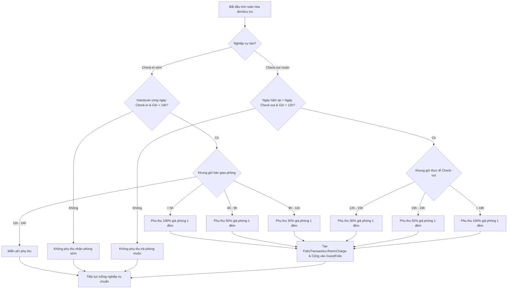

# Tài liệu Phân tích và Thay đổi Business Rules - PhucNguyen Resort & Tour Hub

Tài liệu này thực hiện so sánh, phân tích các Business Rules liên quan đến các nghiệp vụ **Đặt phòng (Booking Room)**, **Nhận phòng (Check-in)**, và **Trả phòng (Check-out)** giữa tài liệu SRS hiện tại (`SWP391_NHOM1_V2.md`) và mã nguồn thực tế của dự án (`PhucNguyenResort`). Từ đó, đề xuất các nội dung cần chỉnh sửa và bổ sung để tài liệu SRS phản ánh chính xác logic hoạt động của hệ thống.

---

## 1. Nghiệp vụ Đặt phòng (Booking Room)

### 1.1. So sánh & Phân tích chênh lệch

| Nội dung trong SRS                                                                                                                                 | Logic thực tế trong mã nguồn (`BookingService.cs`)                                                                                                                                                                                                                                                                                                                                                                                                                                                                                                                                                                                             | Đánh giá & Đề xuất chỉnh sửa                                                                                                                                   |
| :-------------------------------------------------------------------------------------------------------------------------------------------------- | :--------------------------------------------------------------------------------------------------------------------------------------------------------------------------------------------------------------------------------------------------------------------------------------------------------------------------------------------------------------------------------------------------------------------------------------------------------------------------------------------------------------------------------------------------------------------------------------------------------------------------------------------------- | :--------------------------------------------------------------------------------------------------------------------------------------------------------------------- |
| **BR-UC22-05**: Booking phải yêu cầu thanh toán đặt cọc trước khi được xác nhận hoàn toàn.                                    | Hệ thống quy định cứng số tiền đặt cọc**tối thiểu là 40%** tổng giá trị dịch vụ (bao gồm tiền phòng và tiền tour nếu có chọn tour add-on):`booking.DepositAmount = totalRoomPrice * 0.4m;`                                                                                                                                                                                                                                                                                                                                                                                                                         | **Cập nhật SRS**: Cần bổ sung quy định rõ ràng tỷ lệ đặt cọc tối thiểu là **40%** tổng giá trị hóa đơn ước tính.                  |
| **BR-UC23-04**: Việc hoàn tiền đặt cọc tuân theo chính sách hủy phòng. (Chưa mô tả chi tiết chính sách hủy trong Use Case). | Hệ thống triển khai chính sách hủy phòng tự động như sau:- Hủy trước giờ nhận phòng **trên 48 tiếng**: Khách được hoàn lại **100%** tiền cọc. Bản ghi `Refund` được tạo với trạng thái `Pending`.- Hủy trong vòng **48 tiếng** trước giờ nhận phòng: Khách nhận hoàn tiền **0%**.- Khi hủy đặt phòng, tất cả các tour đã đặt liên quan cũng tự động bị hủy và giải phóng slots.                                                                                                                                                                      | **Cập nhật SRS**: Bổ sung chi tiết chính sách hoàn cọc (100% nếu hủy > 48h, 0% nếu hủy <= 48h) và cơ chế tự động hủy dịch vụ tour đi kèm. |
| Chưa có quy định cho đăng ký trực tiếp tại quầy (Walk-in Booking).                                                                       | Phương thức Walk-in được xử lý qua`ProcessWalkInBookingAsync` với các ràng buộc nghiệp vụ nghiêm ngặt:- Số điện thoại khách hàng phải hợp lệ (chỉ gồm chữ số và độ dài từ 9 ký tự trở lên).- Tự động tạo tài khoản Customer mới bằng số điện thoại nếu chưa tồn tại.- Tiền cọc thanh toán trực tiếp tại quầy tối thiểu phải đạt 40% tổng tiền phòng.- Khi chọn nhận phòng ngay (Instant Check-in), bắt buộc phải khai báo tạm trú đầy đủ cho người đặt chính (Họ tên, Ngày sinh, Giới tính, Số CCCD/Passport, Quốc tịch) và các khách đi cùng. | **Bổ sung vào SRS**: Thêm mục Business Rules riêng cho hình thức Đặt phòng trực tiếp (Walk-in Booking).                                              |

### 1.2. Đề xuất nội dung thay đổi trong SRS (Module Đặt phòng)

```markdown
- **BR-UC22-05**: Đơn đặt phòng yêu cầu thanh toán đặt cọc tối thiểu **40% tổng giá trị dự kiến** (bao gồm tiền phòng và các tour add-on đặt trước) để chuyển từ trạng thái `PendingPayment` sang `Reserved`.
- **BR-UC22-06 (Bổ sung)**: Hệ thống tự động quét và hủy các đơn đặt phòng ở trạng thái `PendingPayment` quá hạn thanh toán quy định (thông qua job chạy ngầm `PendingBookingCleanupJob`).
- **BR-UC23-04**: Chính sách hủy đặt phòng và hoàn tiền đặt cọc:
  - Nếu khách hàng thực hiện hủy phòng trước giờ check-in dự kiến **trên 48 tiếng**: Hoàn lại **100% tiền đặt cọc**, tạo yêu cầu hoàn tiền `Refund` ở trạng thái chờ duyệt `Pending`.
  - Nếu hủy phòng trong vòng **48 tiếng** trước giờ check-in: **Không hoàn lại tiền đặt cọc** (tiền cọc mất 100%).
  - Khi đơn đặt phòng bị hủy, toàn bộ các lượt đặt tour liên kết (`TourBookings`) tự động chuyển sang trạng thái `Cancelled` và hoàn trả số chỗ (`AvailableSlots`) lại cho lịch trình tour.
- **BR-WKB-01 (Walk-in Booking - Bổ sung)**: Nghiệp vụ đặt phòng trực tiếp tại quầy (Walk-in Booking):
  - Số điện thoại của khách hàng phải gồm toàn ký tự số và độ dài tối thiểu là 9 ký tự.
  - Nếu khách hàng chưa có tài khoản trên hệ thống, hệ thống sẽ tự động tạo tài khoản Customer mới với mật khẩu mặc định và email tạm thời theo định dạng `[SĐT]@phucnguyenresort.temp`.
  - Yêu cầu thanh toán tiền cọc ngay tại quầy tối thiểu đạt **40%** tổng tiền phòng.
  - Nếu khách chọn nhận phòng ngay (`InstantCheckIn`), bắt buộc nhân viên lễ tân phải hoàn thành khai báo lưu trú cho người đặt chính (bao gồm các trường: Họ tên, Ngày sinh, Giới tính, Quốc tịch, Số CCCD/Passport) mới được thực hiện Check-in.
```

---

## 2. Nghiệp vụ Nhận phòng (Check-in)

### 2.1. So sánh & Phân tích chênh lệch

| Nội dung trong SRS                                                                                                    | Logic thực tế trong mã nguồn (`ReceptionService.cs`)                                                                                                                                                                                                                                                                                                                                                                                                                                                                                                                                                                                   | Đánh giá & Đề xuất chỉnh sửa                                                                                                                                     |
| :--------------------------------------------------------------------------------------------------------------------- | :------------------------------------------------------------------------------------------------------------------------------------------------------------------------------------------------------------------------------------------------------------------------------------------------------------------------------------------------------------------------------------------------------------------------------------------------------------------------------------------------------------------------------------------------------------------------------------------------------------------------------------------- | :----------------------------------------------------------------------------------------------------------------------------------------------------------------------- |
| **BR-UC51-01**: Chỉ các đơn đặt phòng có trạng thái đã xác nhận (Confirmed) mới được check-in. | Trong code, trạng thái cho phép Check-in linh hoạt hơn, bao gồm:`Reserved`, `PendingPayment`, hoặc `Arrived`.                                                                                                                                                                                                                                                                                                                                                                                                                                                                                                                   | **Cập nhật SRS**: Điều chỉnh các trạng thái đơn phòng được chấp nhận khi check-in.                                                                 |
| **BR-UC51-03**: Phải gán một phòng vật lý cụ thể trong quá trình check-in.                             | Hệ thống hỗ trợ 2 chế độ Check-in:1. **Arrival Only**: Đăng ký khách đã đến resort nhưng chưa nhận phòng vật lý (chuyển trạng thái sang `Arrived`). Chưa cần gán phòng vật lý.2. **Full Check-in**: Bắt buộc gán phòng vật lý phù hợp cho từng chi tiết đặt phòng (mỗi phòng chỉ gán cho 1 chi tiết và không được trùng lặp).                                                                                                                                                                                                                                           | **Cập nhật SRS**: Phân định rõ quy tắc gán phòng đối với chế độ đăng ký đến trước (Arrival Only) và nhận phòng thực tế (Full Check-in). |
| Chưa có quy định về phụ thu nhận phòng sớm.                                                                   | Hệ thống áp dụng chính sách phụ thu nhận phòng sớm (**Early Check-in Surcharge**) tự động nếu thời gian bàn giao phòng thực tế (`RoomHandoverTime`) sớm hơn giờ quy định (14:00) trong ngày nhận phòng:- Trước 06:00 AM: Phụ thu **100%** tiền phòng 1 đêm.- Từ 06:00 AM đến dưới 09:00 AM: Phụ thu **50%** tiền phòng 1 đêm.- Từ 09:00 AM đến dưới 11:00 AM: Phụ thu **30%** tiền phòng 1 đêm.- Từ 11:00 AM đến dưới 14:00 PM: **Miễn phí**.Khoản phụ thu này tự động ghi nhận vào Guest Folio dưới dạng giao dịch `RoomCharge`. | **Cập nhật SRS**: Đây là quy tắc nghiệp vụ tài chính quan trọng trong code, bắt buộc phải bổ sung vào SRS để đồng bộ thông tin.              |

### 2.2. Đề xuất nội dung thay đổi trong SRS (Module Nhận phòng)

```markdown
- **BR-UC51-01**: Lễ tân chỉ được thực hiện quy trình Check-in đối với các đơn đặt phòng ở trạng thái `Reserved` (Đã đặt cọc), `PendingPayment` (Chờ thanh toán), hoặc `Arrived` (Khách đã đến nơi).
- **BR-UC51-03**: Phân định quy trình nhận phòng tại quầy:
  - Nếu đăng ký khách đến trước (`IsArrivalOnly = true`): Trạng thái đơn phòng chuyển sang `Arrived`, tạo Guest Folio ghi nhận thông tin lưu trú, chưa cần gán số phòng vật lý.
  - Nếu nhận phòng thực tế (`IsArrivalOnly = false`): Bắt buộc phải chọn gán phòng vật lý cụ thể cho tất cả các chi tiết phòng trong đơn. Một phòng vật lý không được gán trùng lặp cho nhiều chi tiết phòng hoặc nhiều đơn đặt phòng có lịch ở trùng nhau. Trạng thái phòng chuyển sang `Occupied` và trạng thái đơn phòng chuyển sang `CheckedIn`.
- **BR-UC51-06 (Bổ sung - Phụ thu nhận phòng sớm)**: Quy tắc tính phí phụ thu khi khách hàng nhận phòng sớm (Early Check-in Surcharge) trong ngày check-in:
  - Bàn giao phòng trước **06:00 AM**: Thu thêm **100%** đơn giá phòng/đêm.
  - Bàn giao phòng từ **06:00 AM đến dưới 09:00 AM**: Thu thêm **50%** đơn giá phòng/đêm.
  - Bàn giao phòng từ **09:00 AM đến dưới 11:00 AM**: Thu thêm **30%** đơn giá phòng/đêm.
  - Bàn giao phòng từ **11:00 AM đến dưới 14:00 PM**: **Miễn phí phụ thu**.
  - Toàn bộ phí phụ thu này được tự động tạo dưới dạng giao dịch tính phí phòng (`FolioTransactionType.RoomCharge`) và cộng trực tiếp vào Guest Folio của khách hàng.
```

---

## 3. Nghiệp vụ Trả phòng (Check-out)

### 3.1. So sánh & Phân tích chênh lệch

| Nội dung trong SRS                                                                             | Logic thực tế trong mã nguồn (`ReceptionService.cs`)                                                                                                                                                                                                                                                                                                                                                                                                                                                                                                    | Đánh giá & Đề xuất chỉnh sửa                                                                                                                     |
| :---------------------------------------------------------------------------------------------- | :------------------------------------------------------------------------------------------------------------------------------------------------------------------------------------------------------------------------------------------------------------------------------------------------------------------------------------------------------------------------------------------------------------------------------------------------------------------------------------------------------------------------------------------------------------ | :------------------------------------------------------------------------------------------------------------------------------------------------------- |
| **BR-UC53-01**: Khách hàng không thể check-out nếu hóa đơn chưa thanh toán.     | Đúng. Hệ thống tính toán khoản chênh lệch cần trả`BalanceDue = TotalAmount - DepositAmount`. Nếu `BalanceDue > 0`, lễ tân bắt buộc phải chọn phương thức thanh toán để xử lý giao dịch.                                                                                                                                                                                                                                                                                                                                        | **Cập nhật SRS**: Giữ nguyên và bổ sung chi tiết về phương thức xử lý thanh toán phần chênh lệch `BalanceDue`.                  |
| Chưa có quy định về phụ thu trả phòng muộn.                                            | Hệ thống tự động tính toán phí phụ thu trả phòng muộn (**Late Check-out Surcharge**) nếu thời gian thực hiện trả phòng muộn hơn giờ tiêu chuẩn (12:00 PM) trong ngày trả phòng:- Từ 12:00 PM đến dưới 15:00 PM: Phụ thu **30%** tổng tiền phòng 1 đêm.- Từ 15:00 PM đến dưới 18:00 PM: Phụ thu **50%** tổng tiền phòng 1 đêm.- Từ 18:00 PM trở đi: Phụ thu **100%** tổng tiền phòng 1 đêm.Phí phụ thu này tự động cộng vào Guest Folio trước khi chốt hóa đơn. | **Cập nhật SRS**: Bổ sung chi tiết quy tắc phụ thu muộn để nhân viên và khách hàng nắm rõ cách tính toán hóa đơn tổng hợp. |
| **BR-UC53-04**: Trạng thái phòng phải chuyển thành Needs Cleaning sau khi checkout. | Đúng. Mã nguồn thực thi chuyển trạng thái tất cả phòng vật lý trong đơn đặt sang`NeedsCleaning` để chuyển tiếp sang bộ phận Buồng phòng (Housekeeping).                                                                                                                                                                                                                                                                                                                                                                            | **Giữ nguyên**.                                                                                                                                  |
| Chưa quy định về việc gửi thông báo sau checkout.                                       | Trong code, sau khi lưu các thay đổi checkout thành công, hệ thống tự động gửi email thông báo check-out kèm hóa đơn điện tử cho khách hàng thông qua template`CheckOutSuccess.html`.                                                                                                                                                                                                                                                                                                                                               | **Cập nhật SRS**: Bổ sung quy trình tự động gửi hóa đơn và thông báo cảm ơn qua email.                                             |

### 3.2. Đề xuất nội dung thay đổi trong SRS (Module Trả phòng)

```markdown
- **BR-UC53-01**: Khách hàng chỉ được phép hoàn thành thủ tục Check-out khi số dư cần thanh toán (`BalanceDue = Tổng hóa đơn - Tiền đặt cọc`) đã được thanh toán đầy đủ (xác nhận bằng việc chọn một phương thức thanh toán hợp lệ và hệ thống ghi nhận giao dịch thành công).
- **BR-UC53-05 (Bổ sung - Phụ thu trả phòng muộn)**: Quy tắc tính phí phụ thu khi khách hàng trả phòng muộn (Late Check-out Surcharge) so với giờ quy định (12:00 PM trưa) trong ngày check-out:
  - Trả phòng từ **12:00 PM đến dưới 15:00 PM**: Phụ thu **30%** tổng đơn giá phòng/đêm của tất cả phòng trong đơn.
  - Trả phòng từ **15:00 PM đến dưới 18:00 PM**: Phụ thu **50%** tổng đơn giá phòng/đêm của tất cả phòng trong đơn.
  - Trả phòng sau **18:00 PM**: Phụ thu **100%** tổng đơn giá phòng/đêm của tất cả phòng trong đơn.
  - Khoản phụ thu này được hệ thống tự động thêm vào danh sách giao dịch dưới dạng `RoomCharge` và cập nhật vào tổng giá trị của hóa đơn trước khi tiến hành thanh toán cuối cùng.
- **BR-UC53-06 (Bổ sung - Gửi hóa đơn điện tử)**: Sau khi hoàn tất check-out và xác nhận thanh toán, hệ thống phải tự động gửi email thông báo trả phòng thành công kèm theo chi tiết hóa đơn (mã hóa đơn, tổng tiền, tiền cọc, số tiền đã thanh toán) cho khách hàng theo địa chỉ email đăng ký trên đơn phòng.
```

---

## 4. Báo cáo Tóm tắt Thay đổi

Dưới đây là sơ đồ tóm tắt luồng xử lý thực tế trong mã nguồn đối với hai trường hợp Phụ thu Nhận phòng sớm / Trả phòng muộn nhằm làm rõ thiết kế kỹ thuật:



Tất cả các thay đổi trên giúp cho tài liệu SRS và mã nguồn C# thực tế ăn khớp hoàn toàn, đảm bảo tính nhất quán của hệ thống tài liệu dự án SWP391.
