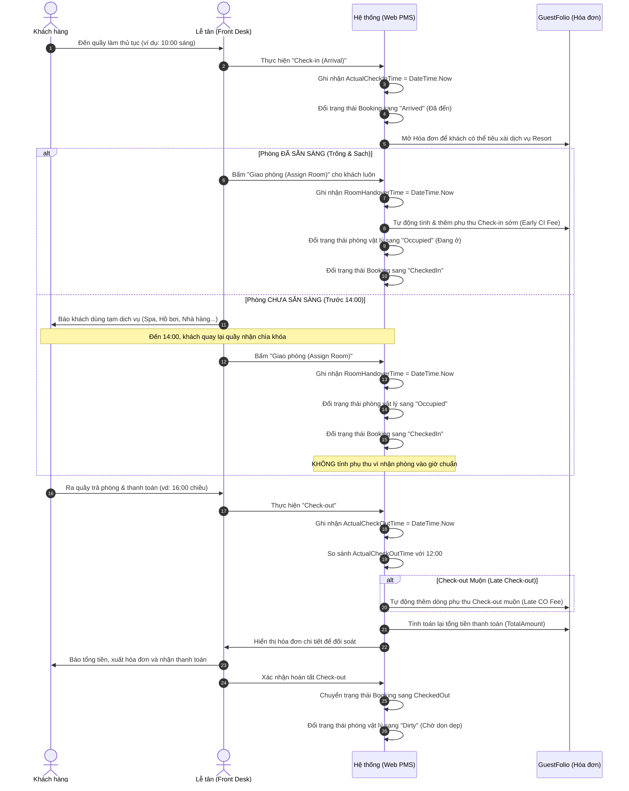
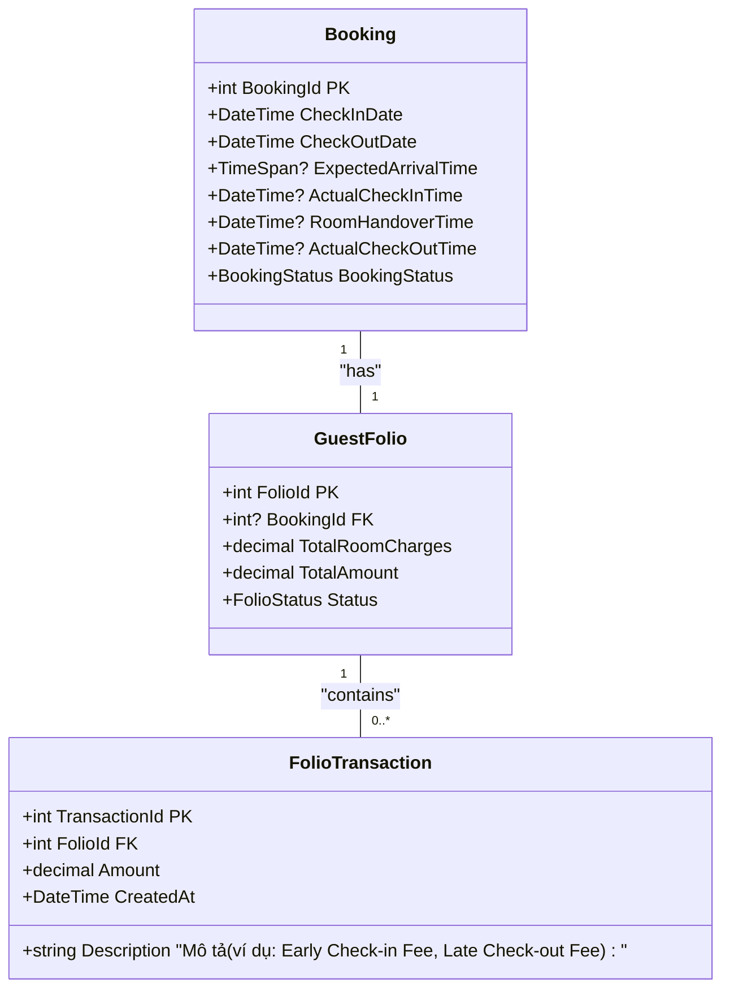

# Kế hoạch Nghiệp vụ & Kỹ thuật: Theo dõi Thời gian Check-in/Check-out Thực tế & Tự động Tính Phụ phí

## 1. Giới thiệu & Mục tiêu (Overview & Objectives)

Hiện tại, hệ thống của **Phúc Nguyên Resort** đang quản lý việc nhận/trả phòng dựa trên hai trường ngày là `CheckInDate` và `CheckOutDate` (kiểu dữ liệu Date, mặc định thời gian cố định). Quy trình này chưa phản ánh đúng thực tế vận hành và dẫn đến các hạn chế:
- **Thất thoát doanh thu:** Không tính được phụ thu khi khách nhận phòng sớm (Early Check-in) hoặc trả phòng muộn (Late Check-out).
- **Thiếu chính xác trong vận hành buồng phòng:** Bộ phận dọn dẹp không biết chính xác thời điểm khách đã rời phòng để vào dọn dẹp ngay lập tức.
- **Gian lận dịch vụ:** Không có log đối soát thời gian check-in/out thực tế của lễ tân để kiểm tra chéo với doanh thu hóa đơn.

**Mục tiêu của kế hoạch này:**
1. Tách bạch quy trình **Check-in (Đăng ký khách đến)** và **Bàn giao phòng (Room Handover)** để linh hoạt hỗ trợ khách đến sớm có thể sử dụng dịch vụ Resort.
2. Ghi nhận thời gian khách đến (`ActualCheckInTime`), thời gian nhận phòng (`RoomHandoverTime`) và Check-out (`ActualCheckOutTime`).
3. Tự động hóa nghiệp vụ tính phụ phí (Surcharge) dựa trên thời gian nhận phòng thực tế và trả phòng thực tế so với giờ tiêu chuẩn.
4. Đồng bộ trạng thái buồng phòng (Housekeeping Status) chính xác theo thời gian thực.

---

## 2. Quy tắc Nghiệp vụ Phụ phí (Business Rules)

Giờ chuẩn quy định của **Phúc Nguyên Resort**:
- **Giờ Check-in tiêu chuẩn:** Từ **14:00** ngày nhận phòng.
- **Giờ Check-out tiêu chuẩn:** Trước **12:00** ngày trả phòng.

Hệ thống sẽ áp dụng quy tắc tự động đề xuất phụ thu khi làm thủ tục Check-in/Check-out thực tế:

### A. Quy tắc Check-in Sớm (Early Check-in Surcharge)
Tính phụ phí dựa vào khoảng thời gian khách thực tế nhận chìa khóa phòng (`RoomHandoverTime`) vào ngày nhận phòng. *(Ghi chú: Nếu khách chỉ Check-in đến Resort để sử dụng dịch vụ công cộng mà chưa nhận phòng thì **không** tính phụ thu này).*
- **Trước 06:00 sáng:** Phụ thu **100%** giá tiền phòng/đêm.
- **Từ 06:00 đến trước 09:00 sáng:** Phụ thu **50%** giá tiền phòng/đêm.
- **Từ 09:00 đến trước 14:00 chiều:** Phụ thu **30%** giá tiền phòng/đêm.
- **Từ 14:00 trở đi:** Không phụ thu (Tính theo giờ chuẩn).

### B. Quy tắc Check-out Muộn (Late Check-out Surcharge)
Tính phụ phí dựa vào khoảng thời gian của `ActualCheckOutTime` vào ngày trả phòng:
- **Từ 12:00 đến trước 15:00 chiều:** Phụ thu **30%** giá tiền phòng/đêm.
- **Từ 15:00 đến trước 18:00 chiều:** Phụ thu **50%** giá tiền phòng/đêm.
- **Từ 18:00 trở đi:** Phụ thu **100%** giá tiền phòng/đêm.

> [!NOTE]
> - Giá tiền phòng/đêm dùng để tính phụ thu là giá phòng thực tế tại thời điểm đặt phòng (`Price` trong `BookingDetail`).
> - Phụ phí sẽ được hệ thống đề xuất dưới dạng một giao dịch phát sinh tự động trong Hóa đơn phòng (`GuestFolio` / `FolioTransaction`). Lễ tân có quyền giảm trừ hoặc miễn phí phụ thu này (FOC - Free of Charge) nếu có sự đồng ý của quản lý.

---

## 3. Quy trình Trải nghiệm Người dùng & Hệ thống (User & System Flow)



---

## 4. Thiết kế Cơ sở dữ liệu (Database Schema Design)

Chúng ta cần mở rộng các trường thông tin trong bảng [Booking.cs](file:///e:/SWP391_PROJECT/su26-swp391-se2023-g1/PhucNguyenResort/PhucNguyenResort/Models/Booking.cs) để lưu vết thời gian.

### A. Cập nhật Model `Booking`
Thêm các thuộc tính mới phục vụ lưu vết thời gian và tách quy trình:
- `ExpectedArrivalTime` (`TimeSpan?`): Lưu giờ dự kiến khách sẽ đến (ví dụ: 15:30) phục vụ chuẩn bị phòng.
- `ActualCheckInTime` (`DateTime?`): Thời gian thực tế khách đến resort làm thủ tục (Arrival).
- `RoomHandoverTime` (`DateTime?`): Thời gian thực tế lễ tân bàn giao chìa khóa và phòng cho khách.
- `ActualCheckOutTime` (`DateTime?`): Thời gian thực tế lễ tân bấm nút Check-out và xác nhận thanh toán.



---

## 5. Thiết kế Giao diện & Kỹ thuật (UI/UX & Code Implementation)

### A. Cập nhật Trang Đặt phòng phía Khách hàng
*   **Trang Checkout trực tuyến (`Views/Bookings/Create.cshtml`):**
    *   Bổ sung thêm một input để khách hàng nhập/chọn giờ dự kiến đến:
        ```html
        <div class="form-group col-md-6">
            <label for="ExpectedArrivalTime">Giờ dự kiến đến (Dưới dạng 24h):</label>
            <select class="form-control" id="ExpectedArrivalTime" name="ExpectedArrivalTime">
                <option value="">-- Không xác định --</option>
                <option value="12:00:00">12:00 - 14:00</option>
                <option value="14:00:00">14:00 - 16:00 (Giờ tiêu chuẩn)</option>
                <option value="16:00:00">16:00 - 18:00</option>
                <option value="18:00:00">Sau 18:00</option>
            </select>
        </div>
        ```

### B. Cập nhật Quy trình Check-in & Giao phòng phía Lễ tân (`ReceptionService.cs`)
Quy trình giờ đây được tách làm 2 bước (có thể thực hiện liên tiếp hoặc cách nhau một khoảng thời gian).

*   **Bước 1: Khi lễ tân bấm "Check-in (Arrival)":**
    *   Lưu thời gian khách đến: `booking.ActualCheckInTime = DateTime.Now;`
    *   Chuyển trạng thái `BookingStatus = Arrived` (để khách có thể bắt đầu sử dụng dịch vụ và mở hóa đơn nhưng chưa nhận phòng).

*   **Bước 2: Khi lễ tân bấm "Giao phòng (Assign Room)":**
    *   Lưu thời gian giao phòng: `booking.RoomHandoverTime = DateTime.Now;`
    *   Chuyển trạng thái `BookingStatus = CheckedIn` và phòng vật lý sang `Occupied`.
    *   **Kiểm tra logic tính phụ thu nhận phòng sớm (tính theo giờ giao phòng):**
        ```csharp
        if (booking.RoomHandoverTime.Value.Date == booking.CheckInDate.Date)
        {
            var handoverHour = booking.RoomHandoverTime.Value.TimeOfDay;
            if (handoverHour < TimeSpan.FromHours(14))
            {
                // Logic tính phụ thu sớm
                decimal roomPrice = booking.BookingDetails.Sum(bd => bd.Price ?? 0);
                decimal surcharge = 0;

                if (handoverHour < TimeSpan.FromHours(6))
                {
                    surcharge = roomPrice * 1.0m; // 100% giá 1 đêm
                }
                else if (handoverHour < TimeSpan.FromHours(9))
                {
                    surcharge = roomPrice * 0.5m; // 50%
                }
                else
                {
                    surcharge = roomPrice * 0.3m; // 30%
                }

                // Thêm một FolioTransaction ghi nhận phụ thu
                var folioTransaction = new FolioTransaction
                {
                    FolioId = booking.GuestFolio.FolioId,
                    Description = $"Phụ thu Giao phòng sớm lúc {booking.RoomHandoverTime.Value:HH:mm}",
                    Amount = surcharge,
                    CreatedAt = DateTime.Now
                };
                _context.FolioTransactions.Add(folioTransaction);
            }
        }
        ```

### C. Cập nhật Quy trình Check-out phía Lễ tân (`ReceptionService.cs`)
*   **Khi lễ tân bấm Check-out:**
    *   Lưu thời gian thực tế: `booking.ActualCheckOutTime = DateTime.Now;`
    *   Kiểm tra logic trả phòng muộn:
        ```csharp
        if (booking.ActualCheckOutTime.Value.Date == booking.CheckOutDate.Date)
        {
            var checkOutHour = booking.ActualCheckOutTime.Value.TimeOfDay;
            if (checkOutHour > TimeSpan.FromHours(12))
            {
                // Logic tính phụ thu muộn
                decimal roomPrice = booking.BookingDetails.Sum(bd => bd.Price ?? 0);
                decimal surcharge = 0;

                if (checkOutHour <= TimeSpan.FromHours(15))
                {
                    surcharge = roomPrice * 0.3m; // 30% giá 1 đêm
                }
                else if (checkOutHour <= TimeSpan.FromHours(18))
                {
                    surcharge = roomPrice * 0.5m; // 50%
                }
                else
                {
                    surcharge = roomPrice * 1.0m; // 100%
                }

                // Thêm vào FolioTransaction
                var folioTransaction = new FolioTransaction
                {
                    FolioId = booking.GuestFolio.FolioId,
                    Description = $"Phụ thu Check-out muộn lúc {booking.ActualCheckOutTime.Value:HH:mm}",
                    Amount = surcharge,
                    CreatedAt = DateTime.Now
                };
                _context.FolioTransactions.Add(folioTransaction);
            }
        }
        ```
    *   Đổi trạng thái các phòng của booking này sang `RoomStatus.Dirty` (Cần dọn dẹp) để bộ phận Housekeeping bắt đầu làm việc.

---

## 6. Kế hoạch Kiểm thử & Kiểm tra (Verification Plan)

### A. Kiểm thử Tự động (Automated Tests)
- **Unit Test 1 (`CheckIn_Surcharge_CalculatesCorrectly`):** Giả lập check-in lúc 08:30 sáng, kiểm tra xem hệ thống có tạo ra FolioTransaction với số tiền bằng đúng 50% giá phòng/đêm hay không.
- **Unit Test 2 (`CheckOut_Surcharge_CalculatesCorrectly`):** Giả lập check-out lúc 16:15 chiều, kiểm tra xem hệ thống có tạo ra FolioTransaction phụ thu 50% giá phòng/đêm hay không.

### B. Kiểm thử Thủ công (Manual Verification)
1. **Kiểm tra nghiệp vụ Khách đến (Arrival):** Thực hiện Check-in cho khách lúc 10:00 sáng. Kiểm tra xem Folio đã mở chưa, khách có bị tính phụ thu sớm không (Kỳ vọng: KHÔNG tính phụ thu nếu chưa giao phòng).
2. **Kiểm tra nghiệp vụ Giao phòng sớm:** Bấm "Giao phòng" cho khách trên lúc 10:15 sáng do có phòng trống. Kiểm tra tab Hóa đơn (Folio) xem có tự động sinh dòng giao dịch "Phụ thu Giao phòng sớm" đúng số tiền 30% hay không.
3. **Kiểm tra nghiệp vụ Giao phòng đúng giờ:** Khách khác Check-in lúc 09:00, nhưng 14:00 mới bấm "Giao phòng". Kiểm tra hóa đơn (Kỳ vọng: Không có dòng phụ thu phòng sớm).
4. **Kiểm tra nghiệp vụ Check-out:** Tiến hành check-out thực tế muộn lúc 19:00 tối. Mở màn hình hóa đơn thanh toán, xác nhận xem tổng số tiền khách phải trả đã cộng thêm 100% tiền của 1 đêm hay chưa.
3. **Kiểm tra trạng thái phòng:** Sau khi hoàn tất bấm nút Check-out, truy cập danh sách phòng vật lý, kiểm tra xem phòng vừa check-out có chuyển sang trạng thái "Dirty" thành công hay không.
