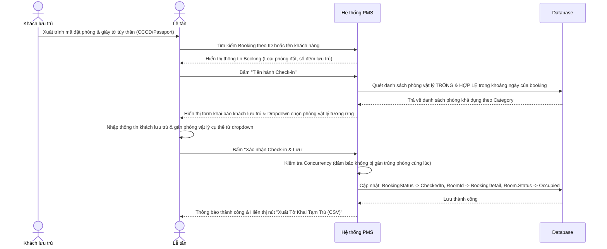

# Kế hoạch Nghiệp vụ & Thiết kế: Check-In & Gán Phòng (Room Assignment)

Tài liệu này đặc tả chi tiết quy trình nghiệp vụ và giải pháp thiết kế cho tính năng **Check-in kết hợp Gán phòng vật lý** cho resort.

---

## 1. Phân tích Nghiệp vụ (Business Analysis)

### 1.1. Thực tế vận hành (PMS Business Operations)
*   **Booking theo loại phòng (Category Booking)**: Khi khách đặt phòng trên trang chủ (Room Reservation), họ chỉ chọn loại phòng (Deluxe, Suite, Villa) chứ không được chọn số phòng vật lý cụ thể (ví dụ: phòng 101, 102). Việc này giúp tối ưu hóa công suất phòng (occupancy) của resort.
*   **Gán phòng vật lý (Room Assignment / Allocation)**: Khi làm thủ tục nhận phòng (Check-in) tại quầy Lễ tân, Lễ tân sẽ đối chiếu giấy tờ và chọn phòng vật lý cụ thể đang **sẵn sàng** (Clean & Available) thuộc đúng loại phòng khách đã đặt để gán cho khách.
*   **Thiết kế Database**: Thực thể `BookingDetail` hiện tại đã có sẵn thuộc tính `RoomId` (cho phép nullable). Ban đầu khi tạo booking, `RoomId` sẽ bằng `null`. Khi làm thủ tục check-in, Lễ tân sẽ cập nhật giá trị `RoomId` này.

### 1.2. Luồng xử lý chi tiết (Detailed Workflow)



---

## 2. Các Luật Nghiệp vụ Cốt lõi (Business Rules - BR)

Để đảm bảo tính chính xác và tránh xung đột dữ liệu, hệ thống phải tuân thủ các quy tắc sau:

| Quy tắc ID | Tên quy tắc | Nội dung đặc tả |
| :--- | :--- | :--- |
| **BR-ASSIGN-01** | **Khớp Loại Phòng (Category Match)** | Phòng vật lý được gán cho `BookingDetail` bắt buộc phải có `CategoryId` trùng khớp với `RoomCategoryId` của dòng chi tiết đặt phòng đó. |
| **BR-ASSIGN-02** | **Trạng thái phòng khả dụng** | Loại bỏ các phòng có trạng thái `RoomStatus.Maintenance` (Đang bảo trì) ra khỏi danh sách gợi ý gán phòng. |
| **BR-ASSIGN-03** | **Tránh trùng phòng (No Double-Booking)** | Một phòng vật lý **không** được gán cho booking hiện tại nếu phòng đó đang bị chiếm dụng bởi một booking khác có lịch lưu trú trùng lặp:<br>`CheckInDate < Other.CheckOutDate && CheckOutDate > Other.CheckInDate`<br>(loại trừ các booking đã hủy `Cancelled` hoặc đã trả phòng `CheckedOut`). |
| **BR-ASSIGN-04** | **Yêu cầu gán phòng bắt buộc** | Để hoàn tất thủ tục check-in, tất cả các `BookingDetail` thuộc Booking đó bắt buộc phải được chọn số phòng vật lý cụ thể (không được để trống `RoomId`). |
| **BR-ASSIGN-05** | **Đồng bộ trạng thái check-in** | Sau khi check-in thành công:<br>1. Trạng thái phòng vật lý chuyển sang `Occupied` (Đang có khách).<br>2. Trạng thái Booking chuyển sang `CheckedIn`. |

---

## 3. Thiết kế Kỹ thuật (Technical Specification)

### 3.1. Cấu trúc ViewModel mới
Cập nhật [PreCheckinViewModel.cs](file:///e:/SWP391_PROJECT/su26-swp391-se2023-g1/PhucNguyenResort/PhucNguyenResort/ViewModels/Bookings/PreCheckinViewModel.cs):

```csharp
namespace PhucNguyenResort.ViewModels.Bookings
{
    public class PreCheckinViewModel
    {
        public int BookingId { get; set; }
        
        // Thông tin hiển thị tĩnh trên giao diện
        public string CategoryName { get; set; } = string.Empty;
        public DateTime CheckInDate { get; set; }
        public DateTime CheckOutDate { get; set; }
        public bool PdpdConsentChecked { get; set; }

        // Danh sách gán phòng vật lý cho từng phòng đã đặt
        public List<BookingDetailAssignmentViewModel> RoomAssignments { get; set; } = new();

        // Danh sách khai báo khách lưu trú thực tế
        public List<BookingGuestDto> Guests { get; set; } = new();
    }

    public class BookingDetailAssignmentViewModel
    {
        public int BookingDetailId { get; set; }
        public int RoomCategoryId { get; set; }
        public string CategoryName { get; set; } = string.Empty;
        
        // RoomId được chọn từ dropdown
        [Required(ErrorMessage = "Vui lòng gán phòng cụ thể.")]
        public int? SelectedRoomId { get; set; }

        // Danh sách các phòng vật lý khả dụng để hiển thị lên Dropdown
        public List<RoomDto> AvailableRooms { get; set; } = new();
    }

    public class RoomDto
    {
        public int RoomId { get; set; }
        public string RoomNumber { get; set; } = string.Empty;
    }
}
```

### 3.2. Logic trong Dịch vụ (Service Layer)

Thêm các phương thức mới vào `IReceptionService` và [ReceptionService.cs](file:///e:/SWP391_PROJECT/su26-swp391-se2023-g1/PhucNguyenResort/PhucNguyenResort/Services/Reception/ReceptionService.cs):

#### A. Tìm kiếm phòng khả dụng (Get Available Rooms for Check-In)
```csharp
public async Task<List<Room>> GetAvailableRoomsForCategoryAsync(int categoryId, DateTime checkIn, DateTime checkOut, int? currentBookingId = null)
{
    // 1. Lấy tất cả phòng vật lý thuộc Category đang hoạt động bình thường
    var allRooms = await _context.Rooms
        .Where(r => r.CategoryId == categoryId && r.Status != RoomStatus.Maintenance)
        .ToListAsync();

    // 2. Tìm danh sách RoomId đã bị gán cho các booking khác trùng lịch lưu trú
    var occupiedRoomIds = await _context.BookingDetails
        .Where(bd => bd.RoomCategoryId == categoryId &&
                     bd.RoomId != null &&
                     bd.BookingId != currentBookingId &&
                     bd.Booking != null &&
                     bd.Booking.BookingStatus != BookingStatus.Cancelled &&
                     bd.Booking.BookingStatus != BookingStatus.CheckedOut &&
                     bd.Booking.CheckInDate < checkOut &&
                     bd.Booking.CheckOutDate > checkIn)
        .Select(bd => bd.RoomId!.Value)
        .Distinct()
        .ToListAsync();

    // 3. Loại trừ các phòng đã bị chiếm dụng
    return allRooms.Where(r => !occupiedRoomIds.Contains(r.RoomId)).ToList();
}
```

#### B. Nạp dữ liệu phòng trống cho View Check-in
Khi chuẩn bị ViewModel:
1. Lấy thông tin `Booking` kèm danh sách `BookingDetails`.
2. Với mỗi `BookingDetail`, gọi hàm `GetAvailableRoomsForCategoryAsync` để lấy danh sách các phòng khả dụng.
3. Map sang `BookingDetailAssignmentViewModel` và gắn vào `PreCheckinViewModel`.

#### C. Thực hiện xác nhận Check-in (`ProcessCheckInAsync`)
Khi lễ tân submit form:
1. Xác thực đầy đủ thông tin khách lưu trú (CCCD, Họ tên, Quốc tịch).
2. Lặp qua danh sách `RoomAssignments` từ model gửi lên, tìm `BookingDetail` trong database và gán `RoomId = assignment.SelectedRoomId`.
3. Đổi trạng thái của phòng vật lý đó thành `RoomStatus.Occupied`.
4. Đổi trạng thái Booking thành `BookingStatus.CheckedIn`.
5. Thực hiện `await _context.SaveChangesAsync()`. (Catch lỗi `DbUpdateConcurrencyException` nếu có xung đột gán phòng).

---

## 4. Thiết kế Giao diện (UI/UX Razor Views)

Cập nhật giao diện [CheckIn.cshtml](file:///e:/SWP391_PROJECT/su26-swp391-se2023-g1/PhucNguyenResort/PhucNguyenResort/Views/Reception/CheckIn.cshtml):
*   Tại cột thông tin phòng bên phải, thay vì hiển thị tĩnh `@Model.RoomNumber`, ta sẽ render vòng lặp `RoomAssignments` dạng Dropdown.
*   Ví dụ thiết kế Razor:
    ```html
    @for (int i = 0; i < Model.RoomAssignments.Count; i++)
    {
        <div class="form-group">
            <label class="font-weight-bold small">Chi tiết phòng #@(i+1) (@Model.RoomAssignments[i].CategoryName)</label>
            <input type="hidden" asp-for="RoomAssignments[i].BookingDetailId" />
            <input type="hidden" asp-for="RoomAssignments[i].RoomCategoryId" />
            <input type="hidden" asp-for="RoomAssignments[i].CategoryName" />
            <select asp-for="RoomAssignments[i].SelectedRoomId" class="form-control" 
                    asp-items="@(new SelectList(Model.RoomAssignments[i].AvailableRooms, "RoomId", "RoomNumber"))">
                <option value="">-- Chọn phòng vật lý --</option>
            </select>
            <span asp-validation-for="RoomAssignments[i].SelectedRoomId" class="text-danger small"></span>
        </div>
    }
    ```
