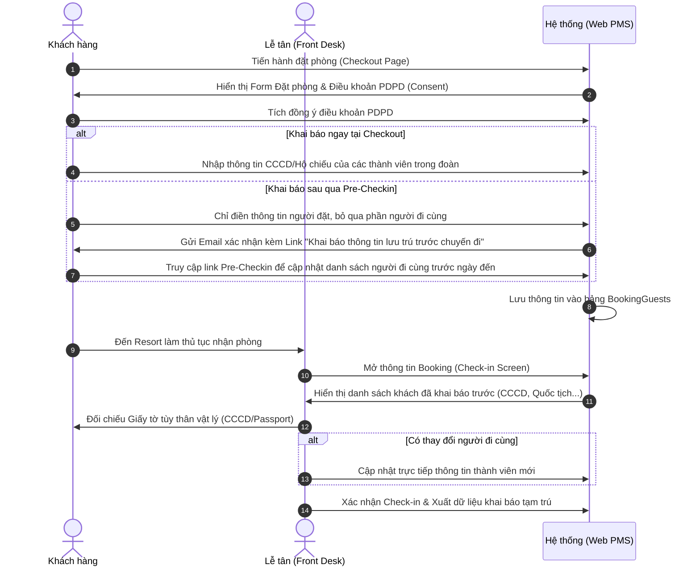
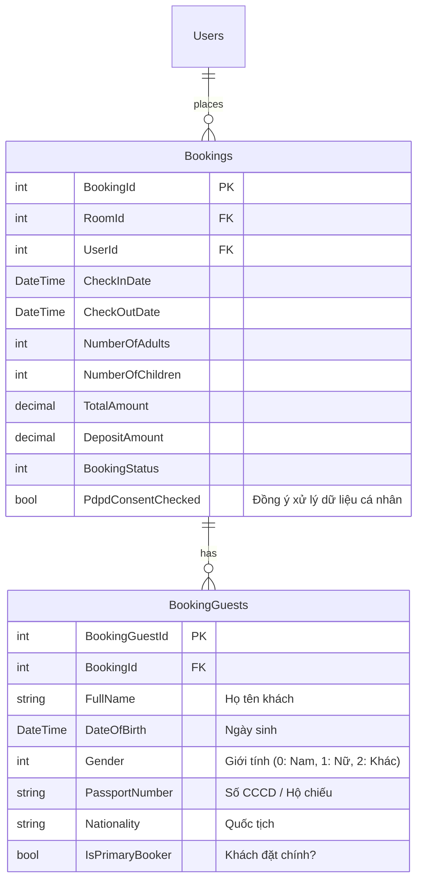

# Kế hoạch Nghiệp vụ & Kỹ thuật: Khai báo Thông tin Khách lưu trú (Tạm trú) & Tuân thủ PDPD

## 1. Giới thiệu & Mục tiêu (Overview & Objectives)

Để tối ưu hóa quy trình Front Desk và nâng cao trải nghiệm khách hàng tại **Phúc Nguyên Resort**, hệ thống cần cho phép khách hàng khai báo trước thông tin cá nhân của tất cả người đi cùng (Họ tên, Ngày sinh, Số CCCD/Hộ chiếu, Quốc tịch, Giới tính) ngay khi đặt phòng hoặc trước khi Check-in (Pre-Arrival Declaration).

Khi khách đến resort, lễ tân chỉ cần đối chiếu nhanh giấy tờ tùy thân thực tế với dữ liệu đã khai báo trước đó trong hệ thống, thực hiện check-in và gửi báo cáo tạm trú tự động (hoặc xuất file báo cáo tạm trú cho Cơ quan Công an địa phương theo **Luật Cư trú 2020**).

---

## 2. Ràng buộc Pháp lý & Tuân thủ (Regulatory Compliance)

### A. Luật Cư trú 2020 (Temporary Residence Registration)

Cơ sở lưu trú du lịch có trách nhiệm thông báo lưu trú với cơ quan Công an xã, phường, thị trấn nơi có cơ sở lưu trú. Các thông tin bắt buộc phải thu thập bao gồm:

1. **Họ và tên khai sinh** (Full Name)
2. **Ngày, tháng, năm sinh** (Date of Birth)
3. **Giới tính** (Gender)
4. **Số Định danh cá nhân / Số CCCD / Số Hộ chiếu** (Passport/ID Number)
5. **Quốc tịch** (Nationality)
6. **Thời gian tạm trú dự kiến** (Ngày Nhận & Trả phòng)

### B. Nghị định 356/2025/NĐ-CP về Bảo vệ dữ liệu cá nhân (PDPD)

Số CCCD, số hộ chiếu và ngày sinh là các dữ liệu cá nhân nhạy cảm. Do đó hệ thống phải tuân thủ nghiêm ngặt các quy định sau:

- **Sự đồng ý rõ ràng (Explicit Consent):** Khách hàng phải chủ động tích chọn ô đồng ý cho hệ thống lưu trữ và xử lý thông tin cá nhân cho mục đích khai báo tạm trú.
- **Quyền được xóa dữ liệu (Right to Deletion - Article 5):** Khách hàng có quyền yêu cầu xóa hoặc hệ thống phải tự động ẩn/mã hóa số CCCD/Hộ chiếu sau khi hoàn tất kỳ nghỉ và thanh toán (chỉ giữ lại thông tin tài chính phục vụ báo cáo doanh thu và kế toán).

---

## 3. Quy trình Trải nghiệm Người dùng (User Flow)



### Chi tiết các bước:

1. **Bước 1: Trang thanh toán cọc (Bookings/Create)**
   - Form thanh toán hiển thị hộp đồng ý: *"Tôi đồng ý cung cấp thông tin cá nhân của các thành viên trong đoàn cho mục đích khai báo tạm trú theo Nghị định 356/2025/NĐ-CP."* (PDPD Consent Checkbox - Bắt buộc tích để lưu CCCD).
   - Hiển thị danh sách nhập liệu cho người đi cùng tương ứng với số lượng người lớn và trẻ em đã chọn.
   - Để tránh làm giảm tỷ lệ chuyển đổi (giảm Friction khi thanh toán), **cho phép người dùng bỏ qua bước nhập chi tiết CCCD của người đi cùng tại thời điểm thanh toán**, nhưng bắt buộc nhập thông tin của Người đặt phòng chính.
2. **Bước 2: Pre-Checkin (Khai báo sau đặt phòng)**
   - Sau khi thanh toán cọc thành công, email xác nhận đặt phòng tự động gửi link quản lý đặt phòng.
   - Giao diện quản lý đặt phòng cho phép khách hàng cập nhật, bổ sung thông tin CCCD/Passport của các thành viên trước khi đến khách sạn (Pre-Checkin).
3. **Bước 3: Lễ tân làm thủ tục nhận phòng (Check-In)**
   - Khi Khách đến, lễ tân tìm kiếm booking ID trên Dashboard.
   - Lễ tân thấy toàn bộ danh sách khách đi kèm đã được điền sẵn thông tin. Lễ tân chỉ cần quét hoặc đối chiếu CCCD thực tế với thông tin trên màn hình trong vòng **30 giây** để hoàn tất check-in, thay vì mất 5-10 phút gõ tay từng người như trước.

---

## 4. Thiết kế Cơ sở dữ liệu (Database Schema Design)

Chúng ta sử dụng bảng `BookingGuest` hiện có và mở rộng thêm các trường thông tin cần thiết.



### Migration đề xuất cho Entity `BookingGuest` & `Booking`:

1. **Bổ sung trường vào `Booking`**:
   - `bool PdpdConsentChecked { get; set; }` (Lưu vết khách hàng đã đồng ý điều khoản bảo mật thông tin).
2. **Bổ sung/cập nhật trường vào `BookingGuest`**:
   - `Gender` (Enum hoặc int đại diện cho Giới tính: Nam, Nữ, Khác).
   - `IsPrimaryBooker` (bool xác định đây có phải người đứng tên đặt phòng chính hay không).

---

## 5. Thiết kế Giao diện (UI/UX Mockup & Implementation)

### A. Trang Đặt phòng (Checkout Page - `Bookings/Create.cshtml`)

Thêm phần nhập danh sách thành viên đi kèm dưới dạng Tab hoặc danh sách co giãn (Accordion):

- Khi chọn số lượng khách lớn, hiển thị số form nhập tương ứng.
- **PDPD Consent Form:**
  ```html
  <div class="custom-control custom-checkbox mb-3">
      <input type="checkbox" class="custom-control-input" id="pdpdConsent" name="PdpdConsentChecked" required>
      <label class="custom-control-label" for="pdpdConsent" style="font-size: 13px;">
          Tôi đồng ý để Phúc Nguyên Resort thu thập, lưu trữ thông tin số định danh cá nhân (CCCD/Hộ chiếu) của các thành viên trong đoàn để thực hiện thủ tục đăng ký tạm trú bắt buộc theo Luật Cư trú và Nghị định 356/2025/NĐ-CP.
      </label>
  </div>
  ```

### B. Màn hình của Lễ tân khi Check-In (Front Desk Portal)

- Tại màn hình chi tiết Check-in của lễ tân, hiển thị lưới thông tin (Grid) chứa danh sách Khách lưu trú.
- Cho phép lễ tân chỉnh sửa nhanh (Inline Edit) hoặc bấm nút "Quét mã QR trên CCCD" (nếu có tích hợp đầu đọc quét mã QR của Bộ Công An) để tự điền nhanh thông tin vào hệ thống.
- Bấm nút **"Xuất file Khai báo tạm trú"** (Định dạng Excel theo biểu mẫu của Công an địa phương) giúp lễ tân nộp trực tuyến dễ dàng.

---

## 6. Lộ trình triển khai (Implementation Roadmap)

### Phase 1: Nâng cấp Database & Model Entity

- Chạy Migration thêm các cột `PdpdConsentChecked`, `Gender`, `IsPrimaryBooker`.
- Cấu hình Entity Relation: Một `Booking` có nhiều `BookingGuests`.

### Phase 2: Cập nhật Flow Đặt phòng & Pre-Checkin UI

- Sửa [BookingsController.cs](file:///e:/SWP391_PROJECT/su26-swp391-se2023-g1/PhucNguyenResort/PhucNguyenResort/Controllers/BookingsController.cs) và View [Create.cshtml](file:///e:/SWP391_PROJECT/su26-swp391-se2023-g1/PhucNguyenResort/PhucNguyenResort/Views/Bookings/Create.cshtml) để truyền lên danh sách `BookingGuests`.
- Xây dựng trang Pre-Checkin công khai cho khách hàng chỉnh sửa thông tin người đi kèm mà không cần đăng nhập tài khoản (truy cập bảo mật bằng Booking ID và mã Hash bảo mật qua Link Email).

### Phase 3: Xây dựng màn hình Checkin cho Lễ tân

- Nâng cấp màn hình Front Desk để hiển thị, chỉnh sửa danh sách khách lưu trú đi kèm.
- Thiết lập tính năng xuất manifest khai báo tạm trú (Excel/JSON).

### Phase 4: Tính năng Quyền được xóa (Right to Deletion - Article 5, Decree 356/2025)

- Xây dựng một Background Service (Scheduled Cron) tự động chạy định kỳ (ví dụ: 00:00 hàng ngày) để tự động mã hóa hoặc xóa bỏ vĩnh viễn trường `PassportNumber` (Số CCCD) và `DateOfBirth` của những Booking đã có trạng thái `CheckedOut` quá 7 ngày (hoặc ngay sau khi hoàn thành kỳ nghỉ và khách bấm nút yêu cầu xóa thông tin).
