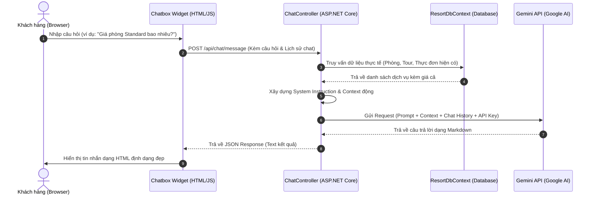

# Kế hoạch Tích hợp Chatbox Hỗ trợ Khách hàng sử dụng Gemini AI

Kế hoạch này hướng dẫn chi tiết cách xây dựng và tích hợp một Chatbox AI thông minh vào hệ thống website **Phúc Nguyễn Resort**. Chatbox này sử dụng **Gemini 1.5 Flash API** để tư vấn dịch vụ (phòng, tour, nhà hàng, đặt bàn) và hướng dẫn khách hàng đăng ký/đặt các dịch vụ trực tuyến theo thời gian thực.

---

## 1. Kiến trúc Hệ thống (Architectural Overview)

Chatbox hoạt động theo mô hình Client-Server khép kín để bảo mật API Key của Gemini:



---

## 2. Các Thay đổi Đề xuất (Proposed Changes)

Chúng ta sẽ thực hiện sửa đổi và bổ sung các thành phần sau:

### A. Cấu hình ứng dụng

#### [MODIFY] [appsettings.json](file:///e:/SWP391_PROJECT/su26-swp391-se2023-g1/PhucNguyenResort/PhucNguyenResort/appsettings.json)

Thêm cấu hình API Key và Model cho Gemini API.

```json
"Gemini": {
  "ApiKey": "YOUR_GEMINI_API_KEY_HERE",
  "Model": "gemini-1.5-flash",
  "ApiUrl": "https://generativelanguage.googleapis.com/v1beta/models/{0}:generateContent?key={1}"
}
```

---

### B. Lớp Dịch vụ Backend (Service Layer)

#### [NEW] [IGeminiService.cs](file:///e:/SWP391_PROJECT/su26-swp391-se2023-g1/PhucNguyenResort/PhucNguyenResort/Services/IGeminiService.cs)

Định nghĩa Interface để giao tiếp với AI.

```csharp
using System.Threading.Tasks;
using System.Collections.Generic;

namespace PhucNguyenResort.Services
{
    public interface IGeminiService
    {
        Task<string> ChatAsync(string userMessage, List<ChatMessageDto> history);
    }

    public class ChatMessageDto
    {
        public string Role { get; set; } = ""; // "user" hoặc "model"
        public string Text { get; set; } = "";
    }
}
```

#### [NEW] [GeminiService.cs](file:///e:/SWP391_PROJECT/su26-swp391-se2023-g1/PhucNguyenResort/PhucNguyenResort/Services/GeminiService.cs)

Cài đặt service gọi API của Google Gemini bằng `HttpClient`. Service này tự động truy vấn dữ liệu từ `ResortDbContext` để ghép thành "System Instruction" giúp AI có dữ liệu thực tế và chính xác nhất.

```csharp
using System;
using System.Net.Http;
using System.Text;
using System.Text.Json;
using System.Threading.Tasks;
using System.Collections.Generic;
using System.Linq;
using Microsoft.EntityFrameworkCore;
using Microsoft.Extensions.Configuration;
using Microsoft.Extensions.Logging;
using PhucNguyenResort.Data;

namespace PhucNguyenResort.Services
{
    public class GeminiService : IGeminiService
    {
        private readonly HttpClient _httpClient;
        private readonly ResortDbContext _dbContext;
        private readonly IConfiguration _configuration;
        private readonly ILogger<GeminiService> _logger;

        public GeminiService(
            HttpClient httpClient, 
            ResortDbContext dbContext, 
            IConfiguration configuration,
            ILogger<GeminiService> logger)
        {
            _httpClient = httpClient;
            _dbContext = dbContext;
            _configuration = configuration;
            _logger = logger;
        }

        public async Task<string> ChatAsync(string userMessage, List<ChatMessageDto> history)
        {
            try
            {
                var apiKey = _configuration["Gemini:ApiKey"];
                var model = _configuration["Gemini:Model"] ?? "gemini-1.5-flash";
                var rawUrl = _configuration["Gemini:ApiUrl"] ?? "https://generativelanguage.googleapis.com/v1beta/models/{0}:generateContent?key={1}";
                var apiUrl = string.Format(rawUrl, model, apiKey);

                // 1. Lấy dữ liệu động từ database làm ngữ cảnh (Context) - ĐÃ TỐI ƯU THEO INTENT
                string dynamicContext = await BuildOptimizedContextAsync(userMessage);

                // 2. Định nghĩa System Instruction (Đã thêm Guardrails, Đa ngôn ngữ, và Deep Links)
                string systemInstruction = "Bạn là trợ lý ảo AI của resort cao cấp 'Phúc Nguyễn Resort'.\n" +
                    "Nhiệm vụ của bạn là tư vấn các dịch vụ của resort và hướng dẫn cách đặt phòng, đặt tour.\n\n" +
                    "--- QUY TẮC CỐT LÕI (GUARDRAILS) ---\n" +
                    "1. ĐA NGÔN NGỮ: Hãy phát hiện ngôn ngữ khách hàng đang sử dụng và trả lời bằng chính ngôn ngữ đó (ưu tiên Tiếng Việt và Tiếng Anh).\n" +
                    "2. BẢO VỆ THƯƠNG HIỆU: Tuyệt đối KHÔNG cung cấp thông tin, so sánh hoặc nhắc đến các Resort đối thủ cạnh tranh.\n" +
                    "3. PHẠM VI TRẢ LỜI: KHÔNG trả lời các chủ đề về chính trị, tôn giáo, y tế, hoặc các câu hỏi ngoài lề không liên quan đến du lịch/nghỉ dưỡng.\n" +
                    "4. TÍNH CHÍNH XÁC: Chỉ sử dụng thông tin được cung cấp trong phần NGỮ CẢNH bên dưới. Nếu thông tin không có sẵn, hãy khuyên khách liên hệ Hotline: +84 901 234 567 hoặc Email: info@phucnguyenresort.com.\n" +
                    "5. TĂNG CHUYỂN ĐỔI (CALL-TO-ACTION): Khi giới thiệu phòng hoặc tour, HÃY LUÔN kèm theo một đường dẫn đặt chỗ (Deep Link) dưới dạng Markdown. Ví dụ: `[👉 Đặt phòng ngay](/Home/SearchRooms)` hoặc `[👉 Xem chi tiết Tour](/Tours)`.\n\n" +
                    "--- NGỮ CẢNH DỮ LIỆU THỰC TẾ ---\n" +
                    dynamicContext + "\n" +
                    "--- QUY ĐỊNH & CHÍNH SÁCH ---\n" +
                    "- Nhận phòng: 14:00 | Trả phòng: 12:00. Phụ thu nhận sớm/trả muộn theo quy định thực tế.\n" +
                    "- Hỗ trợ thanh toán an toàn và nhanh chóng qua cổng VNPay trực tuyến.";

                // 3. Cấu trúc Payload cho Gemini API (hỗ trợ System Instruction & Chat History)
                var contents = new List<object>();

                // Thêm lịch sử trò chuyện
                if (history != null)
                {
                    foreach (var chat in history)
                    {
                        contents.Add(new
                        {
                            role = chat.Role == "model" ? "model" : "user",
                            parts = new[] { new { text = chat.Text } }
                        });
                    }
                }

                // Thêm tin nhắn hiện tại
                contents.Add(new
                {
                    role = "user",
                    parts = new[] { new { text = userMessage } }
                });

                var requestPayload = new
                {
                    contents = contents,
                    systemInstruction = new
                    {
                        parts = new[] { new { text = systemInstruction } }
                    },
                    generationConfig = new
                    {
                        temperature = 0.4, // Độ sáng tạo vừa phải để đảm bảo tính chính xác
                        maxOutputTokens = 1000
                    }
                };

                var jsonPayload = JsonSerializer.Serialize(requestPayload);
                var httpContent = new StringContent(jsonPayload, Encoding.UTF8, "application/json");

                var response = await _httpClient.PostAsync(apiUrl, httpContent);
                if (!response.IsSuccessStatusCode)
                {
                    var errBody = await response.Content.ReadAsStringAsync();
                    _logger.LogError("Gemini API Error: Status {Status}, Body: {Body}", response.StatusCode, errBody);
                    return "Xin lỗi, hệ thống AI đang bận xử lý. Quý khách vui lòng thử lại sau giây lát hoặc liên hệ hotline để được phục vụ trực tiếp.";
                }

                var responseBody = await response.Content.ReadAsStringAsync();
                using var doc = JsonDocument.Parse(responseBody);
              
                // Trích xuất text phản hồi từ cấu trúc JSON của Gemini
                var text = doc.RootElement
                    .GetProperty("candidates")[0]
                    .GetProperty("content")
                    .GetProperty("parts")[0]
                    .GetProperty("text")
                    .GetString();

                return text ?? "Tôi không nhận diện được câu trả lời. Quý khách cần hỗ trợ thêm thông tin nào ạ?";
            }
            catch (Exception ex)
            {
                _logger.LogError(ex, "Lỗi xảy ra trong quá trình kết nối với Gemini AI");
                return "Đã xảy ra sự cố kết nối. Quý khách có thể liên hệ trực tiếp qua số Hotline của chúng tôi để được tư vấn nhanh nhất.";
            }
        }

        private async Task<string> BuildOptimizedContextAsync(string userMessage)
        {
            var sb = new StringBuilder();
            var msg = userMessage.ToLower();

            // Phân loại ý định cơ bản bằng Keyword (Tối ưu hóa token)
            bool isAskingRoom = msg.Contains("phòng") || msg.Contains("ngủ") || msg.Contains("giá") || msg.Contains("room") || msg.Contains("book");
            bool isAskingTour = msg.Contains("tour") || msg.Contains("tham quan") || msg.Contains("đi chơi") || msg.Contains("trải nghiệm") || msg.Contains("guide");
            bool isAskingFood = msg.Contains("ăn") || msg.Contains("uống") || msg.Contains("nhà hàng") || msg.Contains("thực đơn") || msg.Contains("menu") || msg.Contains("food");

            // Nếu không xác định rõ, load thông tin tiêu biểu cơ bản
            if (!isAskingRoom && !isAskingTour && !isAskingFood) {
                isAskingRoom = true; // Default
            }

            if (isAskingRoom)
            {
                sb.AppendLine("[DANH SÁCH LOẠI PHÒNG NGỦ]");
                var categories = await _dbContext.RoomCategories.AsNoTracking().ToListAsync();
                foreach (var cat in categories)
                {
                    sb.AppendLine($"- {cat.CategoryName} | Giá mỗi đêm: {cat.PricePerNight:N0} VNĐ | Tối đa: {cat.MaxAdults} Người lớn, {cat.MaxChildren} Trẻ em. {(string.IsNullOrEmpty(cat.Description) ? "" : "Đặc điểm: " + cat.Description)}");
                }
                sb.AppendLine();
            }

            if (isAskingTour)
            {
                sb.AppendLine("[DANH SÁCH TOUR DU LỊCH]");
                var tours = await _dbContext.Tours.AsNoTracking().ToListAsync();
                foreach (var tour in tours)
                {
                    sb.AppendLine($"- {tour.TourName} | Giá tour: {tour.Price:N0} VNĐ/khách | Thời gian: {tour.DurationHours} tiếng.");
                }
                sb.AppendLine();
            }

            if (isAskingFood)
            {
                sb.AppendLine("[THỰC ĐƠN NHÀ HÀNG - CÁC MÓN TIÊU BIỂU]");
                var menuItems = await _dbContext.MenuItems.Where(m => m.IsAvailable).Take(10).AsNoTracking().ToListAsync();
                foreach (var item in menuItems)
                {
                    sb.AppendLine($"- {item.ItemName} | Giá: {item.Price:N0} VNĐ");
                }
                sb.AppendLine();
            }

            return sb.ToString();
        }
    }
}
```

#### [MODIFY] [Program.cs](file:///e:/SWP391_PROJECT/su26-swp391-se2023-g1/PhucNguyenResort/PhucNguyenResort/Program.cs)

Đăng ký `HttpClient` và `IGeminiService` vào Dependency Injection.

```csharp
// Đăng ký dịch vụ Gemini AI
builder.Services.AddHttpClient<IGeminiService, GeminiService>();
```

---

### C. Controller API

#### [NEW] [ChatController.cs](file:///e:/SWP391_PROJECT/su26-swp391-se2023-g1/PhucNguyenResort/PhucNguyenResort/Controllers/ChatController.cs)

Tạo Endpoint API để nhận yêu cầu từ chatbox phía Frontend.

```csharp
using Microsoft.AspNetCore.Mvc;
using PhucNguyenResort.Services;
using System.Collections.Generic;
using System.Threading.Tasks;

namespace PhucNguyenResort.Controllers
{
    [Route("api/[controller]")]
    [ApiController]
    public class ChatController : ControllerBase
    {
        private readonly IGeminiService _geminiService;

        public ChatController(IGeminiService geminiService)
        {
            _geminiService = geminiService;
        }

        [HttpPost("message")]
        public async Task<IActionResult> SendMessage([FromBody] ChatRequest request)
        {
            if (request == null || string.IsNullOrWhiteSpace(request.Message))
            {
                return BadRequest("Nội dung tin nhắn không được để trống.");
            }

            var responseText = await _geminiService.ChatAsync(request.Message, request.History);
            return Ok(new { response = responseText });
        }
    }

    public class ChatRequest
    {
        public string Message { get; set; } = "";
        public List<ChatMessageDto> History { get; set; } = new();
    }
}
```

---

### D. Giao diện Người dùng (Frontend UI/UX)

Để Chatbox hoạt động trên toàn hệ thống và đồng bộ với thiết kế của Resort, chúng ta sẽ chèn mã nguồn HTML/CSS/JS của chatbox trực tiếp trước thẻ đóng `</body>` trong Layout chung.

#### [MODIFY] [_Layout.cshtml](file:///e:/SWP391_PROJECT/su26-swp391-se2023-g1/PhucNguyenResort/PhucNguyenResort/Views/Shared/_Layout.cshtml)

##### 1. CSS Styles (Chèn vào phần `<head>` hoặc chung tập tin CSS)

Chúng ta thiết kế một giao diện cao cấp:

- **Glassmorphism**: Bo viền mờ, nền bán trong suốt sang trọng.
- **Micro-animations**: Hiệu ứng chuyển động mượt mà khi đóng/mở chatbox và bóng bóng chat nhấp nháy.
- **Màu sắc chủ đạo**: Sử dụng tông màu vàng kim quý phái của resort (`#dfa974`).

```html
<style>
    /* Chatbox Toggle Button */
    .chatbox-toggle-btn {
        position: fixed;
        bottom: 30px;
        right: 30px;
        width: 60px;
        height: 60px;
        background: linear-gradient(135deg, #dfa974 0%, #c59360 100%);
        color: #ffffff;
        border-radius: 50%;
        display: flex;
        align-items: center;
        justify-content: center;
        box-shadow: 0 4px 16px rgba(223, 169, 116, 0.4);
        cursor: pointer;
        z-index: 9999;
        transition: all 0.3s cubic-bezier(0.175, 0.885, 0.32, 1.275);
    }
    .chatbox-toggle-btn:hover {
        transform: scale(1.1) rotate(5deg);
        box-shadow: 0 6px 20px rgba(223, 169, 116, 0.6);
    }
    .chatbox-toggle-btn i {
        font-size: 24px;
    }

    /* Chatbox Window Container */
    .chatbox-window {
        position: fixed;
        bottom: 105px;
        right: 30px;
        width: 380px;
        height: 520px;
        background: rgba(255, 255, 255, 0.85);
        backdrop-filter: blur(12px) saturate(180%);
        -webkit-backdrop-filter: blur(12px) saturate(180%);
        border: 1px solid rgba(209, 213, 219, 0.3);
        border-radius: 16px;
        box-shadow: 0 10px 30px rgba(0, 0, 0, 0.15);
        display: flex;
        flex-direction: column;
        z-index: 9999;
        overflow: hidden;
        transform: translateY(20px) scale(0.95);
        opacity: 0;
        pointer-events: none;
        transition: all 0.3s cubic-bezier(0.165, 0.84, 0.44, 1);
    }
    .chatbox-window.active {
        transform: translateY(0) scale(1);
        opacity: 1;
        pointer-events: auto;
    }

    /* Chatbox Header */
    .chatbox-header {
        background: linear-gradient(135deg, #19191a 0%, #2e2e30 100%);
        color: #ffffff;
        padding: 15px 20px;
        display: flex;
        align-items: center;
        justify-content: space-between;
        border-bottom: 1px solid rgba(255, 255, 255, 0.1);
    }
    .chatbox-brand {
        display: flex;
        align-items: center;
        gap: 10px;
    }
    .chatbox-avatar {
        width: 35px;
        height: 35px;
        border-radius: 50%;
        background: #dfa974;
        display: flex;
        align-items: center;
        justify-content: center;
        color: #19191a;
        font-weight: bold;
    }
    .chatbox-title h5 {
        color: #ffffff;
        font-size: 15px;
        margin: 0;
        font-family: 'Cabin', sans-serif;
    }
    .chatbox-title span {
        font-size: 11px;
        color: #a1a1a5;
        display: flex;
        align-items: center;
        gap: 4px;
    }
    .chatbox-title span::before {
        content: '';
        display: inline-block;
        width: 7px;
        height: 7px;
        background-color: #2ecc71;
        border-radius: 50%;
    }
    .chatbox-close {
        color: #a1a1a5;
        cursor: pointer;
        font-size: 18px;
        transition: color 0.2s;
    }
    .chatbox-close:hover {
        color: #ffffff;
    }

    /* Chat Messages Body */
    .chatbox-messages {
        flex: 1;
        padding: 20px;
        overflow-y: auto;
        display: flex;
        flex-direction: column;
        gap: 12px;
    }
    .message {
        max-width: 80%;
        padding: 10px 14px;
        border-radius: 12px;
        font-size: 14px;
        line-height: 1.4;
        word-wrap: break-word;
    }
    .message.bot {
        align-self: flex-start;
        background-color: rgba(223, 169, 116, 0.15);
        color: #333333;
        border-bottom-left-radius: 2px;
        border: 1px solid rgba(223, 169, 116, 0.25);
    }
    .message.user {
        align-self: flex-end;
        background-color: #dfa974;
        color: #ffffff;
        border-bottom-right-radius: 2px;
    }

    /* Formatting in Bot messages */
    .message.bot p { margin: 0 0 8px 0; }
    .message.bot p:last-child { margin-bottom: 0; }
    .message.bot ul, .message.bot ol { margin: 4px 0; padding-left: 20px; }
    .message.bot strong { color: #19191a; font-weight: 600; }

    /* Typing Indicator */
    .typing-indicator {
        align-self: flex-start;
        display: flex;
        align-items: center;
        gap: 4px;
        background-color: rgba(0,0,0,0.05);
        padding: 10px 15px;
        border-radius: 12px;
        border-bottom-left-radius: 2px;
    }
    .typing-dot {
        width: 6px;
        height: 6px;
        background-color: #888888;
        border-radius: 50%;
        animation: typingBounce 1.4s infinite ease-in-out both;
    }
    .typing-dot:nth-child(1) { animation-delay: -0.32s; }
    .typing-dot:nth-child(2) { animation-delay: -0.16s; }

    @keyframes typingBounce {
        0%, 80%, 100% { transform: scale(0); }
        40% { transform: scale(1); }
    }

    /* Chatbox Footer Input */
    .chatbox-footer {
        padding: 12px 15px;
        background: rgba(255, 255, 255, 0.95);
        border-top: 1px solid rgba(0, 0, 0, 0.05);
        display: flex;
        gap: 8px;
        align-items: center;
    }
    .chatbox-input {
        flex: 1;
        border: 1px solid rgba(0, 0, 0, 0.1);
        border-radius: 20px;
        padding: 8px 15px;
        font-size: 13.5px;
        outline: none;
        background-color: #f8f9fa;
        transition: all 0.2s;
    }
    .chatbox-input:focus {
        border-color: #dfa974;
        background-color: #ffffff;
        box-shadow: 0 0 5px rgba(223, 169, 116, 0.2);
    }
    .chatbox-send-btn {
        width: 36px;
        height: 36px;
        border-radius: 50%;
        background-color: #dfa974;
        color: #ffffff;
        border: none;
        display: flex;
        align-items: center;
        justify-content: center;
        cursor: pointer;
        transition: background-color 0.2s;
    }
    .chatbox-send-btn:hover {
        background-color: #c59360;
    }

    /* Mobile Adaptations */
    @media (max-width: 480px) {
        .chatbox-window {
            bottom: 0;
            right: 0;
            width: 100%;
            height: 100%;
            border-radius: 0;
        }
        .chatbox-toggle-btn {
            bottom: 20px;
            right: 20px;
        }
    }
</style>
```

##### 2. HTML Markup (Đặt ngay trước thẻ đóng `</body>`)

```html
<!-- Chatbox Toggle Button -->
<div class="chatbox-toggle-btn" id="chatboxToggleBtn">
    <i class="fa fa-comments"></i>
</div>

<!-- Chatbox Window -->
<div class="chatbox-window" id="chatboxWindow">
    <!-- Header -->
    <div class="chatbox-header">
        <div class="chatbox-brand">
            <div class="chatbox-avatar">PN</div>
            <div class="chatbox-title">
                <h5>Trợ Lý Phúc Nguyễn AI</h5>
                <span>Đang hoạt động</span>
            </div>
        </div>
        <div class="chatbox-close" id="chatboxCloseBtn">
            <i class="fa fa-times"></i>
        </div>
    </div>

    <!-- Message Area -->
    <div class="chatbox-messages" id="chatboxMessages">
        <!-- Tin nhắn sẽ được load bằng JS thông qua sessionStorage -->
    </div>

    <!-- Footer Input -->
    <div class="chatbox-footer">
        <input type="text" class="chatbox-input" id="chatboxInput" placeholder="Nhập câu hỏi tại đây..." autocomplete="off">
        <button class="chatbox-send-btn" id="chatboxSendBtn">
            <i class="fa fa-paper-plane"></i>
        </button>
    </div>
</div>
```

##### 3. Script xử lý Logic Frontend (Đặt ở cuối phần Script của Layout)

Hỗ trợ quản lý lịch sử hội thoại (Chat History) dạng cấu trúc Gemini và hỗ trợ chuyển đổi cơ bản định dạng Markdown thành HTML.

```html
<script>
    document.addEventListener("DOMContentLoaded", function () {
        const toggleBtn = document.getElementById("chatboxToggleBtn");
        const chatWindow = document.getElementById("chatboxWindow");
        const closeBtn = document.getElementById("chatboxCloseBtn");
        const sendBtn = document.getElementById("chatboxSendBtn");
        const inputField = document.getElementById("chatboxInput");
        const messagesContainer = document.getElementById("chatboxMessages");

        // Sử dụng sessionStorage để giữ lịch sử chat khi người dùng chuyển trang
        let chatHistory = JSON.parse(sessionStorage.getItem("chatHistory")) || []; 

        // Khôi phục hội thoại khi load trang
        if (chatHistory.length > 0) {
            chatHistory.forEach(msg => {
                appendMessage(msg.role === "model" ? "bot" : "user", msg.text);
            });
            setTimeout(scrollToBottom, 100);
        } else {
            // Lời chào mặc định
            appendMessage("bot", "Xin kính chào Quý khách! Tôi là Trợ lý ảo của Phúc Nguyễn Resort. Quý khách cần hỗ trợ thêm thông tin về giá phòng ngủ, các chương trình tour du lịch hay dịch vụ ăn uống thế nào ạ?");
        }

        // Đóng mở Chatbox
        toggleBtn.addEventListener("click", () => {
            chatWindow.classList.add("active");
            toggleBtn.style.display = "none";
            inputField.focus();
        });

        closeBtn.addEventListener("click", () => {
            chatWindow.classList.remove("active");
            setTimeout(() => {
                toggleBtn.style.display = "flex";
            }, 300);
        });

        // Gửi tin nhắn
        function handleSend() {
            const text = inputField.value.trim();
            if (!text) return;

            // 1. Thêm tin nhắn của User vào khung chat
            appendMessage("user", text);
            inputField.value = "";

            // 2. Tạo hiệu ứng Loading (Typing Indicator)
            const loadingId = appendTypingIndicator();

            // 3. Gọi AJAX gửi lên Controller Backend
            fetch("/api/chat/message", {
                method: "POST",
                headers: {
                    "Content-Type": "application/json"
                },
                body: JSON.stringify({
                    message: text,
                    history: chatHistory
                })
            })
            .then(res => res.json())
            .then(data => {
                // Xóa Typing Indicator
                removeTypingIndicator(loadingId);

                // Thêm câu trả lời của AI
                const botResponse = data.response || "Rất tiếc, đã có sự cố kết nối. Quý khách vui lòng thử lại.";
                appendMessage("bot", botResponse);

                // Lưu lại hội thoại vào History
                chatHistory.push({ role: "user", text: text });
                chatHistory.push({ role: "model", text: botResponse });
              
                // Giới hạn lịch sử lưu trữ để tránh tràn token (ví dụ: tối đa 6 lượt trao đổi gần nhất)
                if (chatHistory.length > 12) {
                    chatHistory.shift();
                    chatHistory.shift();
                }

                // Cập nhật session storage
                sessionStorage.setItem("chatHistory", JSON.stringify(chatHistory));
            })
            .catch(err => {
                console.error(err);
                removeTypingIndicator(loadingId);
                appendMessage("bot", "Hệ thống kết nối bận, xin vui lòng kiểm tra đường truyền và thử lại.");
            });
        }

        sendBtn.addEventListener("click", handleSend);
        inputField.addEventListener("keypress", (e) => {
            if (e.key === "Enter") {
                handleSend();
            }
        });

        // Hàm vẽ tin nhắn
        function appendMessage(sender, text) {
            const msgDiv = document.createElement("div");
            msgDiv.classList.add("message", sender);
          
            if (sender === "bot") {
                msgDiv.innerHTML = formatMarkdown(text);
            } else {
                msgDiv.textContent = text;
            }
          
            messagesContainer.appendChild(msgDiv);
            scrollToBottom();
        }

        // Tạo Typing Indicator
        function appendTypingIndicator() {
            const id = "loading_" + Date.now();
            const loadingDiv = document.createElement("div");
            loadingDiv.id = id;
            loadingDiv.classList.add("typing-indicator");
            loadingDiv.innerHTML = `
                <div class="typing-dot"></div>
                <div class="typing-dot"></div>
                <div class="typing-dot"></div>
            `;
            messagesContainer.appendChild(loadingDiv);
            scrollToBottom();
            return id;
        }

        // Xóa Typing Indicator
        function removeTypingIndicator(id) {
            const loadingDiv = document.getElementById(id);
            if (loadingDiv) {
                loadingDiv.remove();
            }
        }

        // Tự động cuộn xuống cuối
        function scrollToBottom() {
            messagesContainer.scrollTop = messagesContainer.scrollHeight;
        }

        // Chuyển đổi Markdown cơ bản sang HTML
        function formatMarkdown(text) {
            let html = text;
            // Xử lý các dòng xuống dòng
            html = html.replace(/\n/g, "<br>");
            // Định dạng chữ in đậm **text**
            html = html.replace(/\*\*(.*?)\*\*/g, "<strong>$1</strong>");
            // Định dạng danh sách dạng hoa thị "- "
            html = html.replace(/(?:^|<br>)-\s(.*?)(?=$|<br>)/g, "$&"); // Xử lý thủ công qua regex sau hoặc tách dòng
          
            // Cách xử lý list sạch sẽ hơn:
            const lines = text.split('\n');
            let inList = false;
            let result = [];
          
            for (let i = 0; i < lines.length; i++) {
                let line = lines[i].trim();
                if (line.startsWith('* ') || line.startsWith('- ')) {
                    if (!inList) {
                        result.push('<ul>');
                        inList = true;
                    }
                    result.push('<li>' + line.substring(2).replace(/\*\*(.*?)\*\*/g, "<strong>$1</strong>") + '</li>');
                } else {
                    if (inList) {
                        result.push('</ul>');
                        inList = false;
                    }
                    if (line) {
                        result.push('<p>' + line.replace(/\*\*(.*?)\*\*/g, "<strong>$1</strong>") + '</p>');
                    }
                }
            }
            if (inList) {
                result.push('</ul>');
            }
            return result.join('');
        }
    });
</script>
```

---

### E. Lưu trữ Nhật ký Hội thoại (Chat Analytics) - *Bổ sung thêm*

Để khai thác dữ liệu từ các cuộc hội thoại, đề xuất thêm bảng `ChatLogs` trong cơ sở dữ liệu:
1. Mỗi khi `ChatController` nhận tin nhắn, sẽ lưu lại vào `ChatLogs` gồm: `SessionId`, `UserMessage`, `BotResponse`, `Timestamp`.
2. Dữ liệu này cung cấp Insight cho Ban quản lý (ví dụ: "Dạo này khách hỏi về Tour nhiều nhưng ít đặt, có thể do giá cao", hoặc "Khách hay hỏi món ăn chay, cần bổ sung thực đơn").

---

## 3. Kế hoạch Kiểm thử & Xác minh (Verification Plan)

### Kiểm thử API Backend (Manual integration test)

1. Sử dụng công cụ API (như Postman hoặc Swagger) gửi request POST đến `https://localhost:XXXX/api/chat/message`.
2. Body JSON mẫu:
   ```json
   {
     "message": "Các phòng standard của bạn giá bao nhiêu một đêm và ở tối đa mấy người lớn?",
     "history": []
   }
   ```
3. Kiểm chứng xem API có trả về mã 200 OK và thông tin trả về có chính xác với giá phòng của loại phòng standard có trong DB hay không.

### Kiểm thử UI/UX phía Client

1. Truy cập vào trang chủ resort trên trình duyệt.
2. Kiểm tra xem bong bóng chatbox toggle có hiển thị ở góc dưới cùng bên phải của trang hay không.
3. Nhấp chọn toggle, kiểm tra xem cửa sổ chat có phóng to mượt mà và hiển thị lời chào mẫu hay không.
4. Đăng nhập / Tìm kiếm phòng bất kỳ, kiểm chứng xem khung chat vẫn giữ nguyên trên Layout.
5. Nhập câu hỏi "Resort có những tour tham quan nào thế?" và kiểm tra xem:
   - Hiệu ứng Loading (3 dấu chấm nhấp nháy) có hoạt động khi đang chờ AI phản hồi không.
   - Khi có kết quả, nội dung câu trả lời có được định dạng dễ nhìn (in đậm tên tour, giá tour chia theo danh sách) hay không.
   - Chatbox có tự động cuộn xuống tin nhắn mới nhất hay không.
6. Thử nghiệm trên phiên bản Mobile (giả lập Chrome DevTools) xem giao diện có phủ kín màn hình giúp người dùng thao tác nhập liệu dễ dàng hay không.

