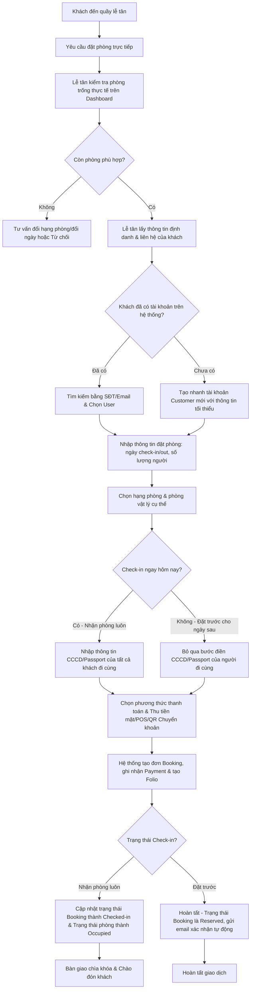

# Kế Hoạch Nghiệp Vụ: Tính Năng Đặt Phòng Tại Quầy (Walk-in Booking)

Tài liệu này trình bày giải pháp nghiệp vụ (Business Analysis) và thiết kế hệ thống cho tính năng **Đặt phòng tại quầy (Walk-in Booking)** của phân hệ Lễ tân (Receptionist) trong hệ thống quản lý resort **PhucNguyen Resort**.

---

## 1. Quy Trình Nghiệp Vụ (Business Process Flow)

Quy trình đặt phòng trực tiếp tại quầy đòi hỏi sự linh hoạt cao hơn đặt phòng trực tuyến (Online Booking) của Khách hàng, do Lễ tân phải vừa xử lý giao dịch tài chính trực tiếp, vừa đối chiếu phòng trống thực tế và thu thập thông tin định danh (CCCD/Passport) để làm thủ tục nhận phòng ngay (nếu khách check-in luôn).



---

## 2. Đặc Tả Use Case (Use Case Specification)

### **UC-Walkin: Đặt Phòng và Thanh Toán Tại Quầy**

*   **Actor chính:** Lễ tân (Receptionist)
*   **Tiền điều kiện (Preconditions):**
    1.  Lễ tân đã đăng nhập vào hệ thống quản lý (Dashboard).
    2.  Hệ thống có các phòng vật lý đang ở trạng thái trống và sạch (`Available` & `Clean`).
*   **Hậu điều kiện (Postconditions):**
    1.  Hệ thống tạo thành công bản ghi `Booking` và `BookingDetails`.
    2.  Một tài khoản `User` (Customer) mới được tạo tự động (nếu là khách mới).
    3.  Bản ghi giao dịch `Payment` và ví chi tiêu `GuestFolio` được khởi tạo.
    4.  Nếu check-in ngay, trạng thái phòng chuyển sang `Occupied` (Đang có khách) và trạng thái booking chuyển thành `Checked-in`.

#### **Luồng Xử Lý Chính (Basic Flow):**
1.  Lễ tân truy cập vào Dashboard Lễ tân, chọn chức năng **"Đặt Phòng Tại Quầy"**.
2.  Hệ thống hiển thị màn hình tạo đơn đặt phòng trực tiếp tại quầy.
3.  Lễ tân nhập Số điện thoại hoặc Email của khách hàng để kiểm tra thông tin thành viên:
    *   *Hệ thống tự động truy vấn và điền thông tin nếu khách đã có tài khoản.*
    *   *Nếu khách mới, Lễ tân nhập Họ tên, Số điện thoại và Email để hệ thống tạo nhanh tài khoản.*
4.  Lễ tân chọn **Ngày nhận phòng (Check-in Date)** và **Ngày trả phòng (Check-out Date)**.
5.  Hệ thống hiển thị danh sách các hạng phòng (`RoomCategories`) và số lượng phòng trống thực tế trong khoảng thời gian đó.
6.  Lễ tân chọn hạng phòng, số lượng phòng và gán trực tiếp **Số phòng vật lý** (ví dụ: Phòng 101, 102).
7.  Lễ tân nhập Số lượng người lớn và Trẻ em đi cùng.
8.  Lễ tân lựa chọn loại hình đặt phòng:
    *   **Đặt giữ chỗ trước (Reserved):** Ngày check-in trong tương lai.
    *   **Nhận phòng ngay (Instant Check-in):** Ngày check-in là hôm nay.
9.  Nếu chọn **Nhận phòng ngay**, hệ thống hiển thị thêm form nhập thông tin CCCD/Passport, Ngày sinh, Giới tính, Quốc tịch của Khách chính và tất cả Khách đi cùng để phục vụ việc khai báo tạm trú (PDPD & Law on Residence compliance).
10. Lễ tân nhập thông tin thanh toán:
    *   **Số tiền thanh toán:** Cọc một phần hoặc Thanh toán toàn bộ 100%.
    *   **Phương thức thanh toán:** Tiền mặt (Cash), Quẹt thẻ (POS), hoặc Chuyển khoản qua ngân hàng (QR Pay).
11. Lễ tân nhấn **"Hoàn tất đặt phòng"**.
12. Hệ thống thực hiện:
    *   Tạo bản ghi `Booking`, gán phòng vật lý trực tiếp.
    *   Khởi tạo `GuestFolio` (hồ sơ chi tiêu của phòng).
    *   Tạo giao dịch `Payment` ghi nhận số tiền thanh toán thực tế của khách tại quầy.
    *   Cập nhật trạng thái phòng vật lý thành `Occupied` (nếu nhận phòng luôn).
    *   Gửi email tự động xác nhận đặt phòng và thông tin tài khoản cho khách hàng.
13. Hệ thống thông báo thành công và quay lại màn hình quản lý.

#### **Luồng Rẽ Nhánh (Alternative Flows):**
*   **A1: Khách hàng chưa có Email hoặc không muốn cung cấp Email**
    *   Tại bước 3, nếu khách không có email, hệ thống hỗ trợ sinh tự động email tạm thời dựa trên số điện thoại (ví dụ: `0987654321@phucnguyenresort.temp`) để đảm bảo tính toàn vẹn dữ liệu trong DB.
*   **A2: Khách không thanh toán cọc ngay**
    *   Tại bước 10, nếu chính sách resort cho phép đặt phòng tại quầy không cần cọc trước (hoặc khách quen thanh toán khi checkout), Lễ tân chọn số tiền cọc = 0. Hệ thống lưu trạng thái Booking là `Reserved` hoặc `Checked-in` nhưng ghi nhận số dư nợ trên `GuestFolio`.

---

## 3. Các Quy Tắc Nghiệp Vụ Quan Trọng (Business Rules)

| Mã BR | Quy Tắc Nghiệp Vụ (Business Rule) | Mô tả chi tiết |
| :--- | :--- | :--- |
| **BR-WK-01** | **Ràng buộc tài khoản khách hàng (`UserId`)** | Để giữ vững tính nhất quán của hệ thống, mỗi Booking bắt buộc phải liên kết với một `UserId` (Role Customer). Không chấp nhận booking "vô danh". Hệ thống phải tự động tạo tài khoản nhanh từ thông tin tối thiểu (Họ tên, SĐT, Email) mà lễ tân nhập vào. |
| **BR-WK-02** | **Xác nhận thanh toán ngoại tuyến** | Đặt phòng online bắt buộc thanh toán qua cổng VNPay để xác nhận đơn. Ngược lại, đặt phòng tại quầy cho phép Lễ tân tự xác nhận trạng thái thanh toán ngoại tuyến (Tiền mặt, POS, Chuyển khoản trực tiếp tới tài khoản resort) và lưu vết phương thức cụ thể. |
| **BR-WK-03** | **Kiểm soát trùng lịch đặt phòng (Double Booking)** | Hệ thống phải kiểm tra thời gian thực (Real-time) tình trạng sẵn có của phòng vật lý được chọn trước khi lưu đơn, đảm bảo phòng đó chưa bị khóa hoặc gán cho một booking online khác trong cùng khoảng thời gian. |
| **BR-WK-04** | **Quy tắc gán phòng trực tiếp** | Khác với khách đặt online (chỉ chọn hạng phòng, lúc check-in mới được gán số phòng), khách tại quầy được lễ tân gán trực tiếp **Số phòng cụ thể** ngay lúc đặt phòng để đảm bảo tính chắc chắn. |
| **BR-WK-05** | **Tuân thủ quy định tạm trú & PDPD** | Khi thực hiện nhận phòng ngay, lễ tân phải tích chọn xác nhận khách hàng đồng ý cung cấp thông tin cá nhân (PDPD Consent) và nhập đầy đủ thông tin định danh của các khách lưu trú để xuất báo cáo tạm trú gửi cơ quan chức năng. |

---

## 4. Giải Pháp Thiết Kế Hệ Thống & Giao Diện (System & UI Design)

Để triển khai tính năng này trên codebase hiện tại của **PhucNguyen Resort**, chúng ta cần thực hiện các thay đổi sau:

### 4.1. Thiết Kế Giao Diện (UI Mockup Idea)
*   Thêm nút **"Đặt phòng tại quầy" (Walk-in Booking)** nổi bật ở góc trên bên phải trang `Reception/Index` (Dashboard Lễ tân).
*   Giao diện form gồm 4 phân vùng chính trên cùng một trang (Single Page Form) để Lễ tân thao tác nhanh:
    1.  **Thông tin khách hàng:** Ô tìm kiếm thành viên (nhập SĐT/Email để tự điền) + Các trường nhập nhanh (Họ tên, SĐT, Email).
    2.  **Thông tin lưu trú:** Chọn ngày Check-in/Check-out, Số lượng người lớn/Trẻ em. Hệ thống sẽ tự động hiển thị danh sách phòng trống thực tế bằng AJAX.
    3.  **Chọn phòng & hạng phòng:** Dropdown/Checkbox để chọn Số phòng vật lý cụ thể (chỉ hiển thị các phòng đang có trạng thái `Available` & `Clean`).
    4.  **Thanh toán & Check-in nhanh:** Chọn phương thức thanh toán (Tiền mặt / POS / QR), Nhập số tiền thu thực tế. Một checkbox "Check-in ngay lập tức" (nếu tích chọn sẽ hiện form điền CCCD của các thành viên đi cùng).

### 4.2. Cấu trúc Controller & Service đề xuất

#### **1. Tạo ViewModel mới:** `WalkInBookingViewModel.cs`
Chứa toàn bộ thông tin cần thiết để tạo một đơn đặt phòng trực tiếp và làm thủ tục check-in đồng thời.
```csharp
public class WalkInBookingViewModel
{
    // Thông tin khách hàng đặt phòng
    [Required(ErrorMessage = "Vui lòng nhập họ tên khách hàng")]
    public string CustomerName { get; set; } = string.Empty;
    
    [Required(ErrorMessage = "Vui lòng nhập số điện thoại")]
    public string PhoneNumber { get; set; } = string.Empty;
    
    public string? Email { get; set; }

    // Thông tin lưu trú
    [Required]
    public DateTime CheckInDate { get; set; } = DateTime.Today;
    
    [Required]
    public DateTime CheckOutDate { get; set; } = DateTime.Today.AddDays(1);
    
    public int NumberOfAdults { get; set; } = 2;
    public int NumberOfChildren { get; set; } = 0;

    // Chọn phòng vật lý cụ thể
    [Required(ErrorMessage = "Vui lòng chọn ít nhất một phòng")]
    public List<int> SelectedRoomIds { get; set; } = new List<int>();

    // Thanh toán & Thủ tục
    public bool InstantCheckIn { get; set; } = true;
    public decimal PaidAmount { get; set; }
    public string PaymentMethod { get; set; } = "Cash"; // Cash, POS, BankTransfer
    public bool PdpdConsentChecked { get; set; }

    // Danh sách thông tin định danh của các khách lưu trú (nếu InstantCheckIn = true)
    public List<BookingGuestDto> Guests { get; set; } = new List<BookingGuestDto>();
}
```

#### **2. Bổ sung các Action vào** [ReceptionController.cs](file:///e:/SWP391_PROJECT/su26-swp391-se2023-g1/PhucNguyenResort/PhucNguyenResort/Controllers/ReceptionController.cs)
*   `GET: /Reception/WalkInBooking`: Hiển thị form điền thông tin đặt phòng tại quầy. Lấy danh sách các phòng trống khả dụng truyền vào View.
*   `POST: /Reception/WalkInBooking`: Nhận dữ liệu, xử lý nghiệp vụ:
    1.  Kiểm tra xem `User` với SĐT/Email đã tồn tại chưa. Nếu chưa, tạo mới một `User` với mật khẩu ngẫu nhiên và vai trò `Customer`.
    2.  Gọi hàm tạo `Booking` từ Service.
    3.  Gán phòng vật lý cho `BookingDetail`.
    4.  Tạo bản ghi `Payment` để ghi nhận tiền cọc/thanh toán bằng Tiền mặt/POS/Chuyển khoản trực tiếp (thay vì chuyển sang cổng VNPay).
    5.  Tạo hồ sơ `GuestFolio`.
    6.  Nếu chọn `InstantCheckIn`, lưu thông tin định danh `BookingGuests` và chuyển trạng thái Booking thành `CheckedIn`, trạng thái phòng thành `Occupied`.

---

## 5. Kế Hoạch Kiểm Thử Nghiệp Vụ (Verification Plan)

| Ca kiểm thử (Test Case) | Mô tả hành vi | Kết quả mong đợi |
| :--- | :--- | :--- |
| **TC-WK-01** | Tạo đơn đặt phòng cho khách hàng cũ | Hệ thống tự động điền Email và Họ tên khi lễ tân nhập SĐT khách quen. Đơn đặt phòng liên kết đúng `UserId` cũ. |
| **TC-WK-02** | Tạo đơn đặt phòng cho khách hàng mới | Hệ thống tự động tạo một User mới với SĐT/Email vừa nhập. Gửi email thông báo tài khoản và mật khẩu tạm thời cho khách. |
| **TC-WK-03** | Đặt trước tại quầy (Không nhận phòng ngay) | Lưu trạng thái đơn là `Reserved`. Phòng vật lý được giữ chỗ nhưng trạng thái phòng vẫn là `Available` cho đến ngày nhận phòng. |
| **TC-WK-04** | Đặt phòng và nhận phòng ngay (Instant Check-in) | Trạng thái Booking cập nhật thành `CheckedIn`, các phòng vật lý chuyển sang màu đỏ (`Occupied`) trên sơ đồ phòng. Lưu đầy đủ thông tin CCCD khách lưu trú. |
| **TC-WK-05** | Thanh toán đa dạng tại quầy | Chọn hình thức thanh toán là `Cash` hoặc `POS`. Hệ thống tạo hóa đơn thanh toán thành công trực tiếp mà không chuyển hướng đến VNPay. |
| **TC-WK-06** | Kiểm tra trùng phòng (Double booking) | Hai trình duyệt cùng thao tác gán một phòng vật lý cùng thời điểm. Trình duyệt lưu sau sẽ báo lỗi phòng đã được gán và yêu cầu chọn phòng khác. |
